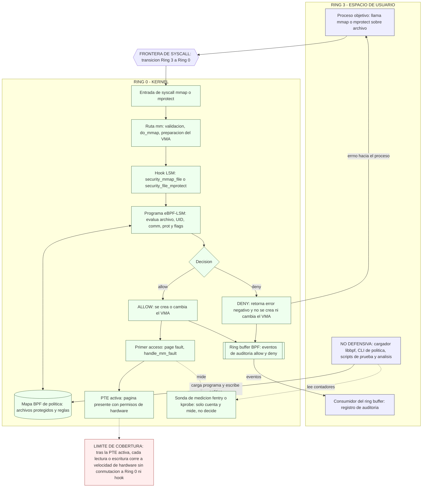

# Error-Capa-8 | Sistemas Operativos

Parcial 3 de Sistemas Operativos SO2026B (valor: 25% de la nota), en equipo: Miguel Ángel Colorado Castaño y Sebastián Andrés Ibarra Prada. Tema: **seguridad de archivos mediante intervención en la capa del kernel y mapeo de memoria (`mmap`)**. Referencia base del profesor: [USOS/CapaKernel](https://github.com/evalenciEAFIT/SO2026B/tree/main/USOS/CapaKernel).

Este repositorio parte de una copia de Fear-Compresor (Parcial 2) como **base heredada**: el shell educativo `eafitOS`, el editor de texto por líneas y el compresor Huffman concurrente. Esa base se conserva al final de este README; la implementación del Parcial 3 (Parte III) aún no existe.

## Índice
1. [Entregables según la rúbrica](#entregables-según-la-rúbrica)
2. [Parte I: Análisis conceptual y preguntas diagnósticas (30%)](#parte-i-análisis-conceptual-y-preguntas-diagnósticas-30)
3. [Parte II: Diseño de la estrategia con apoyo de inteligencia artificial (30%)](#parte-ii-diseño-de-la-estrategia-con-apoyo-de-inteligencia-artificial-30)
   1. [Flujo de trabajo asistido por IA](#flujo-de-trabajo-asistido-por-ia)
      1. [Rol 1: Exploración arquitectónica](#rol-1-exploración-arquitectónica)
      2. [Rol 2: Generación y verificación de código C de bajo nivel](#rol-2-generación-y-verificación-de-código-c-de-bajo-nivel)
      3. [Rol 3: Casos de prueba y PoC controladas](#rol-3-casos-de-prueba-y-poc-controladas)
      4. [Capturas de los prompts enviados](#capturas-de-los-prompts-enviados)
   2. [Metodología de ingeniería de prompts y verificación crítica](#metodología-de-ingeniería-de-prompts-y-verificación-crítica)
      1. [Tabla de uso de IA (skills y prompts)](#tabla-de-uso-de-ia-skills-y-prompts)
      2. [Registro de ejecuciones y alucinaciones](#registro-de-ejecuciones-y-alucinaciones)
      3. [Validación y compilación](#validación-y-compilación)
   3. [Estrategia arquitectónica seleccionada](#estrategia-arquitectónica-seleccionada)
      1. [Diagrama conceptual](#diagrama-conceptual)
      2. [Matriz de compensaciones](#matriz-de-compensaciones)
4. [Parte III: Implementación, presentación y argumentación de la solución (40%)](#parte-iii-implementación-presentación-y-argumentación-de-la-solución-40)
   1. [Entregables de código e implementación](#entregables-de-código-e-implementación)
   2. [Argumentación y análisis de resultados](#argumentación-y-análisis-de-resultados)
5. [Categorías preexistentes del shell](#categorías-preexistentes-del-shell)
   1. [Datos y archivos (`datos`)](#datos-y-archivos-datos)
   2. [Memoria (`memoria`)](#memoria-memoria)
   3. [Monitoreo y procesos (`monitoreo`)](#monitoreo-y-procesos-monitoreo)
   4. [Utilidades (`utilidades`)](#utilidades-utilidades)
   5. [Ayuda interactiva](#ayuda-interactiva)
6. [Base heredada 1: Integración con el shell](#base-heredada-1-integración-con-el-shell)
   1. [Por qué una categoría nueva y no `datos`](#por-qué-una-categoría-nueva-y-no-datos)
   2. [Funcionamiento](#funcionamiento)
   3. [Cambios al shell](#cambios-al-shell)
   4. [Pasos de ejecución](#pasos-de-ejecución)
7. [Base heredada 2: Editor de texto](#base-heredada-2-editor-de-texto)
   1. [Comandos](#comandos)
   2. [Estructura de datos](#estructura-de-datos)
   3. [Funcionamiento](#funcionamiento-1)
   4. [Pasos de ejecución](#pasos-de-ejecución-1)
8. [Base heredada 3: Compresor Huffman concurrente](#base-heredada-3-compresor-huffman-concurrente)
   1. [Comandos en el editor](#comandos-en-el-editor)
   2. [Fases del algoritmo](#fases-del-algoritmo)
   3. [Sincronización](#sincronización)
   4. [Carrera con la edición](#carrera-con-la-edición)
   5. [Formato del archivo `.huf`](#formato-del-archivo-huf)
   6. [Pasos de ejecución](#pasos-de-ejecución-2)
9. [Base heredada 4: Pruebas](#base-heredada-4-pruebas)
   1. [Pasos de ejecución](#pasos-de-ejecución-3)
10. [Rendimiento: secuencial vs concurrente](#rendimiento-secuencial-vs-concurrente)
11. [Estructura del repositorio](#estructura-del-repositorio)
12. [Autores](#autores)
13. [Información del curso](#información-del-curso)

## Entregables según la rúbrica

| Entregable | Dónde | Estado |
| --- | --- | --- |
| Código fuente y Makefile | Repositorio, a definir en la Parte III | Pendiente |
| README explicativo | Este archivo | En construcción: Parte II documentada; Parte I y Parte III pendientes |
| Informe completo (respuestas, estrategia con IA y argumentación) | Enlace POR CONFIRMAR | POR CONFIRMAR |
| Evidencia individual | Buzón de interactiva EAFIT; la sube cada integrante | Pendiente |

## Parte I: Análisis conceptual y preguntas diagnósticas (30%)

A cargo de Sebastián Andrés Ibarra Prada. Diez preguntas diagnósticas.

Estado: Pendiente.

## Parte II: Diseño de la estrategia con apoyo de inteligencia artificial (30%)

Parcial 3 de Sistemas Operativos SO2026B: seguridad de archivos mediante intervención en la capa del kernel y mapeo de memoria (`mmap`). Esta parte documenta cómo se usa la IA como acelerador del ciclo de ingeniería y cómo se verifica cada salida antes de aceptarla.

| Elemento (rúbrica) | Estado |
| --- | --- |
| Flujo de trabajo asistido por IA (3.1) | Completo |
| Tabla de uso de IA: skills y prompts (3.2) | Construida; crece con cada prompt nuevo |
| Registro de ejecuciones y alucinaciones (3.2) | Estructura lista; se completa al terminar la entrega |
| Validación y compilación (3.2) | Estructura lista; se completa al terminar la implementación |
| Estrategia arquitectónica: diagrama y matriz (3.3) | Completo, sujeto a la puerta de viabilidad de la implementación |

### Flujo de trabajo asistido por IA

| Actor | Función en el flujo |
| --- | --- |
| Claude AI (skill `token-efficient`) | Magíster en SO, orquestador de agentes y diseñador de `.md`. Explora la arquitectura, define la estrategia, escribe los prompts, analiza los reportes de ejecución y edita el README. |
| Claude Code (skill `anthropic-skills:token-efficient-code`) | Constructor limitado a los prompts, reglas y banderas recibidos. Escribe código, README y wiki. No versiona. |
| Sebastián Andrés Ibarra Prada | Parte I: análisis conceptual y preguntas diagnósticas. |
| Miguel Ángel Colorado Castaño | Compila y ejecuta en WSL2 Ubuntu 24.04, reporta con captura, observaciones y peticiones, y hace todos los commits y pushes. |

Ciclo de trabajo:

1. Claude AI explora y diseña (Rol 1) y escribe el prompt con la estructura contexto, rol, restricción y resultado esperado.
2. Claude Code construye lo que el prompt permite (Rol 2), sin commits.
3. Miguel compila y ejecuta en WSL2 y reporta: duda concreta con captura, observaciones y peticiones.
4. Claude AI analiza el reporte, diagnostica la causa raíz y corrige archivos, prompts o comandos.
5. Se valida con compilación limpia contra los headers del kernel en uso y con pruebas con y sin la defensa cargada (Rol 3). Cada alucinación se registra.
6. Miguel hace commit y push.

Esta fase (rúbrica 3.1 y 3.3) se ejecutó con cinco agentes en paralelo: tres definieron los roles que siguen, uno diseñó el diagrama conceptual y otro la matriz de compensaciones. Los agentes solo devolvieron texto; Claude AI lo integró y ninguno escribió en el repositorio.

#### Rol 1: Exploración arquitectónica

| Aspecto | Descripción |
| --- | --- |
| Actor | Claude AI diseña y razona la arquitectura; Claude Code lee headers y fuentes del kernel disponibles en WSL2 y resume estructuras y firmas. |
| Tareas de la IA | Explicar `vm_area_struct`, `handle_mm_fault` y las tablas de páginas; proponer hooks LSM (`mmap_file`, `file_mprotect`) y su uso desde eBPF-LSM; comparar las alternativas A a E; listar los requisitos de configuración del kernel por DESCUBRIR. |
| Límites (qué no hace la IA) | No es fuente de verdad: no decide la arquitectura final, no confirma que el kernel de WSL2 soporte BPF LSM y no sustituye la lectura de los headers. |
| Verificación humana y técnica | Cada nombre de función, macro, hook o `CONFIG_*` se contrasta con `lsm_hook_defs.h`, los headers instalados y la documentación del kernel. El equipo ejecuta los comandos DESCUBRIR y descarta lo que no aparezca. |
| Entregable | Notas de diseño con firmas verificadas, matriz de alternativas y lista de requisitos del entorno. |

Este rol entrega al rol de generación de código firmas y requisitos ya verificados, para que Claude Code no invente hooks ni símbolos.

#### Rol 2: Generación y verificación de código C de bajo nivel

| Aspecto | Descripción |
| --- | --- |
| Actor | Claude AI diseña los prompts (contexto, rol, restricción, resultado esperado). Claude Code escribe el código limitado a esos prompts, reglas y banderas, y lo verifica con comandos reales. |
| Tareas de la IA | Borrador del programa eBPF-LSM (hooks de mmap y mprotect), cargador en C con libbpf, mapas de política, ring buffer de auditoría y Makefile. Lectura de las advertencias del compilador y del log del verificador eBPF. |
| Límites (qué no hace la IA) | No hace commits, pushes ni merges. No propone desactivar WP de CR0 ni hookear la tabla de syscalls sin control de concurrencia. No da por válido un símbolo, macro o hook sin comprobarlo. No decide la estrategia final. |
| Verificación humana y técnica | Compuerta anti-alucinación: símbolos contra `EXPORT_SYMBOL` y kallsyms; macros y hooks contra los headers y el BTF del kernel de WSL2; clean build con `-Wall -Wextra -Werror`; log del verificador eBPF sin rechazos; revisión humana línea a línea. Lo que falla se rechaza y se vuelve a pedir con el error literal. |
| Entregable | Código C y Makefile que compilan limpio, logs de compilación y del verificador, y registro de alucinaciones detectadas. El equipo hace el commit. |

Este rol entrega al rol de pruebas un binario verificado y una política explícita, para que los scripts midan el comportamiento real del kernel y no código sin validar.

#### Rol 3: Casos de prueba y PoC controladas

| Aspecto | Descripción |
| --- | --- |
| Actor | Claude AI propone casos y esqueletos; Claude Code genera los scripts. Miguel y Sebastián los ejecutan y deciden. |
| Tareas de la IA | Proponer una matriz de casos (prot, flags, modo del fd, UID). Redactar scripts Bash/Python y programas C de prueba. Redactar el estrés de carreras entre `madvise(MADV_DONTNEED)` y escrituras sobre páginas privadas. Proponer la medición de overhead con `perf`, `strace` y `ftrace`. |
| Límites (qué no hace la IA) | Las PoC son pruebas de comportamiento sobre archivos temporales creados por la propia prueba, sin escalada de privilegios. No reproduce el exploit de CVE-2016-5195, que se usa solo como motivación y control negativo: el Debian Security Tracker lo lista como afectando kernels anteriores a 4.8.3, por lo que un kernel 6.x no debería reproducirlo (versión de corte por confirmar). No declara resultados sin ejecutar. |
| Verificación humana y técnica | Leer cada prueba antes de correrla. Ejecutar en WSL2 con y sin la defensa cargada. Contrastar con `errno`, `strace` y la auditoría. Medir overhead con repeticiones. Ante un resultado inesperado, prevalece lo observado. |
| Entregable | Scripts de prueba, tabla de resultados reales y mediciones de overhead (por medir en la implementación). |

Los resultados esperados son hipótesis por validar, no hechos:

| Caso de prueba | Sin defensa | Con defensa |
| --- | --- | --- |
| `mmap` `MAP_SHARED` con `PROT_WRITE` sobre archivo protegido temporal (fd `O_RDWR`) | Se mapea y la escritura llega al archivo | `mmap` denegado (`errno` por confirmar); contenido intacto y evento auditado |
| `mmap` con `PROT_READ` y luego `mprotect` que agrega `PROT_WRITE` | Permitido con fd `O_RDWR` | `mprotect` denegado y auditado |
| `PROT_WRITE` con `MAP_PRIVATE` sobre fd `O_RDONLY` | Permitido (copia al escribir); el archivo no cambia | Según política (por definir); el archivo no cambia |
| Carrera `madvise(MADV_DONTNEED)` contra escrituras en páginas privadas (control negativo) | Archivo base intacto | Igual, sin falsos positivos; overhead medido |

#### Capturas de los prompts enviados

Las capturas de los prompts se guardan en la carpeta `capturas/3.1/` de la raíz del repositorio.

| Prompt | Archivo | Estado |
| --- | --- | --- |
| P1 | `capturas/3.1/P1.png` | Pendiente |
| P2 | `capturas/3.1/P2.png` | Pendiente |
| P3 | `capturas/3.1/P3.png` | Pendiente |
| P4 | `capturas/3.1/P4.png` | Pendiente |
| P5 | `capturas/3.1/P5.png` | Pendiente |
| P6 | `capturas/3.1/P6.png` | Pendiente |
| P7 | `capturas/3.1/P7.png` | Pendiente |
| P8 | `capturas/3.1/P8.png` | Pendiente |
| P9 | `capturas/3.1/P9.png` | Pendiente |
| P10 | `capturas/3.1/P10.png` | Pendiente |
| P11 | `capturas/3.1/P11.png` | Pendiente |

### Metodología de ingeniería de prompts y verificación crítica

#### Tabla de uso de IA (skills y prompts)

Estructura de cada prompt: **C** contexto, **R** rol, **Rs** restricción, **RE** resultado esperado. Los prompts de construcción para Claude Code se agregan a esta tabla cuando se escriben.

| ID | Tipo | Herramienta | Nombre | Propósito | Estructura del prompt | Estado |
| --- | --- | --- | --- | --- | --- | --- |
| S1 | Skill | Claude AI | `token-efficient` | Respuestas directas: resultado primero, sin relleno, tablas sobre prosa, sin guiones largos ni comillas tipográficas. | N/A | En uso |
| S2 | Skill | Claude Code | `anthropic-skills:token-efficient-code` | Ejecución autónoma de código con mínimo de tokens; no versiona (sin commit, push ni merge); verifica con comandos reales; hereda las reglas de `token-efficient`. En Claude AI la misma skill se llama `token-efficient-code`. | N/A | Se usa desde la implementación |
| P1 | Prompt | Miguel a Claude AI | Parte II: orquestación de agentes y edición del README | Definir el trabajo de la Parte II: roles, tabla de uso de IA, registro de alucinaciones, validación, diagrama y matriz. | **C:** base del proyecto cruzada con la rúbrica (ver cruce abajo). <br>**R:** Claude AI como magíster en SO, orquestador de agentes y diseñador de `.md`; Claude Code como constructor. <br>**Rs:** edita solo el README; 3.1 y 3.3 en paralelo, 3.2 después y solo pasos de construcción; sin avanzar a la Parte III sin orden explícita. <br>**RE:** README con la Parte II. | Enviado; texto completo abajo |
| P2 | Prompt | Claude AI a agente en paralelo | Rol 1: exploración arquitectónica | Definir el rol de la IA en la exploración de estructuras, headers y hooks. | **C:** contexto compartido (curso, rúbrica, opciones A a E, pistas técnicas por verificar, reglas de salida). <br>**R:** agente de exploración arquitectónica. <br>**Rs:** sin afirmar hechos no ocurridos; la IA no es fuente de verdad; verificar hooks y `CONFIG_*`. <br>**RE:** fragmento del Rol 1 en tabla de 5 filas, máximo 220 palabras, y lista VERIFICAR. | Ejecutado; integrado |
| P3 | Prompt | Claude AI a agente en paralelo | Rol 2: generación y verificación de C | Definir el rol de la IA al generar y verificar código de bajo nivel. | **C:** contexto compartido. <br>**R:** agente de generación y verificación de código C. <br>**Rs:** incluir la compuerta anti-alucinación (`EXPORT_SYMBOL`, headers, `-Wall -Wextra -Werror`, log del verificador); sin commits por IA. <br>**RE:** fragmento del Rol 2, máximo 240 palabras, y lista VERIFICAR. | Ejecutado; integrado |
| P4 | Prompt | Claude AI a agente en paralelo | Rol 3: pruebas y PoC | Definir el rol de la IA en casos de prueba y PoC controladas. | **C:** contexto compartido. <br>**R:** agente de casos de prueba y PoC. <br>**Rs:** pruebas solo sobre archivos temporales, sin escalada de privilegios y sin reproducir CVE-2016-5195. <br>**RE:** fragmento del Rol 3 con tabla de 4 casos como hipótesis, máximo 280 palabras. | Ejecutado; integrado |
| P5 | Prompt | Claude AI a agente en paralelo | Diagrama conceptual | Dibujar la arquitectura propuesta mostrando el mecanismo. | **C:** contexto compartido y opción C. <br>**R:** agente de diseño del diagrama. <br>**Rs:** un solo diagrama Mermaid validado con `mmdc`; debe mostrar frontera de syscall, hook, mapa de política, decisión, ring buffer, page fault, PTE y límite de cobertura. <br>**RE:** bloque Mermaid, leyenda de máximo 8 filas y párrafo de límite de cobertura. | Ejecutado; integrado |
| P6 | Prompt | Claude AI a agente en paralelo | Matriz de compensaciones | Comparar rendimiento y seguridad entre las alternativas A a E. | **C:** contexto compartido y alternativas A a E. <br>**R:** agente evaluador con 0% de complacencia. <br>**Rs:** criterios mínimos fijados; escala cualitativa; sin mediciones inventadas. <br>**RE:** matriz, resumen por eje y justificación de la selección. | Ejecutado; integrado |
| P7 | Prompt | Miguel a Claude AI | Ronda 2: aclaraciones y objetivos | Fijar las capturas de 3.1, dejar la validación como estructura, crear el prompt del reporte, actualizar el README con la rúbrica y explicar la importación de la wiki. | **C:** README con la Parte II ya integrada, rúbrica del parcial, skills y prompts de la ronda 1. <br>**R:** Claude AI como orquestador de tres agentes en paralelo, uno por objetivo. <br>**Rs:** capturas en `capturas/3.1/`; validación solo con estructura; README sin el enlace de sustentación y con autores; usar skills, prompts y rúbrica compartidos. <br>**RE:** `promptGenerarReporte.md`, README actualizado y explicación de la wiki. | Enviado |
| P8 | Prompt | Claude AI a agente en paralelo | Redactor de `promptGenerarReporte.md` | Escribir el prompt que Claude Code usará para generar `reporteBase.md`. | **C:** contexto compartido, estructura conocida del repo, pendientes POR CONFIRMAR y lista DESCUBRIR, reglas de la skill `token-efficient-code`. <br>**R:** redactor del prompt; Claude Code solo construye. <br>**Rs:** un solo `.md`, abre con `/anthropic-skills:token-efficient-code`, sin reescribir las reglas de la skill, pasos numerados con DEFAULT y DESCUBRIR, máximo 170 líneas. <br>**RE:** archivo del prompt con el formato obligatorio del reporte y el bloque "Al terminar". | Ejecutado; integrado |
| P9 | Prompt | Claude AI a agente en paralelo | Editor del README según la rúbrica | Actualizar el README al Parcial 3 sin perder la base heredada. | **C:** copia de trabajo del README y entregables de la rúbrica. <br>**R:** editor del README. <br>**Rs:** trabajar solo sobre una copia; quitar el enlace de sustentación; conservar Autores; no tocar la Parte II; renombrar "Parte N de la entrega" a "Base heredada N"; verificar anclas y tablas. <br>**RE:** README actualizado con verificaciones en una línea cada una. | Ejecutado; integrado |
| P10 | Prompt | Claude AI a agente en paralelo | Guía para importar la wiki | Explicar cómo traer la wiki del repo a la carpeta raíz. | **C:** repo local, URL de la wiki, Windows con PowerShell y WSL2. <br>**R:** tutor que verifica con la documentación oficial de GitHub. <br>**Rs:** no ejecutar nada en el equipo ni en GitHub; marcar POR CONFIRMAR lo no verificado. <br>**RE:** tabla de tres opciones, recomendación con comandos y advertencia del guion Unicode. | Ejecutado; explicación en el chat |
| P11 | Prompt | Claude AI a Claude Code | `promptGenerarReporte.md` | Generar `reporteBase.md`: resolver la estructura base del repo y los pendientes POR CONFIRMAR con evidencia. | **C:** estructura conocida del repo, entorno WSL2, wiki fuera de alcance. <br>**R:** ingeniero de SO que audita un repo C/POSIX y reporta con evidencia. <br>**Rs:** solo lectura salvo `reporteBase.md`; sin instalar ni versionar; compilar en una copia temporal; toda afirmación cita un comando o `archivo:línea`. <br>**RE:** `reporteBase.md` en la carpeta del repositorio con 9 secciones y tabla de pendientes P1 a P10 y D1 a D12. | Creado en la carpeta raíz (SOU); falta ejecutarlo |

Cruce entre la base del proyecto y la rúbrica (contexto de P1):

| Exigencia de la rúbrica | Qué aporta la base del proyecto | Consecuencia en la estrategia |
| --- | --- | --- |
| Compila en kernel 5.x/6.x con Makefile y clean build | WSL2 Ubuntu 24.04, GCC 13.3.0 y Makefiles existentes; versión del kernel de WSL2 desconocida | La viabilidad de eBPF-LSM o LKM es DESCUBRIR; hay una puerta de viabilidad antes de codificar. |
| Scripts de prueba Bash/Python | Parciales anteriores con `run_tests.sh`, comparación con `cmp` y sanitizers | Se reutiliza el patrón: pruebas automatizadas con resultado verificable. |
| Documentar prompts y validar alucinaciones | Errores de la IA en Parciales 1 y 2: benchmark inventado, cifras de pruebas desactualizadas, README equivocado editado | Regla fija: nada se acepta sin un comando ejecutado; registro de alucinaciones. |
| Overhead con `perf`, `strace` o `ftrace` | Benchmark previo con mediana de 3 corridas y unidades explícitas | Se repite el método: varias corridas, mediana y unidades. |
| Repositorio, README e informe | Plantilla de README de Miguel (índice, pasos de ejecución, autores, información del curso) | El README conserva su formato; la Parte II se inserta sin borrar secciones previas. |
| Uso crítico de la IA | Claude AI diseña y analiza; Claude Code construye; Miguel hace los commits | Claude Code queda limitado a prompts y banderas; la IA no versiona. |

<details>
<summary>Texto completo de P1</summary>

```text
/token-efficient 
Parcial 3

Repo: https://github.com/migueCOLORADO/Error-Capa-8.git 
Repo (local): C:\Users\migue\SOU\Error-Capa-8
Carpeta raiz: C:\Users\migue\SOU
Condición inicial: Es una copia  de https://github.com/migueCOLORADO/Fear-Compresor.git (C:\Users\migue\SOU\Fear-Compresor) y viene de la base del profesor https://github.com/evalenciEAFIT/SO2026B.git de la cual se hizo un fork en https://github.com/migueCOLORADO/Un-Call-a-Tu-System.git (C:\Users\migue\SOU\Un-Call-a-Tu-System)
Wiki: Error Capa 8 - Wiki (https://github.com/migueCOLORADO/Error-Capa-8/wiki/Error-Capa-8-%E2%80%90-Wiki) Aún no esta en local

Rol:

1. Claude AI: Magister en SO, orquestador de agentes y diseñador .md con prompts dedicados en la construcción de codigo.
2. Claude code: Constructor limitado a los prompts, reglas y banderas pasadas.


Objetivos: Atacar las tres partes del Entregable.

1. (Sebastián) Parte 1: Análisis y preguntas
2. (Claude AI) Parte 2: Diseñar Estrategia. Ejecutar 3 agentes en paralelo, cada uno ejecuta un punto, orquestando subagentes por cada punto a realizar. Esta parte esta enfocada en ediciones al readme.
   1. 3.1: Orquesta 3 agentes para que cada uno defina un rol de tu aporte en el flujo de desarrollo de esta entrega. 
   2. 3.2: La idea es que en el readme, sección  PARTE II: DISEÑO DE LA ESTRATEGIA CON APOYO DE INTELIGENCIA ARTIFICIAL (30%) aparezca documentado
      1. Tabla (Usar pc): Construirla en el Readme
         1. Agregar dos o 3 prompts que envie en esta sección. 
         2. Agregar una fila por cada skill usada, y su proposito, p.e:
            1. "token-efficient-code"  (Claude code)
            2. "token-efficient" (Claude Ai)
         3. Agregar una fila por cada prompt construido
      2. Alucinaciones (Semi-Auto) Yo reporto, Claude AI analiza y ejecuta lo pedido. Luego revisa el chat, analiza y crea una sección del readme con un resumen de lo que yo hice, pregunte, pedi, las alucinaciones encontradas. Ten en cuenta:
         1. Por cada ejecución tratare de enviar :
            1. Duda concreta con captura
            2. Estructura
               1. Observaciones (Lista)
               2. Peticiones u Objetivos (Lista)
         2. A Claude AI los resultados de las ejecuciones de Claude Code, para resolver errores ejecutando el punto 1 de esta sección. Se esperan correciones puntuales a archivos del pc - Prompts - o paso a paso para ejecutar comandos.
      3. Validación y compilación: En readme agregar sección dedicada a explicar cómo ejecutar incluyendo:
         1. Versiones compatibles.
         2. Paso a paso.
         3. Resultados esperados.
         4. Errores comunes en la ejecución y como resolverlos.
   3. 3.3: Ejecutar dos agentes en paralelo, cada uno ejecuta un punto de diseño de la rubrica
      1. Diagrama conceptual
      2. Matriz de compensaciones


Restricciones

1. (Claude AI) Para la generación de prompts para Claude Code, usa la estructura del profesor "contexto, rol, restricción y resultado esperado" sin reescribir las reglas, banderas de la skill "token-efficient-code". o la estructura normal que ya hemos trabajado en otro proyecto cómo PupiGO.
2. (Claude AI), no se puede continuar ni preguntar por la parte siguiente a menos de que explicitamente lo diga.


Aclaración:

1. Para la tabla de 2.2.1 de los objetivos agregar al primer prompt - Este -, cómo contexto, la base extraida del contexto de este proyecto cruzado con la rubrica de la entrega.
2. Este mensaje se enfoca en el informe, asi que las ediciones seran sobre el readme.
3. Foco - proximo mensaje: Parte 3 - Implementación. Aquí definimos
   1. Objetivos para Claude code (Claude AI genera los prompts):
      1. Codigo
      2. Readme
      3. Wiki
   2. Restricciones
   3. Aclaraciones
   4. Condiciones iniciales


Flujo de Ejecución

1. Objetivo 2.1, 2.3 ejecutarlos en paralelo
2. Objetivo 2.2 en secuencia luego a paso 1.  Unicamente se ejecutan pasos de construcción pues la completitud de este punto, se dará al terminar de desarrollar la entrega.


Files shared:

1. .md - Rubrica de la entrega
```

</details>

#### Registro de ejecuciones y alucinaciones

Protocolo (semiautomático): Miguel reporta, Claude AI analiza y ejecuta lo pedido. Al cerrar la entrega, Claude AI revisa el chat y completa esta sección con un resumen de lo que Miguel hizo, preguntó y pidió, y de las alucinaciones encontradas.

| Entrada de cada ejecución | Contenido |
| --- | --- |
| Duda concreta con captura | La duda puntual y la captura de pantalla de la salida real. |
| Observaciones | Lista de lo que se vio en la ejecución. |
| Peticiones u objetivos | Lista de lo que se quiere resolver. |
| Resultados de Claude Code | Se envían a Claude AI para resolver errores con el mismo ciclo. |
| Respuesta esperada de Claude AI | Correcciones puntuales a archivos del PC, a prompts o un paso a paso de comandos. |

Registro de ejecuciones:

| ID | Fecha | Duda y captura | Observaciones | Peticiones | Alucinación detectada | Corrección aplicada |
| --- | --- | --- | --- | --- | --- | --- |
| E-00 | Sin ejecuciones registradas | N/A | N/A | N/A | N/A | N/A |

Lista de revisión por categoría (rúbrica 3.2). Estado: sin hallazgos de la IA registrados todavía.

| Categoría | Cómo se detecta |
| --- | --- |
| Función obsoleta | Compilar contra los headers del kernel en uso y revisar las advertencias. |
| Símbolo no exportado (`EXPORT_SYMBOL`) | Buscar el símbolo en `/proc/kallsyms` y en los headers; el enlace del módulo falla si no existe. |
| Macro o hook inexistente | Buscar el nombre en los headers instalados y en `lsm_hook_defs.h`. |
| Práctica insegura (por ejemplo, desactivar WP de CR0 sin control de concurrencia) | Revisión de código línea a línea; se rechaza y se vuelve a pedir. |

Hallazgos de verificación de esta fase:

| ID | Hallazgo | Origen | Verificación | Acción |
| --- | --- | --- | --- | --- |
| H-01 | La rúbrica nombra el hook como `file_mmap`; en `lsm_hook_defs.h` (rama master) el hook es `mmap_file` (`file`, `reqprot`, `prot`, `flags`) y `file_mprotect` (`vma`, `reqprot`, `prot`). No existe un hook `file_mmap`. | Nombre de la rúbrica, no una salida del modelo | Dos agentes lo contrastaron con `lsm_hook_defs.h` de master; falta contrastarlo con los headers del kernel de WSL2 (DESCUBRIR). | Usar `mmap_file` y `file_mprotect` en el diseño. |

#### Validación y compilación

Solo estructura. Claude Code renueva todos los pasos, comandos y resultados con la salida real al terminar la implementación.

##### Versiones compatibles

| Componente | Versión | Cómo se verifica |
| --- | --- | --- |
| Por completar | Por completar | Por completar |

##### Paso a paso

1. Por completar.

##### Resultados esperados

Por completar.

##### Errores comunes y cómo resolverlos

| Error | Causa | Solución |
| --- | --- | --- |
| Por completar | Por completar | Por completar |

### Estrategia arquitectónica seleccionada

Selección propuesta: **opción C**, un programa eBPF-LSM en los hooks `mmap_file` y `file_mprotect` que decide allow o deny al crear o cambiar la protección de un VMA, con auditoría por ring buffer. Una sonda sobre `handle_mm_fault` solo mide overhead y no decide. El cargador, la CLI y los scripts viven en espacio de usuario y no son la capa de defensa. Condición de viabilidad, por descubrir en el kernel de WSL2: `CONFIG_BPF_LSM`, BTF y `bpf` en `lsm=`; si no se cumple, se elige entre un kernel propio de WSL2 y la alternativa B.

Alternativas evaluadas:

| Etiqueta | Alternativa |
| --- | --- |
| A | LKM que modifica la System Call Table (hook de `sys_mmap`) |
| B | LKM con kprobes o ftrace sobre funciones del subsistema mm o de seguridad |
| C | Programa eBPF-LSM en los hooks de mmap y mprotect, con cargador libbpf y mapas de política |
| D | LSM clásico compilado en el kernel (requiere recompilar) |
| E | Wrapper en espacio de usuario (`LD_PRELOAD`), solo como línea base descartada |

#### Diagrama conceptual



| Componente | Función |
| --- | --- |
| Proceso objetivo (Ring 3) | Invoca `mmap` o `mprotect` sobre un archivo; recibe el `errno` si la operación se niega. |
| Cargador, CLI y scripts (Ring 3) | Cargan el programa eBPF, escriben la política y ejecutan pruebas. No son la capa de defensa: si se eluden, el kernel sigue decidiendo. |
| Frontera de syscall | Paso obligatorio de Ring 3 a Ring 0; no se puede evitar desde espacio de usuario. |
| Hook LSM (`mmap_file`, `file_mprotect`) | Punto del kernel donde se consulta a los LSM antes de crear o cambiar el VMA. |
| Programa eBPF-LSM y mapa BPF de política | Decide allow o deny según archivo, UID, `comm`, `prot` y `flags` leídos del mapa. |
| Ring buffer BPF | Canal de auditoría del kernel al espacio de usuario; registra cada decisión. |
| `handle_mm_fault` y PTE activa | Ruta del primer acceso hasta dejar la página presente; desde ahí no hay interceptación. |
| Sonda `fentry` o `kprobe` | Solo mide overhead y cuenta fallos de página; no participa en la decisión. |

Límite de cobertura: el hook decide cuando se crea o cambia el mapeo (`mmap`, `mprotect`), no en cada acceso. Una vez la PTE queda activa, las lecturas y escrituras corren a velocidad de hardware sin pasar por Ring 0 y el programa eBPF-LSM no las ve. Por eso un mapeo permitido no se vuelve a evaluar, y la cobertura por acceso se declara como limitación y trabajo futuro.

Por confirmar en el kernel de WSL2: los nombres de los wrappers `security_mmap_file` y `security_file_mprotect`, la semántica de retorno del hook (el ejemplo oficial devuelve `-EPERM`) y si `handle_mm_fault` admite `fentry` (depende de BTF y de que la función no esté en línea; si no, `kprobe`).

#### Matriz de compensaciones

Escala cualitativa Alto/Medio/Bajo; no contiene mediciones. El overhead real de `mmap`, `mprotect` y los page faults se medirá en la implementación con `perf`, `ftrace` y `strace`. Lectura: en latencia, efecto sobre page faults, riesgo de panic y recompilación, Bajo es mejor; en los demás criterios, Alto es mejor.

| Criterio | A: LKM syscall table | B: LKM kprobes/ftrace | C: eBPF-LSM | D: LSM clásico en kernel | E: LD_PRELOAD |
| --- | --- | --- | --- | --- | --- |
| Latencia agregada en `mmap`/`mprotect` (rendimiento) | Medio: wrapper en cada llamada | Medio: sonda por llamada | Bajo/Medio: programa JIT y consulta de mapa | Bajo: código nativo en el hook | Bajo: solo trampolín de usuario |
| Efecto sobre page faults (rendimiento) | Bajo: no toca la ruta de fallos | Alto: sonda en `handle_mm_fault` es ruta caliente | Bajo: decide fuera de la ruta; `fentry` solo al medir | Bajo: no toca la ruta de fallos | Bajo: no toca la ruta de fallos |
| Profundidad de inspección (seguridad) | Medio: solo argumentos crudos de la syscall | Alto: estructuras internas, pero frágil | Alto: `struct file` y vma vía BTF | Alto: acceso nativo a estructuras | Bajo: solo argumentos vistos por libc |
| Cobertura (seguridad) | Bajo: solo `mmap`; otras rutas escapan | Medio: solo lo que cubra la función enganchada | Medio: `mmap` y `mprotect`; sin accesos por PTE | Medio: mismos hooks; sin accesos por PTE | Bajo: binarios estáticos y syscall directa escapan |
| Resistencia a evasión | Bajo: entradas alternas; parches frágiles | Medio: depende de la función elegida | Medio: decide en kernel; root con capacidades BPF puede descargar | Alto: compilado; política no descargable | Bajo: eludible sin privilegios |
| Viabilidad en WSL2 Ubuntu 24.04 | Bajo: DESCUBRIR módulos, símbolos y headers | Medio: DESCUBRIR módulos, kprobes y headers | Medio: DESCUBRIR `BPF_LSM`, BTF, `lsm=` y clang/libbpf | Bajo: exige kernel propio de WSL2; DESCUBRIR | Alto: no requiere nada del kernel |
| Riesgo de kernel panic | Alto: bug en C de kernel y escritura de tabla | Medio: bug del LKM; sondas con salvaguardas | Bajo: el verificador rechaza programas inseguros | Alto: bug en C de kernel sin aislamiento | Bajo: falla solo el proceso |
| Mantenibilidad entre kernels 5.x/6.x | Bajo: símbolos y wrappers cambian | Bajo: funciones internas cambian de firma | Medio: CO-RE/BTF absorben cambios; hooks por confirmar | Medio: parches por versión de kernel | Alto: independiente del kernel |
| Probabilidad de recompilar el kernel | Bajo: solo si no hay soporte de módulos | Bajo: solo si no hay soporte de módulos | Medio: solo si falta `BPF_LSM` o BTF | Alto: siempre | Bajo: nunca |
| Auditoría de accesos | Medio: `printk` o netlink propio | Medio: salida propia | Alto: ring buffer con `comm`, UID y archivo | Medio: audit del kernel | Bajo: registro en usuario, manipulable |

| Eje | Mejor opción | Peor opción | Nota |
| --- | --- | --- | --- |
| Rendimiento | D (código nativo) y E en costo bruto; C cercano a D | B si se decide en `handle_mm_fault` | E es barata solo porque no protege. C evita la ruta de fallos para decidir. Todo por medir. |
| Seguridad | D por resistencia; C por profundidad y auditoría | E, luego A | Ninguna alternativa inspecciona por acceso una vez activa la PTE. |

Justificación de la selección: C es la única alternativa que decide en el kernel (`mmap_file` y `file_mprotect`) sin cargar un LKM ni recompilar, y el verificador eBPF reduce el riesgo de panic. Su condición de viabilidad es que el kernel de WSL2 tenga `CONFIG_BPF_LSM`, BTF y `bpf` en `lsm=` (DESCUBRIR). C no cubre accesos de carga y escritura tras activarse la PTE, mapeos creados antes de cargar el programa, ni un root con capacidades BPF que descargue el programa; estas son limitaciones declaradas.

Referencias consultadas:

| Tema | Fuente |
| --- | --- |
| Programas BPF de tipo LSM | [docs.kernel.org, BPF LSM](https://docs.kernel.org/bpf/prog_lsm.html) |
| Nombres y firmas de hooks LSM | [lsm_hook_defs.h (torvalds/linux)](https://github.com/torvalds/linux/blob/master/include/linux/lsm_hook_defs.h) |
| Requisitos de eBPF-LSM (fuente secundaria) | [Tracee, soporte LSM](https://aquasecurity.github.io/tracee/dev/docs/install/lsm-support) |
| Corrección de CVE-2016-5195 | [Debian Security Tracker](https://security-tracker.debian.org/tracker/CVE-2016-5195) |

## Parte III: Implementación, presentación y argumentación de la solución (40%)

### Entregables de código e implementación

Estado: Pendiente.

### Argumentación y análisis de resultados

Estado: Pendiente.

## Categorías preexistentes del shell

El shell educativo (`shell/`, binario `eafitOS`) clasifica sus comandos por categoría. Cada comando muestra en magenta, al estilo de `strace`, la llamada al sistema que ejecuta, sus parámetros y el valor que retorna el kernel (macros `LOG_SYSCALL*` de `shell/shell.h`). Estas cuatro categorías vienen del shell del profesor; el editor (Base heredada 1) agrega la quinta, `editor`.

### Datos y archivos (`datos`)

Archivo: `shell/cat_datos.c`. Cada comando es atómico: abre, opera y cierra en la misma invocación.

| Comando | Acción | Syscalls |
| --- | --- | --- |
| `d_create <archivo> "<texto>"` | Crea o vacía el archivo y escribe el texto | `open(O_WRONLY\|O_CREAT\|O_TRUNC, 0644)`, `write`, `close` |
| `d_read <archivo>` | Lee hasta 1023 bytes (buffer de 1024) y los imprime | `open(O_RDONLY)`, `read`, `close` |
| `d_info <archivo>` | Muestra inodo, permisos en octal, UID del dueño, tamaño, tamaño de bloque y fecha de modificación | `stat` |
| `d_copy <origen> <destino>` | Copia en bloques de 512 bytes hasta EOF | `open` ×2, `read`/`write` en bucle, `close` ×2 |

```
eafitOS> d_create mi_archivo.txt "Hola SO"
[syscall] open("mi_archivo.txt", O_WRONLY|O_CREAT|O_TRUNC, 0644) ... = 3
[syscall] write(3, "Hola SO", 7) ... = 7
[syscall] close(3) ... = 0
Archivo 'mi_archivo.txt' creado exitosamente con 7 bytes.
```

### Memoria (`memoria`)

Archivo: `shell/cat_memoria.c`.

| Comando | Acción | Syscalls |
| --- | --- | --- |
| `m_sbrk <incremento_bytes>` | Lee el program break (`sbrk(0)`), lo mueve según el incremento (puede ser negativo) y lo vuelve a leer para mostrar el cambio del heap | `sbrk` / `brk` |
| `m_mmap <tamaño_bytes>` | Mapea memoria anónima y privada, escribe un patrón en ella y la libera | `mmap(NULL, n, PROT_READ\|PROT_WRITE, MAP_PRIVATE\|MAP_ANONYMOUS, -1, 0)`, `munmap` |
| `m_info` | Filtra `/proc/self/status`: `VmPeak`, `VmSize`, `VmLck`, `VmHWM`, `VmRSS`, `VmData`, `VmStk`, `VmExe`, `VmLib`, `VmPTE` | Lectura de `/proc/self/status` |

### Monitoreo y procesos (`monitoreo`)

Archivo: `shell/cat_monitoreo.c`.

| Comando | Acción | Syscalls |
| --- | --- | --- |
| `p_fork` | El hijo imprime su PID y el de su padre, duerme 2 s y sale con `exit(42)`; el padre espera y muestra el código con `WIFEXITED`/`WEXITSTATUS` | `fork`, `getpid`, `getppid`, `waitpid` |
| `p_exec <comando> [args...]` | El hijo reemplaza su imagen con el programa; si `execvp` falla sale con `127` | `fork`, `execvp`, `waitpid` |
| `p_kill <pid> <numero_señal>` | Envía la señal al proceso | `kill` |
| `p_monitor` | Tiempos de CPU de usuario y de sistema, RSS máximo, fallos de página y cambios de contexto voluntarios e involuntarios del shell | `getrusage(RUSAGE_SELF)` |

### Utilidades (`utilidades`)

Archivo: `shell/cat_util.c`.

| Comando | Acción | Syscalls |
| --- | --- | --- |
| `saludar` | Saluda al usuario actual por su nombre | `getuid` + `getpwuid(3)` |
| `despedir` | Despide al usuario actual por su nombre | `getuid` + `getpwuid(3)` |
| `hora` | Hora del sistema `HH:MM:SS` | `time` + `localtime(3)`/`strftime(3)` |
| `fecha` | Fecha del sistema `YYYY-MM-DD` | `time` + `localtime(3)`/`strftime(3)` |

### Ayuda interactiva

* `help`: bienvenida y lista de categorías.
* `help <categoria>`: comandos de `datos`, `memoria`, `monitoreo`, `utilidades` o `editor`.
* `help <comando>`: descripción, uso y syscalls de un comando.
* `clear` limpia la pantalla; `exit` (o `Ctrl+D`) cierra el shell.
* Un comando desconocido sugiere ejecutarlo como binario externo con `p_exec`.

## Base heredada 1: Integración con el shell

El shell educativo del curso (`shell/`) organiza sus comandos en categorías (`datos`, `memoria`, `monitoreo`, `utilidades`), cada una en su propio archivo `cat_*.c` y registrada en la tabla `commands[]` de `main.c`. El editor se integró como una **categoría nueva, `editor`**, con un único comando:

```
eafitOS> e_edit [archivo]
```

### Por qué una categoría nueva y no `datos`

| Criterio | `datos` | Editor |
| --- | --- | --- |
| Estado | Cada comando hace `open → read/write → close` y termina | Mantiene un `fd` abierto y una lista en memoria durante toda la sesión |
| Ciclo de vida | Termina al retornar el handler | Termina con `q` → `close()` + `exit()` |
| Nombres | Prefijo `d_` | Comandos de una letra (`o p a d i s q`); `d` y `p` chocarían con los prefijos `d_` y `p_` |
| Syscalls | `open`, `read`, `write`, `close`, `stat` | Además `lseek` y `ftruncate` |

### Funcionamiento

**Proceso hijo**

`e_edit` hace `fork()`. El hijo ejecuta el editor con su propio prompt `editor>`; el padre espera con `waitpid()` y reporta el código de salida. Así el `exit()` que exige el comando `q` termina solo al editor, y su descriptor y su heap desaparecen con el hijo sin afectar al shell.

```c
pid_t pid = fork();
if (pid == 0) {
    ed_traza = 1;
    editor_run(argc == 2 ? argv[1] : NULL);   /* nunca retorna: q -> exit() */
}
waitpid(pid, &status, 0);
```

**Ctrl+C**

Mientras el editor corre, el shell ignora `SIGINT`; el hijo restaura la acción original. Sin un trabajo Huffman activo, una interrupción termina solo al editor, y como cada comando ya quedó persistido en disco, no se pierde nada. Con un trabajo de compresión o descompresión en curso, `Ctrl+C` cancela ese trabajo y el editor sigue abierto (ver [Base heredada 3](#base-heredada-3-compresor-huffman-concurrente)).

**stdin sin buffer**

Al inicio del shell se ejecuta `setvbuf(stdin, NULL, _IONBF, 0)`. Si la entrada viene de una tubería o un script, el buffer de stdio podría guardar líneas leídas por adelantado; el hijo recibe una copia de ese buffer y, al volver, el padre re-ejecutaría los comandos del editor. Sin buffer, `fgets` nunca lee más allá del `\n`.

### Cambios al shell

| Archivo | Cambio |
| --- | --- |
| `shell/cat_editor.c` | Nuevo: comando `e_edit` |
| `shell/shell.h` | Prototipo de `cmd_e_edit` |
| `shell/main.c` | Registro de `e_edit` (su descripción y syscalls incluyen el compresor), categoría `editor` en `help`, `setvbuf` de stdin |
| `shell/Makefile` | Compila `cat_editor.c` y las fuentes de `../editor` (editor, lista y los módulos del compresor `huffman.c`, `hilos.c`, `huf_editor.c`), enlaza con `-pthread`; `all` ya no ejecuta el binario (eso pasa a `make run`); `clean` borraba `$(TARGET)`, que no existía |

### Pasos de ejecución

1. Compilar el shell: `cd shell && make`.
2. Ejecutar: `./eafitOS` (o `make run`).
3. Escribir `help editor` para ver la categoría.
4. Escribir `e_edit notas.txt` para abrir el editor; `q` regresa al shell.

## Base heredada 2: Editor de texto

Editor estilo `ed` escrito en C. El archivo se manipula **únicamente** con `open`, `read`, `write`, `lseek`, `ftruncate` y `close`; no se usa `fopen`/`fread`/`fwrite`/`fclose`. La consola sí usa `printf` y `fgets`.

### Comandos

| Comando | Acción | Syscalls sobre el archivo |
| --- | --- | --- |
| `o <archivo>` | Abre o crea el archivo y lo carga en memoria | `open(O_RDWR\|O_CREAT)`, `read` |
| `p [n]` | Imprime la línea `n`, o todo el archivo | — |
| `a <texto>` | Agrega una línea al final | `lseek(SEEK_END)`, `write` |
| `d <n>` | Borra la línea `n` | `lseek`, `read`, `write`, `ftruncate` |
| `i <n> <texto>` | Inserta en la línea `n`, desplazando el resto | `lseek`, `read`, `write` |
| `s <palabra>` | Reporta las líneas donde aparece y cuántas veces | — |
| `c`, `x`, `t`, `k`, `w` | Compresor Huffman en segundo plano (ver [Base heredada 3](#base-heredada-3-compresor-huffman-concurrente)) | `open`, `fstat`, `pread`, `pwrite`, `ftruncate`, `rename`, `unlink` |
| `q` | Cierra, libera la lista y termina | `close`, `exit` |
| `h` | Ayuda | — |

### Estructura de datos

Lista doblemente enlazada de líneas. Cada nodo guarda un buffer reservado con `malloc`, su longitud y los punteros `prev` / `next`:

```c
typedef struct Linea {
    char *texto;
    size_t len;
    struct Linea *prev, *next;
} Linea;
```

| Variable | Uso |
| --- | --- |
| `fd` | Descriptor del archivo abierto (`-1` si no hay) |
| `lineas` | Lista con `head`, `tail` (append en O(1)) y `count` (validar `n` en O(1)) |
| `nl_final` | Indica si el archivo está vacío o termina en `\n`, para no pegar texto a la última línea |

**¿Por qué no una tabla hash?** La única clave natural es el número de línea, y ese número cambia para todas las líneas siguientes en cada `i` y cada `d`. No hay claves estables que la justifiquen, y la búsqueda `s` es por subcadena, no por clave exacta.

**¿Por qué no un arreglo?** Insertar o borrar en medio obliga a mover memoria (`memmove`) y a reasignar (`realloc`). En la lista, una vez ubicado el nodo, insertar o desenlazar es O(1), y la búsqueda de la línea `n` empieza desde el extremo más cercano (`head` o `tail`).

### Funcionamiento

**Persistencia inmediata**

Cada comando que modifica (`a`, `d`, `i`) actualiza la lista y escribe el cambio en disco en la misma operación. El desplazamiento en bytes de la línea `n` se calcula desde la lista:

offset(n) = suma de (len + 1) de las líneas 1 .. n-1

**Borrar (`d`)**

Los bytes que siguen a la línea se copian hacia atrás en bloques de 4 KiB, de adelante hacia atrás, y luego se recorta el archivo:

```
antes:     l 1 \n l 2 \n l 3 \n        (borrar línea 2: bytes [3, 6))
copiar:    [6, 9) -> [3, 6)
ftruncate: l 1 \n l 3 \n
```

**Insertar (`i`)**

Los bytes desde la línea `n` se copian `len + 1` posiciones hacia adelante, **de atrás hacia adelante** para no sobrescribir datos que aún no se han leído, y luego se escribe la línea en el hueco. Traza real de `i 2 medio` sobre `uno\ndos\ntres\n`:

```
[syscall] lseek(3, 0, SEEK_END) ... = 13
[syscall] lseek(3, 4, SEEK_SET) ... = 4
[syscall] read(3, buf, 9) ... = 9
[syscall] lseek(3, 10, SEEK_SET) ... = 10
[syscall] write(3, buf, 9) ... = 9
[syscall] lseek(3, 4, SEEK_SET) ... = 4
[syscall] write(3, buf, 6) ... = 6
```

**Manejo de errores**

Cada retorno de syscall se verifica y los fallos se reportan con `perror()`. `read` y `write` se reintentan ante `EINTR` y `write` se repite hasta escribir todo el buffer. Si `a` falla al escribir, se deshace en la lista y el archivo vuelve a su tamaño anterior con `ftruncate`. Si `o` falla, se conserva el archivo que estaba abierto. Los errores del usuario (línea inexistente, número inválido, comando desconocido) no terminan el editor.

### Pasos de ejecución

1. Compilar: `cd editor && make` (genera `./editor`; `make clean` borra binarios y temporales).
2. Ejecutar: `./editor notas.txt`, o `./editor -t notas.txt` para ver la traza de cada syscall.
3. Escribir comandos, por ejemplo `a hola`, `i 1 primera`, `p`, `s hola`, `d 2`.
4. Salir con `q` (o `Ctrl+D`).

## Base heredada 3: Compresor Huffman concurrente

El compresor vive **dentro del editor** como una segunda capacidad: mientras `editor>` sigue aceptando comandos, un hilo orquestador y un pool de hilos trabajadores comprimen o descomprimen el archivo abierto. Solo usa `pthread` (mutex, variables de condición) y syscalls POSIX; no hay librerías de compresión ni de sincronización de alto nivel.

| Archivo | Contenido |
| --- | --- |
| `editor/huffman.c`, `editor/huffman.h` | Motor: histograma, árbol y códigos canónicos, codificación/decodificación por bloque, CRC32, versiones secuencial y concurrente |
| `editor/hilos.c`, `editor/hilos.h` | Pool de hilos genérico con cola de tareas, barrera de fin de fase y cancelación cooperativa |
| `editor/huf_editor.c`, `editor/huf_editor.h` | Orquestador en segundo plano: máquina de estados del trabajo, progreso, cancelación, `SIGINT` |
| `editor/editor.c` | Comandos `c`, `x`, `t`, `k`, `w` y guardia de `a`/`d`/`i` durante un trabajo |
| `editor/docs/CONCURRENCIA.md` | Protocolo de concurrencia completo: hilos, recursos, orden de locks, diagramas, decisiones |
| `editor/docs/FORMATO_HUF.md` | Especificación del formato `.huf` |

### Comandos en el editor

| Comando | Acción |
| --- | --- |
| `c [salida]` | Comprime el archivo abierto en segundo plano; por defecto escribe `<ruta>.huf` |
| `x [salida]` | Descomprime el archivo abierto (debe terminar en `.huf`); por defecto quita la extensión. La salida no puede ser el archivo abierto y nunca sobrescribe un archivo existente (`O_EXCL`) |
| `t` | Estado del trabajo y porcentaje de avance |
| `k` | Cancela el trabajo en curso (cooperativo, entre bloques) |
| `w` | Bloquea hasta que el trabajo termine (espera en variable de condición) |

`c` y `x` regresan de inmediato al prompt. El progreso se imprime en cada múltiplo de 10 % (`[huf] 30 % (comprimiendo notas.txt)`) y nunca retrocede. Solo puede haber un trabajo activo a la vez. `q`, EOF y `Ctrl+C` cancelan el trabajo, unen todos los hilos con `pthread_join` y borran el temporal.

```
editor> o notas.txt
editor> c
[huf] compresión en segundo plano: notas.txt -> notas.txt.huf
editor> t
editor> w
editor> o notas.txt.huf
editor> x notas.rt
editor> w
```

### Fases del algoritmo

El archivo se divide en bloques (64 KiB por defecto). El pool tiene tantos hilos como CPUs en línea, con un tope de 8.

1. **Conteo de frecuencias.** Cada tarea lee su bloque con `pread` y cuenta en su **propio** histograma parcial (`parciales[k][256]`): no hay dato compartido durante el conteo. Tras la barrera (`hilos_esperar`), el orquestador suma los parciales.
2. **Árbol y códigos.** Un solo hilo construye el árbol con un min-heap de desempate determinista y deriva códigos canónicos (longitud máxima 32 bits, con recorte de Kraft para entradas patológicas). La tabla queda inmutable y los workers solo la leen.
3. **Codificación en paralelo.** Cada worker codifica un bloque en su propio buffer, con CRC32 del bloque original.
4. **Ensamblado en orden.** El orquestador hace de ensamblador: espera en `cond_listo` el bloque `sig_escribir`, lo escribe con `pwrite` en el offset acumulado y avanza. Una ventana `W = 2·N` limita cuántos bloques pueden ir por delante, sin interbloqueo porque el bloque esperado siempre está dentro de la ventana.
5. **Cierre atómico.** Se escribe la tabla de bloques, y `<salida>.tmp` se renombra con `rename` solo si todo salió bien; ante error o cancelación se hace `unlink` del temporal.

La **descompresión** reparte un bloque por tarea: cada worker localiza su bloque en la tabla, lo decodifica, verifica el CRC32 y lo escribe con `pwrite` en `k · tam_bloque`. Los destinos son disjuntos, así que no hace falta lock ni orden de escritura.

### Sincronización

| Recurso | Protección |
| --- | --- |
| Cola de tareas del pool | `pthread_mutex` + condvar `hay_tareas` (workers duermen) y `cola_vacia` (barrera) |
| Histogramas parciales | Ninguna: una fila por tarea, reducción en un solo hilo tras la barrera |
| Bloques codificados y cursor de escritura | `mtx` del contexto + condvars `cond_listo` y `cond_ventana` |
| Estado del trabajo (editor) | `estado_mtx` + `estado_cv` |
| Salida por pantalla | `salida_mtx` (prompt y progreso no se mezclan) |
| Cancelación | Bandera atómica (`__atomic_load_n`/`__atomic_store_n`) |
| `SIGINT` | `volatile sig_atomic_t`; el manejador solo la activa |

No hay espera activa: todo punto de espera bloquea en una variable de condición o en `pthread_join`. `estado_mtx` y `salida_mtx` nunca se anidan, y los mutex del motor son hojas, por lo que no hay ciclos de locks. El detalle, los diagramas de hilos y estados y las preguntas de sustentación están en [editor/docs/CONCURRENCIA.md](editor/docs/CONCURRENCIA.md).

### Carrera con la edición

Mientras un trabajo está `RUNNING` o `CANCELLING`, `a`, `d` e `i` se **rechazan** sin tocar el archivo:

```
Error: hay un trabajo Huffman en curso; no se puede modificar el archivo.
Usa 'w' para esperar, 'k' para cancelar o 't' para ver el estado.
```

El estado pasa a `RUNNING` antes de crear el hilo orquestador, y el REPL es monohilo, así que ninguna edición puede colarse entre el arranque del trabajo y la primera lectura de los workers. El trabajo lee con su propio descriptor, nunca con el del editor. `p` y `s` siguen respondiendo porque solo leen la lista en memoria.

### Formato del archivo `.huf`

Enteros little-endian. Especificación completa en [editor/docs/FORMATO_HUF.md](editor/docs/FORMATO_HUF.md).

| Sección | Tamaño | Contenido |
| --- | --- | --- |
| Encabezado | 276 bytes | Magic `HUF1`, tamaño original (u64), tamaño de bloque (u32), número de bloques (u32), 256 longitudes de código (u8) |
| Tabla de bloques | `nbloques × 32` bytes | Por bloque: offset del flujo, longitud comprimida, longitud original, CRC32, bits útiles |
| Flujos de bits | variable | Un flujo por bloque, alineado a byte |

Solo se guardan las longitudes: el descompresor reconstruye los mismos códigos canónicos. La tabla permite decodificar cada bloque sin leer los anteriores.

### Pasos de ejecución

1. Compilar el shell (incluye editor y compresor): `cd shell && make`.
2. Ejecutar `./eafitOS` y abrir el editor: `e_edit notas.txt`.
3. Escribir `h` para ver los comandos; `c` comprime, `t` muestra el avance, `w` espera.
4. Abrir el comprimido con `o notas.txt.huf` y descomprimir con `x notas.rt`; luego `w`.
5. Salir con `q` y comparar: `cmp notas.txt notas.rt` (sin salida si son idénticos).

También se puede usar el editor independiente: `cd editor && make && ./editor notas.txt`.

## Base heredada 4: Pruebas

Hay dos baterías, ambas en `editor/tests/`. El contenido en disco se compara **byte a byte** con `cmp`/`md5sum`.

**`run_tests.sh` (`make test`)**: editor y shell.

- Los 7 comandos del editor, con sus errores de uso y casos borde (línea inexistente, `ENOENT`, `EISDIR`, archivo vacío, archivo sin `\n` final, archivo de más de 4 KiB).
- Ausencia de `fopen`/`fread`/`fwrite`/`fclose` en el binario (`nm -u`) y fugas con AddressSanitizer/LeakSanitizer.
- Integración con el shell (`e_edit`, `waitpid`, `Ctrl+C`).
- Integración shell → editor → compresor: `e_edit`, `h`, `c`, `w`, `x`, ida y vuelta idéntica con `cmp`, sin temporales.

**`run_tests_huf.sh` (`make test-huf`)**: compresor.

- Corrección: ida y vuelta con distintos números de hilos y tamaños de bloque, datos de texto, aleatorios, un solo símbolo y ceros; histograma paralelo idéntico al secuencial.
- Carreras con la edición: `a`/`d`/`i` rechazados durante el trabajo, `p`/`s` responden, original intacto.
- Cancelación con `k`, `q`, EOF y `SIGINT`: sin `.tmp`, original intacto.
- Progreso monótono de 0 a 100 %.
- Errores: `.huf` corrupto o truncado, salida existente, entrada inexistente.
- Estrés con parámetros aleatorios y una tabla de rendimiento.
- Las secciones de carreras y cancelación se repiten con un editor compilado con ThreadSanitizer.

Resultados en WSL2 Ubuntu 24.04 (kernel 6.18.40.1) / GCC 13.3.0:

| Suite | Comando | Resultado |
| --- | --- | --- |
| Editor + shell + integración | `make test` | **73 PASS, 0 FAIL** |
| Compresor | `make test-huf` | **52 PASS, 0 FAIL** |
| Compresor con AddressSanitizer/UBSan/LeakSanitizer | `make test-asan` | **52 PASS, 0 FAIL** |
| Compresor con ThreadSanitizer | `make test-tsan` | **52 PASS, 0 FAIL** |

ThreadSanitizer de GCC 13 aborta al arrancar en kernels con alta entropía de ASLR (`FATAL: ThreadSanitizer: unexpected memory mapping`). Por eso `run_tests_huf.sh` se re-ejecuta a sí mismo con `setarch -R` (ASLR desactivado), y un `FATAL` de TSan cuenta como fallo.

El reporte técnico del editor está en [editor/docs/REPORTE_TECNICO.md](editor/docs/REPORTE_TECNICO.md).

### Pasos de ejecución

1. Entrar al editor: `cd editor`.
2. Editor, shell e integración: `make test`.
3. Compresor: `make test-huf`; con sanitizers: `make test-asan` y `make test-tsan`.
4. Limpiar binarios y temporales: `make clean`.

## Rendimiento: secuencial vs concurrente

Compresión de una entrada de 64 MiB (texto repetido y bytes aleatorios) con el CLI de pruebas `editor/huf_cli` (`make huf_cli`), bloque de 64 KiB, 12 CPUs lógicas, mediana de 3 corridas:

| Modo | Comando | Tiempo (s) | Speedup |
| --- | --- | --- | --- |
| Secuencial | `./huf_cli c in.bin o.huf` | 2.060 | 1.00x |
| Pool de 1 hilo | `./huf_cli C in.bin o.huf 1` | 2.029 | 1.02x |
| Pool automático (8 hilos) | `./huf_cli C in.bin o.huf 0` | 0.489 | 4.21x |

La ida y vuelta (`C` + `X` concurrente y `c` + `x` secuencial) produjo el mismo SHA-256 que la entrada. El detalle de las corridas está en [editor/docs/CONCURRENCIA.md](editor/docs/CONCURRENCIA.md#10-evidencia-secuencial-vs-concurrente).

## Estructura del repositorio

| Ruta | Contenido |
| --- | --- |
| `shell/` | Shell educativo `eafitOS`: categorías `datos`, `memoria`, `monitoreo`, `utilidades` y `editor` |
| `editor/` | Editor por líneas (`main.c`, `editor.c`, `lista.c`) y compresor (`huffman.c`, `hilos.c`, `huf_editor.c`), con su `Makefile` |
| `editor/tests/` | `run_tests.sh`, `run_tests_huf.sh` y el CLI de pruebas `huf_cli.c` |
| `editor/docs/` | `REPORTE_TECNICO.md`, `CONCURRENCIA.md`, `FORMATO_HUF.md` |
| `capturas/` | Evidencia gráfica de la Parte II (capturas de prompts en `capturas/3.1/`) |

## Autores

**Miguel Ángel Colorado Castaño** <br>
**Sebastián Andrés Ibarra Prada**

## Información del curso
**Curso:** Sistemas Operativos - SO2026B <br>
**Profesor:** Edison Valencia Diaz <br>
**Universidad:** Universidad EAFIT <br>
**Entrega:** Parcial 3, Seguridad de Archivos mediante Intervención en la Capa del Kernel y Mapeo de Memoria (mmap) <br>
**Ciclo:** 2026-2
