# Error-Capa-8 | Sistemas Operativos

Parcial 3 de Sistemas Operativos SO2026B (valor: 25% de la nota), en equipo: Miguel Ángel Colorado Castaño y Sebastián Andrés Ibarra Prada. Tema: **seguridad de archivos mediante intervención en la capa del kernel y mapeo de memoria (`mmap`)**. Referencia base del profesor: [USOS/CapaKernel](https://github.com/evalenciEAFIT/SO2026B/tree/main/USOS/CapaKernel).

Este repositorio parte de una copia de Fear-Compresor (Parcial 2) como **base heredada**: el shell educativo `eafitOS`, el editor de texto por líneas y el compresor Huffman concurrente. Esa base se conserva al final de este README. La implementación del Parcial 3 (Parte III) vive en [`mmapguard/`](mmapguard/): compila sin advertencias; cargamos la defensa con `sudo` en nuestro WSL2 y las pruebas con root dieron 64 PASS, 0 FAIL. La Parte III presenta lo medido.

## Índice
1. [Entregables según la rúbrica](#entregables-según-la-rúbrica)
   1. [Estrategia en PDF](#estrategia-en-pdf)
2. [Parte I: Análisis conceptual y preguntas diagnósticas (30%)](#parte-i-análisis-conceptual-y-preguntas-diagnósticas-30)
   1. [Mapeo virtual y Page Faults](#1-mapeo-virtual-y-page-faults)
   2. [MAP_SHARED vs. MAP_PRIVATE](#2-map_shared-vs-map_private)
   3. [Mecanismo Copy-On-Write (COW)](#3-mecanismo-copy-on-write-cow)
   4. [Intercepción de llamadas en el kernel](#4-intercepción-de-llamadas-en-el-kernel)
   5. [Cifrado transparente en memoria](#5-cifrado-transparente-en-memoria)
   6. [Sincronización e integridad (msync y fsync)](#6-sincronización-e-integridad-msync-y-fsync)
   7. [Control de accesos con eBPF](#7-control-de-accesos-con-ebpf)
   8. [Evasión de permisos POSIX](#8-evasión-de-permisos-posix)
   9. [Mitigación de ataques de carrera](#9-mitigación-de-ataques-de-carrera)
   10. [Aislamiento de memoria y paginación](#10-aislamiento-de-memoria-y-paginación)
3. [Parte II: Diseño de la estrategia con apoyo de inteligencia artificial (30%)](#parte-ii-diseño-de-la-estrategia-con-apoyo-de-inteligencia-artificial-30)
   1. [Flujo de trabajo asistido por IA](#flujo-de-trabajo-asistido-por-ia)
      1. [Rol 1: Exploración arquitectónica](#rol-1-exploración-arquitectónica)
      2. [Rol 2: Generación y verificación de código C de bajo nivel](#rol-2-generación-y-verificación-de-código-c-de-bajo-nivel)
      3. [Rol 3: Casos de prueba y PoC controladas](#rol-3-casos-de-prueba-y-poc-controladas)
      4. [Capturas de los prompts enviados](#capturas-de-los-prompts-enviados)
   2. [Metodología de ingeniería de prompts y verificación crítica](#metodología-de-ingeniería-de-prompts-y-verificación-crítica)
      1. [Tabla de uso de IA (skills y prompts)](#tabla-de-uso-de-ia-skills-y-prompts)
      2. [Registro de ejecuciones y alucinaciones](#registro-de-ejecuciones-y-alucinaciones)
      3. [Validación y compilación](#validación-y-compilación)
   3. [Estrategia arquitectónica seleccionada](#estrategia-arquitectónica-seleccionada)
      1. [Diagrama conceptual](#diagrama-conceptual)
      2. [Matriz de compensaciones](#matriz-de-compensaciones)
4. [Parte III: Implementación, presentación y argumentación de la solución (40%)](#parte-iii-implementación-presentación-y-argumentación-de-la-solución-40)
   1. [Entregables de código e implementación](#entregables-de-código-e-implementación)
      1. [Cómo funciona mmapguard](#cómo-funciona-mmapguard)
      2. [Herramientas y entorno](#herramientas-y-entorno)
      3. [Ejecución de mmapguard](#ejecución-de-mmapguard)
   2. [Argumentación y análisis de resultados](#argumentación-y-análisis-de-resultados)
      1. [Por qué decidir en el kernel y no en espacio de usuario](#por-qué-decidir-en-el-kernel-y-no-en-espacio-de-usuario)
      2. [Resultados con defensa](#resultados-con-defensa)
      3. [Costos medidos (línea base y con defensa)](#costos-medidos-línea-base-y-con-defensa)
      4. [Limitaciones y trabajo futuro](#limitaciones-y-trabajo-futuro)
5. [Categorías preexistentes del shell](#categorías-preexistentes-del-shell)
   1. [Datos y archivos (`datos`)](#datos-y-archivos-datos)
   2. [Memoria (`memoria`)](#memoria-memoria)
   3. [Monitoreo y procesos (`monitoreo`)](#monitoreo-y-procesos-monitoreo)
   4. [Utilidades (`utilidades`)](#utilidades-utilidades)
   5. [Ayuda interactiva](#ayuda-interactiva)
6. [Base heredada 1: Integración con el shell](#base-heredada-1-integración-con-el-shell)
   1. [Por qué una categoría nueva y no `datos`](#por-qué-una-categoría-nueva-y-no-datos)
   2. [Funcionamiento](#funcionamiento)
   3. [Cambios al shell](#cambios-al-shell)
   4. [Pasos de ejecución](#pasos-de-ejecución)
7. [Base heredada 2: Editor de texto](#base-heredada-2-editor-de-texto)
   1. [Comandos](#comandos)
   2. [Estructura de datos](#estructura-de-datos)
   3. [Funcionamiento](#funcionamiento-1)
   4. [Pasos de ejecución](#pasos-de-ejecución-1)
8. [Base heredada 3: Compresor Huffman concurrente](#base-heredada-3-compresor-huffman-concurrente)
   1. [Comandos en el editor](#comandos-en-el-editor)
   2. [Fases del algoritmo](#fases-del-algoritmo)
   3. [Sincronización](#sincronización)
   4. [Carrera con la edición](#carrera-con-la-edición)
   5. [Formato del archivo `.huf`](#formato-del-archivo-huf)
   6. [Pasos de ejecución](#pasos-de-ejecución-2)
9. [Base heredada 4: Pruebas](#base-heredada-4-pruebas)
   1. [Pasos de ejecución](#pasos-de-ejecución-3)
10. [Rendimiento: secuencial vs concurrente](#rendimiento-secuencial-vs-concurrente)
11. [Estructura del repositorio](#estructura-del-repositorio)
12. [Autores](#autores)
13. [Información del curso](#información-del-curso)

## Entregables según la rúbrica

| Entregable | Dónde | Estado |
| --- | --- | --- |
| Código fuente y Makefile | [`mmapguard/`](mmapguard/) | Escrito y compilado sin advertencias; cargamos la defensa con `sudo` y las pruebas con root dieron 64 PASS, 0 FAIL |
| README explicativo | Este archivo | Parte I, Parte II y Parte III documentadas, con la medición con defensa en 3 sesiones |
| Informe completo (respuestas, estrategia con IA y argumentación) | Este archivo y el PDF [Estrategia Parcial 3](src/docx/Estrategia%20Parcial%203.pdf) | Completo: Parte I, Parte II y Parte III |
| Evidencia individual | Buzón de interactiva EAFIT; la sube cada integrante | Pendiente |

### Estrategia en PDF

Documento de la estrategia del equipo para el Parcial 3: [Estrategia Parcial 3 (PDF)](src/docx/Estrategia%20Parcial%203.pdf). El PDF es del 6 de noviembre de 2026, anterior a la ejecución con `sudo`; los resultados medidos están en la Parte III de este README. El plan del PDF nombra `~/mg_build` como carpeta de compilación; la ruta final del toolchain es `~/.mmapguard-tc` y los binarios quedan en `mmapguard/build/`.

## Parte I: Análisis conceptual y preguntas diagnósticas (30%)

A cargo de Sebastián Andrés Ibarra Prada. Diez preguntas diagnósticas sobre mmap, memoria virtual y seguridad en la capa del kernel.

### 1. Mapeo virtual y Page Faults

Cuando un proceso ejecuta mmap(), el kernel verifica que el descriptor del archivo sea válido y que se cumplan los permisos necesarios. También intervienen los mecanismos de seguridad, como el hook LSM mmap_file. Después, se crea o modifica una estructura vm_area_struct dentro del espacio de direcciones del proceso, donde quedan registrados los permisos y las características del mapeo. En esta etapa todavía no se reserva memoria física ni se cargan las páginas en las tablas de páginas. Esto se debe a que Linux utiliza una asignación bajo demanda (lazy allocation). Cuando el proceso intenta acceder por primera vez a una dirección del mapeo, la MMU detecta que la entrada correspondiente no está presente y genera un Page Fault. El kernel busca la VMA que contiene esa dirección y utiliza handle_mm_fault() para resolver el fallo. Si se trata de un archivo convencional, filemap_fault() busca la página en el Page Cache o solicita su lectura desde disco. Finalmente, se instala la entrada correspondiente en la tabla de páginas y se reanuda la ejecución del proceso.

### 2. MAP_SHARED vs. MAP_PRIVATE

La principal diferencia entre ambos modos se refleja en las banderas de vm_flags dentro de la VMA. Cuando se utiliza MAP_SHARED, se activa VM_SHARED, lo que permite que varios procesos compartan las mismas páginas del archivo en el Page Cache. Por eso, cuando uno de ellos realiza una escritura, los cambios pueden ser observados por los demás procesos y posteriormente persistirse en el archivo. En cambio, con MAP_PRIVATE las modificaciones no afectan el archivo original. Aunque el mapeo permita escritura, las páginas inicialmente compartidas se mantienen protegidas contra escritura. Cuando el proceso intenta modificarlas, se produce un mecanismo de Copy-On-Write (COW), mediante el cual el kernel crea una copia anónima para ese proceso. Desde ese momento, los cambios se realizan sobre esa copia y no sobre el archivo. Desde el punto de vista de seguridad, MAP_SHARED implica un mayor riesgo de modificación del contenido compartido, mientras que MAP_PRIVATE mantiene los cambios aislados. Sin embargo, ambos modos pueden leer inicialmente información proveniente del mismo Page Cache.

### 3. Mecanismo Copy-On-Write (COW)

El mecanismo COW permite que varios procesos compartan inicialmente una misma página de memoria sin necesidad de crear copias desde el principio. En un mapeo privado, la página puede apuntar inicialmente al Page Cache mediante una entrada de solo lectura. Cuando el proceso intenta escribir sobre ella, se produce un fallo de protección y el kernel crea una nueva página anónima, copia su contenido y actualiza la PTE para que apunte a esa copia con permisos de escritura. También se invalida la entrada correspondiente en la TLB para que la MMU utilice la nueva traducción. Un problema grave ocurre cuando, debido a un error en este procedimiento, la escritura termina afectando la página original en lugar de la copia privada. Esto fue lo que sucedió con Dirty COW (CVE-2016-5195), una vulnerabilidad que involucraba una condición de carrera en get_user_pages() y la gestión de COW. En determinadas circunstancias, la concurrencia con operaciones como madvise(MADV_DONTNEED) permitía que un usuario sin privilegios modificara archivos que normalmente eran de solo lectura, como /etc/passwd o binarios SUID, lo que podía facilitar una escalada de privilegios. En este contexto, VM_MAYWRITE también es importante, ya que controla si un mapeo puede llegar a adquirir permisos de escritura y ayuda a evitar que se habiliten permisos que no corresponden al tipo de acceso autorizado.

### 4. Intercepción de llamadas en el kernel

Una alternativa para controlar el uso de mmap() sería desarrollar un módulo de kernel (LKM) que modifique la System Call Table. Sin embargo, este enfoque presenta varios problemas en versiones modernas de Linux, especialmente en kernels 5.x y 6.x. Por ejemplo, sys_call_table no suele estar exportada, se encuentra protegida contra escritura y modificarla puede requerir alterar el bit WP del registro CR0. Esto representa un riesgo para la estabilidad del sistema y puede generar problemas de concurrencia. Además, interceptar directamente la syscall implica trabajar con parámetros provenientes del espacio de usuario, lo que puede introducir vulnerabilidades como TOCTOU. Una alternativa más adecuada es utilizar Linux Security Modules (LSM), específicamente el hook mmap_file. Este mecanismo permite intervenir durante la validación de seguridad del mapeo y acceder a información como el archivo involucrado, los permisos solicitados y las banderas utilizadas. Además, permite rechazar operaciones no autorizadas, por ejemplo, devolviendo -EPERM, y puede trabajar junto con mecanismos como SELinux o AppArmor. Aunque requiere que el kernel tenga soporte LSM, es una solución más segura y mantenible que modificar directamente la tabla de llamadas al sistema.

### 5. Cifrado transparente en memoria

Para que un archivo cifrado en disco pueda utilizarse mediante mmap(), el kernel debe encargarse de descifrar su contenido antes de entregarlo al espacio de usuario. Esto se puede observar en mecanismos como fscrypt y eCryptfs, donde el almacenamiento mantiene los datos cifrados, pero el Page Cache contiene el contenido en texto claro para permitir su lectura y modificación normal. Cuando ocurre un fallo de página, el kernel solicita la lectura del bloque cifrado y realiza el descifrado antes de que la página quede disponible para el proceso. De manera similar, cuando se modifica una página, los cambios permanecen temporalmente en claro en el Page Cache y se cifran durante el proceso de writeback, antes de escribirse en disco. Es importante tener en cuenta que el cifrado del archivo no garantiza por sí solo la protección del contenido una vez que está descifrado en memoria. Para evitar accesos no autorizados se deben utilizar otros mecanismos del kernel, como los permisos POSIX, las ACL y los controles LSM.

### 6. Sincronización e integridad (msync y fsync)

Cuando un proceso modifica una página compartida mediante mmap(), el hardware y el kernel registran que su contenido ha cambiado, marcándola como sucia (dirty page) dentro del Page Cache. Estas páginas son gestionadas por los mecanismos de writeback del kernel, que se encargan de escribirlas en el almacenamiento de acuerdo con las políticas de memoria y sincronización del sistema. También existen llamadas que permiten solicitar que estos cambios se persistan de forma explícita. msync() permite sincronizar los cambios de una región de memoria mapeada y, cuando se utiliza MS_SYNC, espera a que termine la operación. Por otro lado, fsync() solicita la sincronización de los datos y metadatos correspondientes al archivo, incluyendo los cambios realizados mediante mmap(). Esto tiene una implicación importante en seguridad: un atacante puede modificar el contenido de un archivo mediante un puntero dentro de una región mapeada, sin necesidad de ejecutar write(). Por lo tanto, un mecanismo de seguridad que solamente inspeccione las llamadas write() podría no detectar esas modificaciones. Para controlar este comportamiento es necesario aplicar restricciones en el propio kernel, por ejemplo, mediante un LSM que limite los mapeos compartidos con permisos de escritura sobre archivos sensibles.

### 7. Control de accesos con eBPF

eBPF permite ejecutar programas dentro del kernel sin necesidad de recompilarlo, siempre que estos cumplan las restricciones del verifier, que comprueba que su ejecución sea segura. Una de sus aplicaciones es la auditoría de operaciones relacionadas con mmap(). Para esto se pueden utilizar mecanismos como kprobes y fexit, que permiten observar funciones del kernel como do_mmap() y registrar información sobre las operaciones realizadas. También es posible utilizar BPF-LSM para intervenir directamente en el control de acceso mediante el hook mmap_file, permitiendo rechazar mapeos que incumplan determinadas políticas de seguridad. Por ejemplo, se podría restringir el uso de PROT_WRITE junto con MAP_SHARED sobre archivos sensibles. Los programas eBPF pueden recopilar información del proceso, como PID, UID y los parámetros del mapeo, y enviar los eventos a un programa en espacio de usuario mediante un ring buffer. Sin embargo, hay una limitación importante: estos mecanismos permiten observar la creación de los mapeos y determinados fallos de página, pero no registran automáticamente cada lectura o escritura que realiza el proceso una vez que la MMU ya tiene instaladas las entradas correspondientes.

### 8. Evasión de permisos POSIX

Sí, Linux permite que un proceso abra un archivo con O_RDONLY y posteriormente lo mapee utilizando PROT_READ | PROT_WRITE, siempre que se utilice MAP_PRIVATE y se cumplan las demás condiciones del sistema. Esto ocurre porque el kernel diferencia entre modificar directamente el archivo y modificar una copia privada de su contenido. En los mapeos privados, las escrituras se realizan mediante COW sobre páginas anónimas, por lo que no se modifica el archivo original. Por esa razón, la comprobación del permiso de escritura sobre el descriptor no se aplica de la misma manera que en un mapeo MAP_SHARED. Aunque esto no significa que se estén ignorando los permisos POSIX del archivo, sí puede representar un riesgo desde el punto de vista de seguridad. Un proceso podría modificar temporalmente en su propia memoria información o código que normalmente debería permanecer sin cambios, como las instrucciones de una biblioteca mapeada. Para reducir estos riesgos, se pueden implementar políticas LSM que restrinjan los permisos de escritura o ejecución sobre archivos y mapeos sensibles.

### 9. Mitigación de ataques de carrera

El problema de las condiciones de carrera aparece cuando dos operaciones concurrentes modifican o consultan una misma región de memoria y el resultado depende del orden en que se ejecutan. En el caso de Dirty COW, la combinación de operaciones como madvise(MADV_DONTNEED) y escrituras forzadas mediante get_user_pages() podía provocar que el kernel manejara incorrectamente una página durante el proceso de COW. Las versiones modernas del kernel incorporan diferentes mecanismos para evitar este tipo de situaciones. Uno de ellos es PageAnonExclusive, que permite identificar cuándo una página anónima es exclusiva y puede tratarse como tal durante determinadas operaciones. También se utilizan mecanismos de sincronización y validación de las entradas de las tablas de páginas para comprobar que una PTE no haya cambiado mientras se resuelve un fallo de escritura. Si las condiciones esperadas ya no se cumplen, el kernel debe repetir la operación correspondiente en lugar de continuar utilizando una referencia que podría ser incorrecta. De esta manera, se busca garantizar que las escrituras de un mapeo privado afecten únicamente a su copia y nunca a la página original compartida del archivo.

### 10. Aislamiento de memoria y paginación

El aislamiento de memoria depende en gran parte de cómo el kernel administra las páginas físicas y las tablas de páginas de cada proceso. Para esto utiliza estructuras como struct page, que almacena información sobre los marcos de memoria física, y una jerarquía de tablas formada por PGD, P4D, PUD, PMD y PTE, encargada de traducir las direcciones virtuales en direcciones físicas. Gracias a esta organización, cada proceso mantiene su propio espacio de direcciones y solamente comparte memoria con otros procesos cuando el kernel establece las referencias correspondientes. Además, la MMU utiliza diferentes bits de protección para controlar el acceso a la memoria. El bit R/W determina si una página permite escritura, lo que también interviene en la activación de COW; U/S diferencia los accesos de usuario y kernel; y NX impide ejecutar instrucciones desde páginas marcadas como no ejecutables. En este último caso, si un atacante introduce código en una región de datos, como el heap o la pila, no podrá ejecutarlo mientras se mantenga activa la protección NX. También existen mecanismos complementarios como SMEP y SMAP, que restringen determinados accesos del kernel a memoria de usuario. Finalmente, la política W^X busca evitar que una misma región sea escribible y ejecutable al mismo tiempo, y puede reforzarse mediante controles LSM que restrinjan los cambios de permisos realizados sobre los mapeos.

## Parte II: Diseño de la estrategia con apoyo de inteligencia artificial (30%)

Parcial 3 de Sistemas Operativos SO2026B: seguridad de archivos mediante intervención en la capa del kernel y mapeo de memoria (`mmap`). Esta parte documenta cómo se usa la IA como acelerador del ciclo de ingeniería y cómo se verifica cada salida antes de aceptarla.

| Elemento (rúbrica) | Estado |
| --- | --- |
| Flujo de trabajo asistido por IA (3.1) | Completo |
| Tabla de uso de IA: skills y prompts (3.2) | Construida; crece con cada prompt nuevo |
| Registro de ejecuciones y alucinaciones (3.2) | Estructura lista; se completa al terminar la entrega |
| Validación y compilación (3.2) | Estructura lista; se completa al terminar la implementación |
| Estrategia arquitectónica: diagrama y matriz (3.3) | Completo, sujeto a la puerta de viabilidad de la implementación |

### Flujo de trabajo asistido por IA

| Actor | Función en el flujo |
| --- | --- |
| Claude AI (skill `token-efficient`) | Magíster en SO, orquestador de agentes y diseñador de `.md`. Explora la arquitectura, define la estrategia, escribe los prompts, analiza los reportes de ejecución y edita el README. |
| Claude Code (skill `anthropic-skills:token-efficient-code`) | Constructor limitado a los prompts, reglas y banderas recibidos. Escribe código, README y wiki. No versiona. |
| Sebastián Andrés Ibarra Prada | Parte I: análisis conceptual y preguntas diagnósticas. |
| Miguel Ángel Colorado Castaño | Compila y ejecuta en WSL2 Ubuntu 24.04, reporta con captura, observaciones y peticiones, y hace todos los commits y pushes. |

Ciclo de trabajo:

1. Claude AI explora y diseña (Rol 1) y escribe el prompt con la estructura contexto, rol, restricción y resultado esperado.
2. Claude Code construye lo que el prompt permite (Rol 2), sin commits.
3. Miguel compila y ejecuta en WSL2 y reporta: duda concreta con captura, observaciones y peticiones.
4. Claude AI analiza el reporte, diagnostica la causa raíz y corrige archivos, prompts o comandos.
5. Se valida con compilación limpia contra los headers del kernel en uso y con pruebas con y sin la defensa cargada (Rol 3). Cada alucinación se registra.
6. Miguel hace commit y push.

Esta fase (rúbrica 3.1 y 3.3) se ejecutó con cinco agentes en paralelo: tres definieron los roles que siguen, uno diseñó el diagrama conceptual y otro la matriz de compensaciones. Los agentes solo devolvieron texto; Claude AI lo integró y ninguno escribió en el repositorio.

#### Rol 1: Exploración arquitectónica

| Aspecto | Descripción |
| --- | --- |
| Actor | Claude AI diseña y razona la arquitectura; Claude Code lee headers y fuentes del kernel disponibles en WSL2 y resume estructuras y firmas. |
| Tareas de la IA | Explicar `vm_area_struct`, `handle_mm_fault` y las tablas de páginas; proponer hooks LSM (`mmap_file`, `file_mprotect`) y su uso desde eBPF-LSM; comparar las alternativas A a E; listar los requisitos de configuración del kernel por DESCUBRIR. |
| Límites (qué no hace la IA) | No es fuente de verdad: no decide la arquitectura final, no confirma que el kernel de WSL2 soporte BPF LSM y no sustituye la lectura de los headers. |
| Verificación humana y técnica | Cada nombre de función, macro, hook o `CONFIG_*` se contrasta con `lsm_hook_defs.h`, los headers instalados y la documentación del kernel. El equipo ejecuta los comandos DESCUBRIR y descarta lo que no aparezca. |
| Entregable | Notas de diseño con firmas verificadas, matriz de alternativas y lista de requisitos del entorno. |

Este rol entrega al rol de generación de código firmas y requisitos ya verificados, para que Claude Code no invente hooks ni símbolos.

#### Rol 2: Generación y verificación de código C de bajo nivel

| Aspecto | Descripción |
| --- | --- |
| Actor | Claude AI diseña los prompts (contexto, rol, restricción, resultado esperado). Claude Code escribe el código limitado a esos prompts, reglas y banderas, y lo verifica con comandos reales. |
| Tareas de la IA | Borrador del programa eBPF-LSM (hooks de mmap y mprotect), cargador en C con libbpf, mapas de política, ring buffer de auditoría y Makefile. Lectura de las advertencias del compilador y del log del verificador eBPF. |
| Límites (qué no hace la IA) | No hace commits, pushes ni merges. No propone desactivar WP de CR0 ni hookear la tabla de syscalls sin control de concurrencia. No da por válido un símbolo, macro o hook sin comprobarlo. No decide la estrategia final. |
| Verificación humana y técnica | Compuerta anti-alucinación: símbolos contra `EXPORT_SYMBOL` y kallsyms; macros y hooks contra los headers y el BTF del kernel de WSL2; clean build con `-Wall -Wextra -Werror`; log del verificador eBPF sin rechazos; revisión humana línea a línea. Lo que falla se rechaza y se vuelve a pedir con el error literal. |
| Entregable | Código C y Makefile que compilan limpio, logs de compilación y del verificador, y registro de alucinaciones detectadas. El equipo hace el commit. |

Este rol entrega al rol de pruebas un binario verificado y una política explícita, para que los scripts midan el comportamiento real del kernel y no código sin validar.

#### Rol 3: Casos de prueba y PoC controladas

| Aspecto | Descripción |
| --- | --- |
| Actor | Claude AI propone casos y esqueletos; Claude Code genera los scripts. Miguel y Sebastián los ejecutan y deciden. |
| Tareas de la IA | Proponer una matriz de casos (prot, flags, modo del fd, UID). Redactar scripts Bash/Python y programas C de prueba. Redactar el estrés de carreras entre `madvise(MADV_DONTNEED)` y escrituras sobre páginas privadas. Proponer la medición de overhead con `perf`, `strace` y `ftrace`. |
| Límites (qué no hace la IA) | Las PoC son pruebas de comportamiento sobre archivos temporales creados por la propia prueba, sin escalada de privilegios. No reproduce el exploit de CVE-2016-5195, que se usa solo como motivación y control negativo: el Debian Security Tracker lo lista como afectando kernels anteriores a 4.8.3, por lo que un kernel 6.x no debería reproducirlo (versión de corte por confirmar). No declara resultados sin ejecutar. |
| Verificación humana y técnica | Leer cada prueba antes de correrla. Ejecutar en WSL2 con y sin la defensa cargada. Contrastar con `errno`, `strace` y la auditoría. Medir overhead con repeticiones. Ante un resultado inesperado, prevalece lo observado. |
| Entregable | Scripts de prueba, tabla de resultados reales y mediciones de overhead (por medir en la implementación). |

Los resultados esperados son hipótesis por validar, no hechos:

| Caso de prueba | Sin defensa | Con defensa |
| --- | --- | --- |
| `mmap` `MAP_SHARED` con `PROT_WRITE` sobre archivo protegido temporal (fd `O_RDWR`) | Se mapea y la escritura llega al archivo | `mmap` denegado (`errno` por confirmar); contenido intacto y evento auditado |
| `mmap` con `PROT_READ` y luego `mprotect` que agrega `PROT_WRITE` | Permitido con fd `O_RDWR` | `mprotect` denegado y auditado |
| `PROT_WRITE` con `MAP_PRIVATE` sobre fd `O_RDONLY` | Permitido (copia al escribir); el archivo no cambia | Según política (por definir); el archivo no cambia |
| Carrera `madvise(MADV_DONTNEED)` contra escrituras en páginas privadas (control negativo) | Archivo base intacto | Igual, sin falsos positivos; overhead medido |

#### Capturas de los prompts enviados

Las capturas de los prompts se guardan en la carpeta `src/capturas/3.1/`.

| Prompt | Archivo | Estado |
| --- | --- | --- |
| P1 | `src/capturas/3.1/P1.1.jpg`, `src/capturas/3.1/P1.2.jpg` | Insertada |
| P2 | `src/capturas/3.1/P2.png` | Pendiente |
| P3 | `src/capturas/3.1/P3.png` | Pendiente |
| P4 | `src/capturas/3.1/P4.png` | Pendiente |
| P5 | `src/capturas/3.1/P5.png` | Pendiente |
| P6 | `src/capturas/3.1/P6.png` | Pendiente |
| P7 | `src/capturas/3.1/P7.png` | Pendiente |
| P8 | `src/capturas/3.1/P8.png` | Pendiente |
| P9 | `src/capturas/3.1/P9.png` | Pendiente |
| P10 | `src/capturas/3.1/P10.png` | Pendiente |
| P11 | `src/capturas/3.1/P11.png` | Pendiente |
| P12 | `src/capturas/3.1/P12.jpg` | Insertada |

Captura de P1. El mensaje no cabe en una sola pantalla, por eso lo partimos en dos:

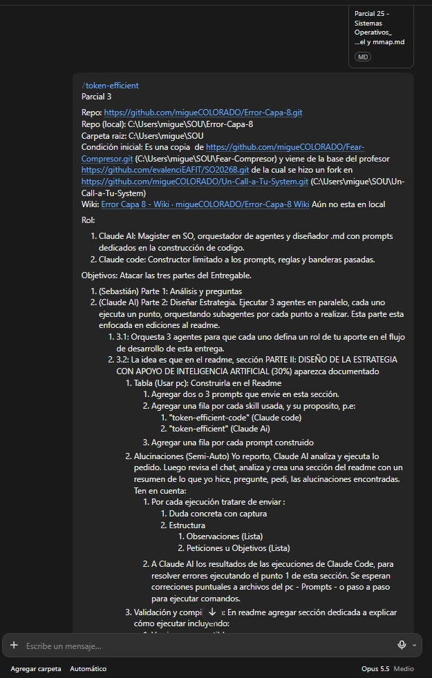

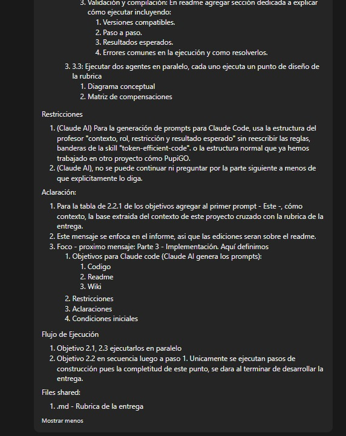

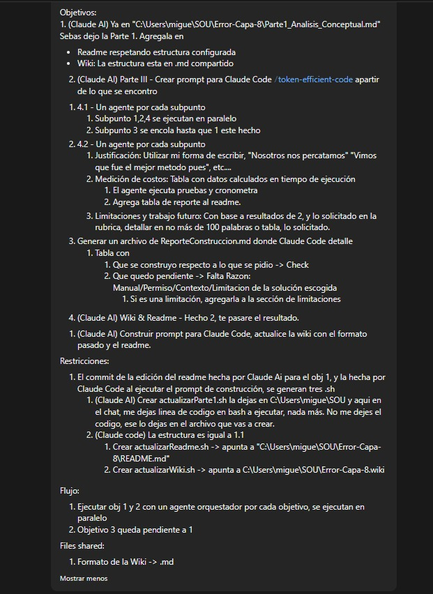

### Metodología de ingeniería de prompts y verificación crítica

#### Tabla de uso de IA (skills y prompts)

Estructura de cada prompt: **C** contexto, **R** rol, **Rs** restricción, **RE** resultado esperado. Los prompts de construcción para Claude Code se agregan a esta tabla cuando se escriben.

| ID | Tipo | Herramienta | Nombre | Propósito | Estructura del prompt | Estado |
| --- | --- | --- | --- | --- | --- | --- |
| S1 | Skill | Claude AI | `token-efficient` | Respuestas directas: resultado primero, sin relleno, tablas sobre prosa, sin guiones largos ni comillas tipográficas. | N/A | En uso |
| S2 | Skill | Claude Code | `anthropic-skills:token-efficient-code` | Ejecución autónoma de código con mínimo de tokens; no versiona (sin commit, push ni merge); verifica con comandos reales; hereda las reglas de `token-efficient`. En Claude AI la misma skill se llama `token-efficient-code`. | N/A | Se usa desde la implementación |
| P1 | Prompt | Miguel a Claude AI | Parte II: orquestación de agentes y edición del README | Definir el trabajo de la Parte II: roles, tabla de uso de IA, registro de alucinaciones, validación, diagrama y matriz. | **C:** base del proyecto cruzada con la rúbrica (ver cruce abajo). <br>**R:** Claude AI como magíster en SO, orquestador de agentes y diseñador de `.md`; Claude Code como constructor. <br>**Rs:** edita solo el README; 3.1 y 3.3 en paralelo, 3.2 después y solo pasos de construcción; sin avanzar a la Parte III sin orden explícita. <br>**RE:** README con la Parte II. | Enviado; texto completo abajo |
| P2 | Prompt | Claude AI a agente en paralelo | Rol 1: exploración arquitectónica | Definir el rol de la IA en la exploración de estructuras, headers y hooks. | **C:** contexto compartido (curso, rúbrica, opciones A a E, pistas técnicas por verificar, reglas de salida). <br>**R:** agente de exploración arquitectónica. <br>**Rs:** sin afirmar hechos no ocurridos; la IA no es fuente de verdad; verificar hooks y `CONFIG_*`. <br>**RE:** fragmento del Rol 1 en tabla de 5 filas, máximo 220 palabras, y lista VERIFICAR. | Ejecutado; integrado |
| P3 | Prompt | Claude AI a agente en paralelo | Rol 2: generación y verificación de C | Definir el rol de la IA al generar y verificar código de bajo nivel. | **C:** contexto compartido. <br>**R:** agente de generación y verificación de código C. <br>**Rs:** incluir la compuerta anti-alucinación (`EXPORT_SYMBOL`, headers, `-Wall -Wextra -Werror`, log del verificador); sin commits por IA. <br>**RE:** fragmento del Rol 2, máximo 240 palabras, y lista VERIFICAR. | Ejecutado; integrado |
| P4 | Prompt | Claude AI a agente en paralelo | Rol 3: pruebas y PoC | Definir el rol de la IA en casos de prueba y PoC controladas. | **C:** contexto compartido. <br>**R:** agente de casos de prueba y PoC. <br>**Rs:** pruebas solo sobre archivos temporales, sin escalada de privilegios y sin reproducir CVE-2016-5195. <br>**RE:** fragmento del Rol 3 con tabla de 4 casos como hipótesis, máximo 280 palabras. | Ejecutado; integrado |
| P5 | Prompt | Claude AI a agente en paralelo | Diagrama conceptual | Dibujar la arquitectura propuesta mostrando el mecanismo. | **C:** contexto compartido y opción C. <br>**R:** agente de diseño del diagrama. <br>**Rs:** un solo diagrama Mermaid validado con `mmdc`; debe mostrar frontera de syscall, hook, mapa de política, decisión, ring buffer, page fault, PTE y límite de cobertura. <br>**RE:** bloque Mermaid, leyenda de máximo 8 filas y párrafo de límite de cobertura. | Ejecutado; integrado |
| P6 | Prompt | Claude AI a agente en paralelo | Matriz de compensaciones | Comparar rendimiento y seguridad entre las alternativas A a E. | **C:** contexto compartido y alternativas A a E. <br>**R:** agente evaluador con 0% de complacencia. <br>**Rs:** criterios mínimos fijados; escala cualitativa; sin mediciones inventadas. <br>**RE:** matriz, resumen por eje y justificación de la selección. | Ejecutado; integrado |
| P7 | Prompt | Miguel a Claude AI | Ronda 2: aclaraciones y objetivos | Fijar las capturas de 3.1, dejar la validación como estructura, crear el prompt del reporte, actualizar el README con la rúbrica y explicar la importación de la wiki. | **C:** README con la Parte II ya integrada, rúbrica del parcial, skills y prompts de la ronda 1. <br>**R:** Claude AI como orquestador de tres agentes en paralelo, uno por objetivo. <br>**Rs:** capturas en `src/capturas/3.1/`; validación solo con estructura; README sin el enlace de sustentación y con autores; usar skills, prompts y rúbrica compartidos. <br>**RE:** `promptGenerarReporte.md`, README actualizado y explicación de la wiki. | Enviado |
| P8 | Prompt | Claude AI a agente en paralelo | Redactor de `promptGenerarReporte.md` | Escribir el prompt que Claude Code usará para generar `reporteBase.md`. | **C:** contexto compartido, estructura conocida del repo, pendientes POR CONFIRMAR y lista DESCUBRIR, reglas de la skill `token-efficient-code`. <br>**R:** redactor del prompt; Claude Code solo construye. <br>**Rs:** un solo `.md`, abre con `/anthropic-skills:token-efficient-code`, sin reescribir las reglas de la skill, pasos numerados con DEFAULT y DESCUBRIR, máximo 170 líneas. <br>**RE:** archivo del prompt con el formato obligatorio del reporte y el bloque "Al terminar". | Ejecutado; integrado |
| P9 | Prompt | Claude AI a agente en paralelo | Editor del README según la rúbrica | Actualizar el README al Parcial 3 sin perder la base heredada. | **C:** copia de trabajo del README y entregables de la rúbrica. <br>**R:** editor del README. <br>**Rs:** trabajar solo sobre una copia; quitar el enlace de sustentación; conservar Autores; no tocar la Parte II; renombrar "Parte N de la entrega" a "Base heredada N"; verificar anclas y tablas. <br>**RE:** README actualizado con verificaciones en una línea cada una. | Ejecutado; integrado |
| P10 | Prompt | Claude AI a agente en paralelo | Guía para importar la wiki | Explicar cómo traer la wiki del repo a la carpeta raíz. | **C:** repo local, URL de la wiki, Windows con PowerShell y WSL2. <br>**R:** tutor que verifica con la documentación oficial de GitHub. <br>**Rs:** no ejecutar nada en el equipo ni en GitHub; marcar POR CONFIRMAR lo no verificado. <br>**RE:** tabla de tres opciones, recomendación con comandos y advertencia del guion Unicode. | Ejecutado; explicación en el chat |
| P11 | Prompt | Claude AI a Claude Code | `promptGenerarReporte.md` | Generar `reporteBase.md`: resolver la estructura base del repo y los pendientes POR CONFIRMAR con evidencia. | **C:** estructura conocida del repo, entorno WSL2, wiki fuera de alcance. <br>**R:** ingeniero de SO que audita un repo C/POSIX y reporta con evidencia. <br>**Rs:** solo lectura salvo `reporteBase.md`; sin instalar ni versionar; compilar en una copia temporal; toda afirmación cita un comando o `archivo:línea`. <br>**RE:** `reporteBase.md` en la carpeta del repositorio con 9 secciones y tabla de pendientes P1 a P10 y D1 a D12. | Ejecutado; generó `reporteBase.md`, hoy en la carpeta raíz (SOU) |
| P12 | Prompt | Miguel a Claude AI | Ronda 3: Parte I, construcción y wiki | Insertar la Parte I de Sebastián en el README, diseñar el prompt de construcción de la Parte III y dejar en cola el prompt de la wiki. | **C:** `reporteBase.md` (entorno y viabilidad), `Parte1_Analisis_Conceptual.md` de Sebastián y `formatoWiki.md` compartido. <br>**R:** Claude AI como orquestador, un agente por objetivo, en paralelo. <br>**Rs:** tres scripts de commit con modos `dry-run` y `run`; Claude Code nunca versiona; el objetivo de la wiki espera los resultados de la construcción. <br>**RE:** Parte I en el README, `actualizarParte1.sh`, `promptConstruccion.md` y, después, el prompt de la wiki. | Enviado |
| P13 | Prompt | Claude AI a agente en paralelo | Orquestador del objetivo 1: Parte I | Pasar las diez respuestas de Sebastián al README sin cambiar su texto y crear `actualizarParte1.sh`. | **C:** README y `Parte1_Analisis_Conceptual.md` del equipo. <br>**R:** agente orquestador del objetivo 1. <br>**Rs:** generar el bloque con un script, no retipear; comparar párrafo a párrafo; anclas con la regla de GitHub; sin commit ni push en el repo real. <br>**RE:** Parte I con encabezados `### N. Título`, índice extendido y script probado en un repo temporal. | Ejecutado; commit `57f9c96` |
| P14 | Prompt | Claude AI a agente en paralelo | Orquestador del objetivo 2: redactor de `promptConstruccion.md` | Escribir el prompt de construcción de la Parte III a partir de `reporteBase.md`. | **C:** secciones 6, 7 y 9 de `reporteBase.md`, estrategia de la Parte II y reglas de la skill. <br>**R:** redactor del prompt; Claude Code solo construye. <br>**Rs:** estructura del profesor cruzada con la skill sin reescribir sus reglas; contrato de interfaz en `mmapguard/`; agentes 4.1 y 4.2 con rutas exclusivas; sin cifras estimadas. <br>**RE:** `promptConstruccion.md` en la carpeta raíz (SOU). | Ejecutado; archivo en SOU |
| P15 | Prompt | Claude AI a Claude Code | `promptConstruccion.md` | Construir mmapguard (eBPF-LSM), completar la Parte III del README y generar `ReporteConstruccion.md`. | **C:** opción C, hooks `mmap_file` y `file_mprotect`, evidencia D1 a D12, mapa de rutas y `prioridad.docx`. <br>**R:** ingeniero de SO y orquestador de agentes 4.1 (1, 2 y 4 en paralelo, 3 tras 1) y 4.2. <br>**Rs:** sin git que escriba ni sudo; compilar en `~/mg_build`; toolchain en espacio de usuario con máximo 3 intentos; "NO MEDIDO (Permiso)" en vez de cifras estimadas. <br>**RE:** `mmapguard/`, README de la Parte III, `ReporteConstruccion.md` y `actualizarReadme.sh` editado. | Ejecutado; commit `00641ab` |
| P16 | Prompt | Claude AI a agente en paralelo | Prioridad 4.1 | Ordenar los subpuntos 4.1.1 a 4.1.4 por dependencia, bloqueo real y recorte. | **C:** orden de ejecución de `promptConstruccion.md` y bloqueos D1 a D12 de `reporteBase.md`. <br>**R:** agente de prioridad del bloque 4.1. <br>**Rs:** máximo 30 palabras por campo; sin inventar; JSON validado. <br>**RE:** filas de 4.1 para `prioridad.docx`. | Ejecutado; integrado en `prioridad.docx` (SOU) |
| P17 | Prompt | Claude AI a agente en paralelo | Prioridad 4.2 | Ordenar los subpuntos 4.2.a a 4.2.c por dependencia, bloqueo real y recorte. | **C:** orden de ejecución de `promptConstruccion.md` y bloqueos D1 a D12. <br>**R:** agente de prioridad del bloque 4.2. <br>**Rs:** máximo 30 palabras por campo; límites de 250 y 100 palabras; sin inventar; JSON validado. <br>**RE:** filas de 4.2 para `prioridad.docx`. | Ejecutado; integrado en `prioridad.docx` (SOU) |
| P18 | Prompt | Claude AI a nueve agentes en paralelo | Guía de cierre de pendientes | Redactar los pasos de cada fila de la tabla 2 de `ReporteConstruccion.md`: LSM activos, carga, demo, pruebas con root, medición, trazado, toolchain, capturas y cierre en EAFIT. | **C:** fila asignada de la tabla 2 y código de `mmapguard/` leído en el equipo. <br>**R:** un agente por fila. <br>**Rs:** no ejecutar nada con sudo; dónde se corre, comando, salida esperada y qué devolver; máximo 170 palabras; POR CONFIRMAR lo no verificado. <br>**RE:** pasos integrados en la guía interactiva de nueve pasos. | Ejecutado; guía publicada y ejecutada por Miguel (capturas en `src/capturas/p3/` y `src/capturas/3.2/`) |
| P19 | Prompt | Claude AI a Claude Code | `correccionParte3.md` | Corregir código, README y reporte con los resultados reales de la ejecución con root. | **C:** resultados transcritos de las capturas (demo, 64 PASS, dos sesiones de medición, strace, ftrace) e incidentes E-01 a E-03. <br>**R:** orquestador de seis agentes en paralelo (A, B, C, C2, D, E) con rutas exclusivas. <br>**Rs:** sin git que escriba ni sudo; README en CRLF con un solo escritor; pruebas sintéticas sin root; reporte de máximo 100 palabras. <br>**RE:** detección de `perf` y `bpftool`, README con resultados reales, `ReporteConstruccion.md` y `actualizarReadme.sh` con tres commits. | Ejecutado; commits `c11fbc7` y `9114659` |
| P20 | Prompt | Claude AI a Claude Code | `actualizarWiki.md` | Pasar todo el contenido del README a la wiki con la estructura heredada del README. | **C:** README corregido, `formatoWiki.md` como idea de formato y wiki local en `Error-Capa-8.wiki`. <br>**R:** documentalista técnico y orquestador de agentes por grupo de páginas. <br>**Rs:** en cola tras `correccionParte3.md`; en español; sin roles, sprints ni backlog; solo escribe en la wiki; sin git que escriba. <br>**RE:** páginas de la wiki, imágenes, verificación de enlaces y `actualizarWiki.sh`. | Pendiente de ejecutar |

Cruce entre la base del proyecto y la rúbrica (contexto de P1):

| Exigencia de la rúbrica | Qué aporta la base del proyecto | Consecuencia en la estrategia |
| --- | --- | --- |
| Compila en kernel 5.x/6.x con Makefile y clean build | WSL2 Ubuntu 24.04, GCC 13.3.0 y Makefiles existentes; versión del kernel de WSL2 desconocida | La viabilidad de eBPF-LSM o LKM es DESCUBRIR; hay una puerta de viabilidad antes de codificar. |
| Scripts de prueba Bash/Python | Parciales anteriores con `run_tests.sh`, comparación con `cmp` y sanitizers | Se reutiliza el patrón: pruebas automatizadas con resultado verificable. |
| Documentar prompts y validar alucinaciones | Errores de la IA en Parciales 1 y 2: benchmark inventado, cifras de pruebas desactualizadas, README equivocado editado | Regla fija: nada se acepta sin un comando ejecutado; registro de alucinaciones. |
| Overhead con `perf`, `strace` o `ftrace` | Benchmark previo con mediana de 3 corridas y unidades explícitas | Se repite el método: varias corridas, mediana y unidades. |
| Repositorio, README e informe | Plantilla de README de Miguel (índice, pasos de ejecución, autores, información del curso) | El README conserva su formato; la Parte II se inserta sin borrar secciones previas. |
| Uso crítico de la IA | Claude AI diseña y analiza; Claude Code construye; Miguel hace los commits | Claude Code queda limitado a prompts y banderas; la IA no versiona. |

<details>
<summary>Texto completo de P1</summary>

```text
/token-efficient 
Parcial 3

Repo: https://github.com/migueCOLORADO/Error-Capa-8.git 
Repo (local): C:\Users\migue\SOU\Error-Capa-8
Carpeta raiz: C:\Users\migue\SOU
Condición inicial: Es una copia  de https://github.com/migueCOLORADO/Fear-Compresor.git (C:\Users\migue\SOU\Fear-Compresor) y viene de la base del profesor https://github.com/evalenciEAFIT/SO2026B.git de la cual se hizo un fork en https://github.com/migueCOLORADO/Un-Call-a-Tu-System.git (C:\Users\migue\SOU\Un-Call-a-Tu-System)
Wiki: Error Capa 8 - Wiki (https://github.com/migueCOLORADO/Error-Capa-8/wiki/Error-Capa-8-%E2%80%90-Wiki) Aún no esta en local

Rol:

1. Claude AI: Magister en SO, orquestador de agentes y diseñador .md con prompts dedicados en la construcción de codigo.
2. Claude code: Constructor limitado a los prompts, reglas y banderas pasadas.


Objetivos: Atacar las tres partes del Entregable.

1. (Sebastián) Parte 1: Análisis y preguntas
2. (Claude AI) Parte 2: Diseñar Estrategia. Ejecutar 3 agentes en paralelo, cada uno ejecuta un punto, orquestando subagentes por cada punto a realizar. Esta parte esta enfocada en ediciones al readme.
   1. 3.1: Orquesta 3 agentes para que cada uno defina un rol de tu aporte en el flujo de desarrollo de esta entrega. 
   2. 3.2: La idea es que en el readme, sección  PARTE II: DISEÑO DE LA ESTRATEGIA CON APOYO DE INTELIGENCIA ARTIFICIAL (30%) aparezca documentado
      1. Tabla (Usar pc): Construirla en el Readme
         1. Agregar dos o 3 prompts que envie en esta sección. 
         2. Agregar una fila por cada skill usada, y su proposito, p.e:
            1. "token-efficient-code"  (Claude code)
            2. "token-efficient" (Claude Ai)
         3. Agregar una fila por cada prompt construido
      2. Alucinaciones (Semi-Auto) Yo reporto, Claude AI analiza y ejecuta lo pedido. Luego revisa el chat, analiza y crea una sección del readme con un resumen de lo que yo hice, pregunte, pedi, las alucinaciones encontradas. Ten en cuenta:
         1. Por cada ejecución tratare de enviar :
            1. Duda concreta con captura
            2. Estructura
               1. Observaciones (Lista)
               2. Peticiones u Objetivos (Lista)
         2. A Claude AI los resultados de las ejecuciones de Claude Code, para resolver errores ejecutando el punto 1 de esta sección. Se esperan correciones puntuales a archivos del pc - Prompts - o paso a paso para ejecutar comandos.
      3. Validación y compilación: En readme agregar sección dedicada a explicar cómo ejecutar incluyendo:
         1. Versiones compatibles.
         2. Paso a paso.
         3. Resultados esperados.
         4. Errores comunes en la ejecución y como resolverlos.
   3. 3.3: Ejecutar dos agentes en paralelo, cada uno ejecuta un punto de diseño de la rubrica
      1. Diagrama conceptual
      2. Matriz de compensaciones


Restricciones

1. (Claude AI) Para la generación de prompts para Claude Code, usa la estructura del profesor "contexto, rol, restricción y resultado esperado" sin reescribir las reglas, banderas de la skill "token-efficient-code". o la estructura normal que ya hemos trabajado en otro proyecto cómo PupiGO.
2. (Claude AI), no se puede continuar ni preguntar por la parte siguiente a menos de que explicitamente lo diga.


Aclaración:

1. Para la tabla de 2.2.1 de los objetivos agregar al primer prompt - Este -, cómo contexto, la base extraida del contexto de este proyecto cruzado con la rubrica de la entrega.
2. Este mensaje se enfoca en el informe, asi que las ediciones seran sobre el readme.
3. Foco - proximo mensaje: Parte 3 - Implementación. Aquí definimos
   1. Objetivos para Claude code (Claude AI genera los prompts):
      1. Codigo
      2. Readme
      3. Wiki
   2. Restricciones
   3. Aclaraciones
   4. Condiciones iniciales


Flujo de Ejecución

1. Objetivo 2.1, 2.3 ejecutarlos en paralelo
2. Objetivo 2.2 en secuencia luego a paso 1.  Unicamente se ejecutan pasos de construcción pues la completitud de este punto, se dará al terminar de desarrollar la entrega.


Files shared:

1. .md - Rubrica de la entrega
```

</details>

#### Registro de ejecuciones y alucinaciones

Protocolo (semiautomático): Miguel reporta, Claude AI analiza y ejecuta lo pedido. Al cerrar la entrega, Claude AI revisa el chat y completa esta sección con un resumen de lo que Miguel hizo, preguntó y pidió, y de las alucinaciones encontradas.

| Entrada de cada ejecución | Contenido |
| --- | --- |
| Duda concreta con captura | La duda puntual y la captura de pantalla de la salida real. |
| Observaciones | Lista de lo que se vio en la ejecución. |
| Peticiones u objetivos | Lista de lo que se quiere resolver. |
| Resultados de Claude Code | Se envían a Claude AI para resolver errores con el mismo ciclo. |
| Respuesta esperada de Claude AI | Correcciones puntuales a archivos del PC, a prompts o un paso a paso de comandos. |

Registro de ejecuciones:

| ID | Fecha | Duda y captura | Observaciones | Peticiones | Alucinación detectada | Corrección aplicada |
| --- | --- | --- | --- | --- | --- | --- |
| E-01 | 2026-11-07 | Por qué `perf stat` dejó de funcionar después de instalar `linux-tools-generic`. Captura: `src/capturas/3.2/E01_perf_wrapper_ubuntu.jpg` | Antes del `apt install`, `make bench` mostraba 58, 15299 y 59 page-faults con `perf stat`. Después, el `perf` del PATH imprime "WARNING: perf not found for kernel 6.18.54.1-microsoft" y sugiere paquetes `linux-tools-6.18.54.1-microsoft-standard-WSL2`; `make bench` pasa a "perf stat: no funciona sin root; se omite". | Recuperar un `perf` que funcione y que el bench no dependa del PATH. | La IA nos indicó instalar `linux-tools-generic` para tener `perf` y `strace` listos, dando por hecho que traería un `perf` usable. En WSL2 el kernel no es el genérico de Ubuntu: el `perf` del PATH quedó como el wrapper de Ubuntu, que busca herramientas para `6.18.54.1-microsoft` y no las encuentra. | `bench.sh` y `bench_con_defensa.sh` detectan el perf de verdad: si `perf --version` falla, buscan `/usr/lib/linux-tools/*/perf` o `*/bin/perf` y usan el primero que funcione; si ninguno sirve, avisan en una línea y siguen sin perf, sin inventar contadores. |
| E-02 | 2026-11-07 | Por qué `sudo bpftool prog show` falla justo después de `load`. Captura: `src/capturas/3.2/E02_bpftool_wrapper_ubuntu.jpg` | `sudo ./build/mmapguard load` respondió "mmapguard cargado: pines en /sys/fs/bpf/mmapguard"; enseguida `bpftool prog show` imprimió "WARNING: bpftool not found for kernel 6.18.54.1-microsoft", el mismo wrapper de E-01. | Listar los programas BPF cargados con un bpftool que funcione. | La IA nos pidió `sudo ./build/mmapguard load && sudo bpftool prog show`, asumiendo que el `bpftool` del PATH funcionaba. En WSL2 es el wrapper de Ubuntu y no ejecuta nada. | El Makefile detecta bpftool también en `/usr/lib/linux-tools/*/bpftool` (con `TC_PREFIX` vacío; si `TC_PREFIX` existe, sigue siendo prioritario). Para consultar a mano usamos la ruta: `$(ls /usr/lib/linux-tools/*/bpftool \| head -1) prog show`. |
| E-03 | 2026-11-07 | Por qué el segundo `load` respondió "ya esta cargado". Captura: `src/capturas/3.2/E03_ya_esta_cargado.jpg` | Al repetir `sudo ./build/mmapguard load && sudo bpftool prog show`, la CLI respondió "ya esta cargado (existe /sys/fs/bpf/mmapguard/mg_policy); ejecutar 'sudo mmapguard unload' antes". El primer `load` había quedado activo porque falló el bpftool que venía encadenado después. | Repetir la carga y la inspección; saber en qué estado quedó la defensa. | La guía ponía un `load` manual antes de la demo, las pruebas y el bench, y daba por hecho que la cadena terminaba limpia. No contemplaba que un fallo posterior dejara la defensa cargada. La defensa pudo quedar cargada en el WSL de Miguel (por confirmar con `ls /sys/fs/bpf/mmapguard`). | Nada exige un `load` manual previo: `demo.sh defended`, `run_tests.sh` y `bench_con_defensa.sh` cargan y descargan solos, con `trap` que descarga aunque falle. Esos scripts y `demo.sh defended` avisan "si quedó cargada: sudo ./build/mmapguard unload". Comando manual para limpiar: `sudo ./build/mmapguard unload`. |
| E-04 | 2026-11-07 | Por qué `bash actualizarParte1.sh dry-run` rechazó el push con "non-fast-forward" y, después del `git pull`, el README quedó con marcas de conflicto. Sin captura | El remoto tenía commits que nuestra copia local no tenía (la versión de la Parte I subida por Sebastián). Tras `git pull --rebase --autostash origin main`, el stash chocó con esa versión y el README quedó con `<<<<<<< Updated upstream`, `=======` y `>>>>>>> Stashed changes`. Así se versionó en el commit de la Parte I y el README público mostró las marcas. | Traer los cambios del remoto sin perder lo nuestro y dejar el README limpio. | Sí, en parte. La IA editó el README sin traer antes la versión del remoto y luego nos recomendó `pull --autostash` sin pedir que revisáramos marcas de conflicto antes del `run`. | Resolvimos el conflicto dejando la versión con encabezados `### N. Título`, que es la que coincide con el índice, y lo versionamos en `42588e0` (`docs(readme): resolver conflicto de la Parte I ...`). Ahora revisamos `grep -c '^<<<<<<<' README.md` antes de cada commit. |
| E-05 | 2026-11-07 | Por qué el bloque de `ftrace` pegado después de `sudo -i` no mostró ninguna salida. Sin captura | Pegamos el bloque completo de una vez. `sudo -i` abrió una shell nueva de root que descartó las líneas que ya estaban en el buffer; la terminal solo las mostró. No salió nada del `grep` ni del `head -40 trace`, y al repetirlo quedamos con una shell de root dentro de otra. | Ejecutar de verdad el trazado de `security_mmap_file`. | Sí. La guía de la IA ponía `sudo -i` como primera línea del mismo bloque que había que copiar y pegar. | Separamos los pasos: primero `sudo -i` solo y luego el bloque. Para la evidencia usamos un único comando `sudo bash -c '...'` que traza, muestra `trace` y limpia el tracer. Ese comando funcionó: `src/capturas/p3/14_ftrace_security_mmap_file.jpg`. |
| E-06 | 2026-11-07 | Por qué aparecieron `current_tracer`, `set_graph_function` y `tracing_on` dentro de `mmapguard/`. Sin captura | Son archivos normales con el texto `function_graph`, `security_mmap_file` y el valor de `tracing_on`. Se crearon cuando las redirecciones `echo ... > archivo` corrieron en `mmapguard/` y no en `/sys/kernel/tracing`; la causa más probable es que el `cd` no se aplicó en esa ejecución (no quedó captura que lo confirme). El grupo `mmapguard` de `actualizarReadme.sh` usa `git add -A` y los versionó en `c11fbc7`. | Sacarlos del repositorio sin tocar el código. | Sí. El bloque de la guía no encadenaba los comandos con `&&`, así que un `cd` fallido dejaba correr los `echo` en la carpeta actual. | Los retiramos con `git rm` (lista `ELIMINAR` de `actualizarReadme.sh`) en el commit de esta tanda. Los comandos de trazado quedan encadenados con `&&` dentro de un solo `sudo bash -c`. |
| E-07 | 2026-11-07 | Creímos que `demo.sh defended` no había salido como se esperaba. Captura: `src/capturas/p3/04b_demo_defendida_primera_corrida.jpg` | La salida coincidía con lo esperado: `shared-write`, `exec` y `mprotect-write` DENEGADO con errno 1 (código 10), `private-write` PERMITIDO (código 0) y tres eventos `verdict=deny`. La línea "ESPERADO" del final es una referencia fija del diseño y no un resultado. | Confirmar si la defensa funcionaba. | No (uso). | Ninguna en el código. Aclaramos que el resultado medido es el bloque de sondas y eventos, no la línea "ESPERADO". |

Lista de revisión por categoría (rúbrica 3.2). Estado: E-01 a E-07 son fallas de entorno, de uso o de instrucciones de la IA sobre herramientas, orden de ejecución y git (WSL2 y Git Bash); todavía no registramos hallazgos de las cuatro categorías de código del kernel.

| Categoría | Cómo se detecta |
| --- | --- |
| Función obsoleta | Compilar contra los headers del kernel en uso y revisar las advertencias. |
| Símbolo no exportado (`EXPORT_SYMBOL`) | Buscar el símbolo en `/proc/kallsyms` y en los headers; el enlace del módulo falla si no existe. |
| Macro o hook inexistente | Buscar el nombre en los headers instalados y en `lsm_hook_defs.h`. |
| Práctica insegura (por ejemplo, desactivar WP de CR0 sin control de concurrencia) | Revisión de código línea a línea; se rechaza y se vuelve a pedir. |

Hallazgos de verificación de esta fase:

| ID | Hallazgo | Origen | Verificación | Acción |
| --- | --- | --- | --- | --- |
| H-01 | La rúbrica nombra el hook como `file_mmap`; en `lsm_hook_defs.h` (rama master) el hook es `mmap_file` (`file`, `reqprot`, `prot`, `flags`) y `file_mprotect` (`vma`, `reqprot`, `prot`). No existe un hook `file_mmap`. | Nombre de la rúbrica, no una salida del modelo | Dos agentes lo contrastaron con `lsm_hook_defs.h` de master; después lo confirmamos con el BTF del kernel de WSL2 volcado con `bpftool`: `bpf_lsm_mmap_file(file, reqprot, prot, flags)` y `bpf_lsm_file_mprotect(vma, reqprot, prot)`. | Usar `mmap_file` y `file_mprotect` en el diseño. |

#### Validación y compilación

Esta sección ya no es solo estructura: son los pasos que seguimos el sábado 2026-11-07 en nuestro WSL2 (Ubuntu 24.04), con los comandos tal como los escribimos y lo que vimos en pantalla. Los números de las pruebas y de la medición salen de las capturas, no los estimamos ni los redondeamos.

##### Versiones compatibles

| Componente | Versión | Cómo se verifica |
| --- | --- | --- |
| Kernel | 6.18.54.1-microsoft-standard-WSL2 | `uname -r` |
| Lista de LSM activos | `capability,landlock,yama,safesetid,selinux,bpf,ima` (`bpf` activo sin tocar `.wslconfig`) | `cat /sys/kernel/security/lsm` (securityfs ya estaba montado) |
| gcc | 13.3.0 | `gcc --version` |
| make | 4.3 | `make --version` |
| clang | 18.1.3 | `clang --version` |
| bpftool | v7.4.0, con libbpf v1.4 | `$(ls /usr/lib/linux-tools/*/bpftool \| head -1) version` |
| strace | POR CONFIRMAR (se instaló con `apt`) | `strace -V` |
| perf | 6.18.54.1.g26d1ceb55087, en `/usr/bin/perf` (así lo reporta `make bench`) | `perf --version` |

##### Paso a paso

Todo se hace desde WSL2, en la carpeta `mmapguard/`. Nada de lo que sigue exige cargar la defensa a mano antes: la demo, las pruebas y la medición con defensa la cargan y la descargan solas.

1. Fecha y kernel. Confirmamos la fecha de la sesión y la versión del kernel de WSL2.

   ```bash
   date; uname -r
   ```

   Resultado: `Sat Nov 7 02:12:10 -05 2026` y `6.18.54.1-microsoft-standard-WSL2`.

   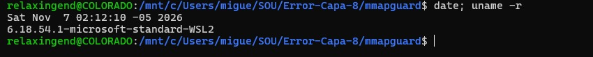

2. LSM activos. Comprobamos que `bpf` esté en la lista de LSM, porque sin eso el programa BPF no se engancha.

   ```bash
   sudo mount -t securityfs securityfs /sys/kernel/security; cat /sys/kernel/security/lsm
   ```

   Resultado: el `mount` avisó que securityfs ya estaba montado y la lista fue `capability,landlock,yama,safesetid,selinux,bpf,ima`. `bpf` está activo sin tocar `.wslconfig`.

   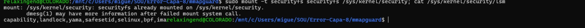

3. Toolchain. Verificamos las versiones de clang y de bpftool (con la ruta real, no con el wrapper de Ubuntu).

   ```bash
   clang --version
   $(ls /usr/lib/linux-tools/*/bpftool | head -1) version
   ```

   Resultado: clang 18.1.3 (Ubuntu), target `x86_64-pc-linux-gnu`; bpftool v7.4.0 usando libbpf v1.4.

   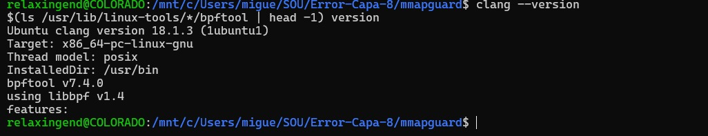

4. Compilar. `make` genera en `build/` el objeto BPF, el skeleton y el binario `mmapguard`. El código de usuario se compila con `-Wall -Wextra -Werror -std=gnu11`, así que cualquier advertencia habría detenido la compilación.

   ```bash
   make
   ```

5. Pruebas sin root. Corremos la batería completa sin `sudo`; los casos que necesitan cargar la defensa se anotan como REQUIERE ROOT en vez de fallar.

   ```bash
   make test
   ```

   Resultado: `RESUMEN: 49 PASS, 0 FAIL, 7 REQUIERE ROOT`.

   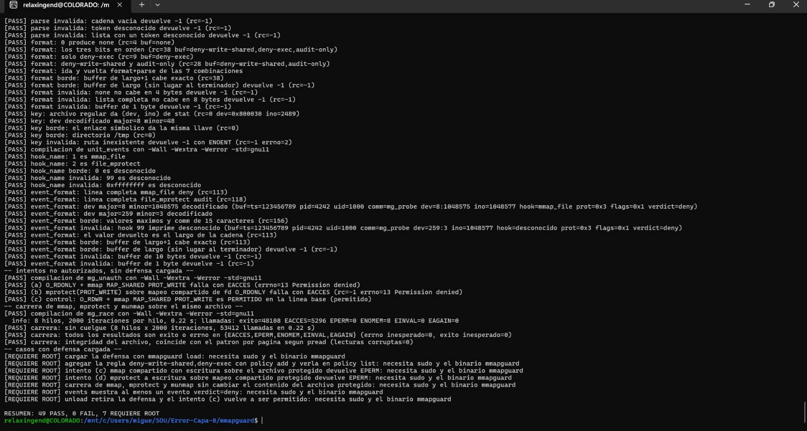

   

   Con `sudo` las mismas pruebas dan `RESUMEN: 64 PASS, 0 FAIL, 0 REQUIERE ROOT`; esa captura y la de la demo con defensa están en la Parte III. El comando con root es:

   ```bash
   sudo MMAPGUARD=$PWD/build/mmapguard bash tests/run_tests.sh
   ```

6. Demostración. Sin defensa (no pide root) y con defensa (pide root; carga, agrega la regla `deny-write-shared,deny-exec`, corre los cuatro modos, muestra los eventos y descarga). Si algo falla en medio, un `trap` descarga la defensa.

   ```bash
   bash demo/demo.sh
   sudo bash demo/demo.sh defended
   ```

   Resultado sin defensa: `shared-write`, `private-write`, `exec` y `mprotect-write` salieron PERMITIDO (código 0) y la escritura llegó al archivo. Resultado con defensa: `shared-write`, `exec` y `mprotect-write` salieron DENEGADO con `errno=1` (código 10) y `private-write` siguió PERMITIDO (código 0).

7. Medición de la línea base. `make bench` compila `build/bench_mmap` y corre 10 corridas de 1000 iteraciones por escenario, sin defensa y sin root.

   ```bash
   make bench
   ```

   Resultado (nproc=12, ns por iteración, mediana con mínimo y máximo): `mmap_munmap` 1570.0 (1157.8 a 4244.1), `mmap_touch` 16909.2 (15996.1 a 18373.2) y `mmap_mprotect` 1828.0 (1506.3 a 2370.8); fallos menores medianos 2, 15002 y 2.

   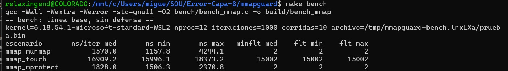

8. Segunda lectura con `perf stat`. Antes de instalar nada, el bench también mostró los contadores de `perf stat` sin root (la corrida adicional cuenta el proceso completo, incluido el arranque): 58, 15299 y 59 page-faults. En esa misma salida `strace` salió "no encontrado" y ftrace "sin permiso (Permission denied)" sobre `/sys/kernel/tracing`.

   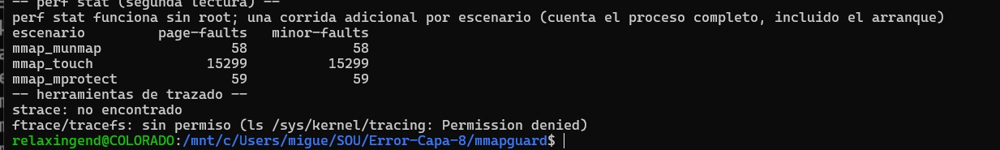

9. Herramientas de trazado. Para strace y perf instalamos los paquetes con `apt`. Este paso fue el que desencadenó los incidentes E-01 y E-02 del registro de más abajo.

   ```bash
   sudo apt update && sudo apt install -y strace linux-tools-generic
   ```

   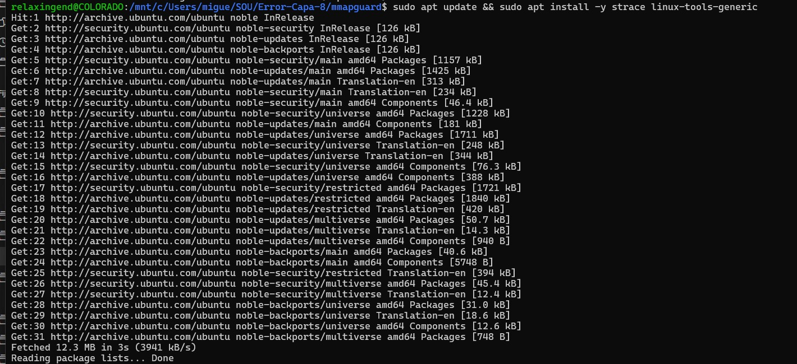

10. Medición con defensa y trazado. `sudo bash bench/bench_con_defensa.sh` mide tres casos (sin defensa, defensa cargada con el archivo sin regla y defensa cargada con regla `deny-exec`) y descarga al terminar; al final avisa con la línea "si quedó cargada: sudo ./build/mmapguard unload". Esos resultados, junto con `strace -c` y el `function_graph` de `security_mmap_file`, están en la Parte III, en "Costos medidos".

##### Resultados esperados

| Paso | Esperado | Obtenido |
| --- | --- | --- |
| LSM activos | `bpf` en la lista | `capability,landlock,yama,safesetid,selinux,bpf,ima` |
| `make` | Compila sin advertencias | Compila (`-Werror` activo) |
| `make test` sin root | 0 FAIL | 49 PASS, 0 FAIL, 7 REQUIERE ROOT |
| `run_tests.sh` con root | 0 FAIL y 0 REQUIERE ROOT | 64 PASS, 0 FAIL, 0 REQUIERE ROOT |
| `demo.sh` sin defensa | Los 4 modos PERMITIDO | Los 4 modos PERMITIDO (código 0) |
| `demo.sh defended` | `shared-write`, `exec` y `mprotect-write` denegados; `private-write` permitido | Tres DENEGADO `errno=1` (código 10) y uno PERMITIDO (código 0) |
| `make bench` | Tabla de ns por iteración y fallos menores | 1570.0, 16909.2 y 1828.0 ns de mediana; fallos menores 2, 15002 y 2 |

La medición con defensa la hicimos en 3 sesiones, como pedía la guía; en ninguna comparación la diferencia se distingue del ruido y el detalle está en la Parte III.

##### Errores comunes y cómo resolverlos

| Error | Causa | Solución |
| --- | --- | --- |
| `aviso: falta clang[...]` o `bpftool[...]` al hacer `make` | No hay clang o bpftool en el PATH ni en `TC_PREFIX` | Instalar clang y bpftool, o fijar `TC_PREFIX=<ruta del toolchain>`. El Makefile también busca bpftool en `/usr/lib/linux-tools/*/bpftool` |
| `WARNING: perf not found for kernel 6.18.54.1-microsoft` y `make bench` omite `perf stat` | El `perf` del PATH es el wrapper de Ubuntu, que busca herramientas del kernel genérico y no del de WSL2 | `bench.sh` y `bench_con_defensa.sh` buscan el perf real en `/usr/lib/linux-tools/*/perf` o `*/bin/perf`; si ninguno funciona avisan y siguen sin perf |
| `WARNING: bpftool not found for kernel 6.18.54.1-microsoft` | El `bpftool` del PATH es el mismo wrapper de Ubuntu | Usar la ruta real: `$(ls /usr/lib/linux-tools/*/bpftool \| head -1) prog show` |
| `mmapguard: ya esta cargado (existe /sys/fs/bpf/mmapguard/mg_policy)` | Un `load` anterior dejó la defensa activa | `sudo ./build/mmapguard unload`. La demo, las pruebas y el bench cargan y descargan solos, con descarga aunque algo falle |
| `strace: no encontrado` | strace no viene instalado en Ubuntu en WSL2 | `sudo apt install -y strace` |
| `ftrace/tracefs: sin permiso (Permission denied)` | `/sys/kernel/tracing` exige root | Ejecutar el trazado con `sudo` (los resultados de ftrace están en la Parte III) |

### Estrategia arquitectónica seleccionada

Selección propuesta: **opción C**, un programa eBPF-LSM en los hooks `mmap_file` y `file_mprotect` que decide allow o deny al crear o cambiar la protección de un VMA, con auditoría por ring buffer. Una sonda sobre `handle_mm_fault` solo mide overhead y no decide. El cargador, la CLI y los scripts viven en espacio de usuario y no son la capa de defensa. Condición de viabilidad, por descubrir en el kernel de WSL2: `CONFIG_BPF_LSM`, BTF y `bpf` en `lsm=`; si no se cumple, se elige entre un kernel propio de WSL2 y la alternativa B. Resultado: se cumplió en el kernel 6.18.54.1 (ver la Parte III).

Alternativas evaluadas:

| Etiqueta | Alternativa |
| --- | --- |
| A | LKM que modifica la System Call Table (hook de `sys_mmap`) |
| B | LKM con kprobes o ftrace sobre funciones del subsistema mm o de seguridad |
| C | Programa eBPF-LSM en los hooks de mmap y mprotect, con cargador libbpf y mapas de política |
| D | LSM clásico compilado en el kernel (requiere recompilar) |
| E | Wrapper en espacio de usuario (`LD_PRELOAD`), solo como línea base descartada |

#### Diagrama conceptual

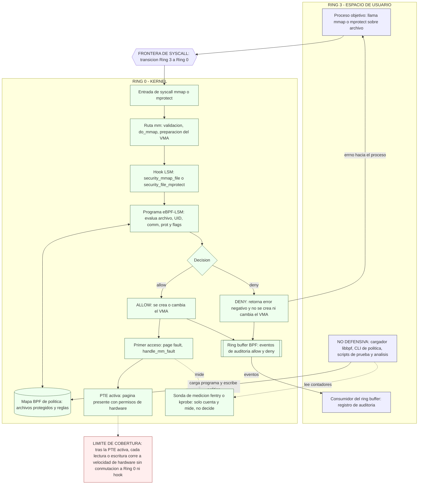

| Componente | Función |
| --- | --- |
| Proceso objetivo (Ring 3) | Invoca `mmap` o `mprotect` sobre un archivo; recibe el `errno` si la operación se niega. |
| Cargador, CLI y scripts (Ring 3) | Cargan el programa eBPF, escriben la política y ejecutan pruebas. No son la capa de defensa: si se eluden, el kernel sigue decidiendo. |
| Frontera de syscall | Paso obligatorio de Ring 3 a Ring 0; no se puede evitar desde espacio de usuario. |
| Hook LSM (`mmap_file`, `file_mprotect`) | Punto del kernel donde se consulta a los LSM antes de crear o cambiar el VMA. |
| Programa eBPF-LSM y mapa BPF de política | Decide allow o deny según archivo, UID, `comm`, `prot` y `flags` leídos del mapa. |
| Ring buffer BPF | Canal de auditoría del kernel al espacio de usuario; registra cada decisión. |
| `handle_mm_fault` y PTE activa | Ruta del primer acceso hasta dejar la página presente; desde ahí no hay interceptación. |
| Sonda `fentry` o `kprobe` | Solo mide overhead y cuenta fallos de página; no participa en la decisión. |

Límite de cobertura: el hook decide cuando se crea o cambia el mapeo (`mmap`, `mprotect`), no en cada acceso. Una vez la PTE queda activa, las lecturas y escrituras corren a velocidad de hardware sin pasar por Ring 0 y el programa eBPF-LSM no las ve. Por eso un mapeo permitido no se vuelve a evaluar, y la cobertura por acceso se declara como limitación y trabajo futuro.

Por confirmar en el kernel de WSL2: los nombres de los wrappers `security_mmap_file` y `security_file_mprotect`, la semántica de retorno del hook (el ejemplo oficial devuelve `-EPERM`) y si `handle_mm_fault` admite `fentry` (depende de BTF y de que la función no esté en línea; si no, `kprobe`).

#### Matriz de compensaciones

Escala cualitativa Alto/Medio/Bajo; no contiene mediciones. El overhead real de `mmap`, `mprotect` y los page faults se medirá en la implementación con `perf`, `ftrace` y `strace`. Lectura: en latencia, efecto sobre page faults, riesgo de panic y recompilación, Bajo es mejor; en los demás criterios, Alto es mejor.

| Criterio | A: LKM syscall table | B: LKM kprobes/ftrace | C: eBPF-LSM | D: LSM clásico en kernel | E: LD_PRELOAD |
| --- | --- | --- | --- | --- | --- |
| Latencia agregada en `mmap`/`mprotect` (rendimiento) | Medio: wrapper en cada llamada | Medio: sonda por llamada | Bajo/Medio: programa JIT y consulta de mapa | Bajo: código nativo en el hook | Bajo: solo trampolín de usuario |
| Efecto sobre page faults (rendimiento) | Bajo: no toca la ruta de fallos | Alto: sonda en `handle_mm_fault` es ruta caliente | Bajo: decide fuera de la ruta; `fentry` solo al medir | Bajo: no toca la ruta de fallos | Bajo: no toca la ruta de fallos |
| Profundidad de inspección (seguridad) | Medio: solo argumentos crudos de la syscall | Alto: estructuras internas, pero frágil | Alto: `struct file` y vma vía BTF | Alto: acceso nativo a estructuras | Bajo: solo argumentos vistos por libc |
| Cobertura (seguridad) | Bajo: solo `mmap`; otras rutas escapan | Medio: solo lo que cubra la función enganchada | Medio: `mmap` y `mprotect`; sin accesos por PTE | Medio: mismos hooks; sin accesos por PTE | Bajo: binarios estáticos y syscall directa escapan |
| Resistencia a evasión | Bajo: entradas alternas; parches frágiles | Medio: depende de la función elegida | Medio: decide en kernel; root con capacidades BPF puede descargar | Alto: compilado; política no descargable | Bajo: eludible sin privilegios |
| Viabilidad en WSL2 Ubuntu 24.04 | Bajo: DESCUBRIR módulos, símbolos y headers | Medio: DESCUBRIR módulos, kprobes y headers | Medio: DESCUBRIR `BPF_LSM`, BTF, `lsm=` y clang/libbpf | Bajo: exige kernel propio de WSL2; DESCUBRIR | Alto: no requiere nada del kernel |
| Riesgo de kernel panic | Alto: bug en C de kernel y escritura de tabla | Medio: bug del LKM; sondas con salvaguardas | Bajo: el verificador rechaza programas inseguros | Alto: bug en C de kernel sin aislamiento | Bajo: falla solo el proceso |
| Mantenibilidad entre kernels 5.x/6.x | Bajo: símbolos y wrappers cambian | Bajo: funciones internas cambian de firma | Medio: CO-RE/BTF absorben cambios; hooks por confirmar | Medio: parches por versión de kernel | Alto: independiente del kernel |
| Probabilidad de recompilar el kernel | Bajo: solo si no hay soporte de módulos | Bajo: solo si no hay soporte de módulos | Medio: solo si falta `BPF_LSM` o BTF | Alto: siempre | Bajo: nunca |
| Auditoría de accesos | Medio: `printk` o netlink propio | Medio: salida propia | Alto: ring buffer con `comm`, UID y archivo | Medio: audit del kernel | Bajo: registro en usuario, manipulable |

| Eje | Mejor opción | Peor opción | Nota |
| --- | --- | --- | --- |
| Rendimiento | D (código nativo) y E en costo bruto; C cercano a D | B si se decide en `handle_mm_fault` | E es barata solo porque no protege. C evita la ruta de fallos para decidir. Todo por medir. |
| Seguridad | D por resistencia; C por profundidad y auditoría | E, luego A | Ninguna alternativa inspecciona por acceso una vez activa la PTE. |

Justificación de la selección: C es la única alternativa que decide en el kernel (`mmap_file` y `file_mprotect`) sin cargar un LKM ni recompilar, y el verificador eBPF reduce el riesgo de panic. Su condición de viabilidad es que el kernel de WSL2 tenga `CONFIG_BPF_LSM`, BTF y `bpf` en `lsm=` (confirmado después: `bpf` figura en la lista activa de LSM, ver la Parte III). C no cubre accesos de carga y escritura tras activarse la PTE, mapeos creados antes de cargar el programa, ni un root con capacidades BPF que descargue el programa; estas son limitaciones declaradas.

Referencias consultadas:

| Tema | Fuente |
| --- | --- |
| Programas BPF de tipo LSM | [docs.kernel.org, BPF LSM](https://docs.kernel.org/bpf/prog_lsm.html) |
| Nombres y firmas de hooks LSM | [lsm_hook_defs.h (torvalds/linux)](https://github.com/torvalds/linux/blob/master/include/linux/lsm_hook_defs.h) |
| Requisitos de eBPF-LSM (fuente secundaria) | [Tracee, soporte LSM](https://aquasecurity.github.io/tracee/dev/docs/install/lsm-support) |
| Corrección de CVE-2016-5195 | [Debian Security Tracker](https://security-tracker.debian.org/tracker/CVE-2016-5195) |

## Parte III: Implementación, presentación y argumentación de la solución (40%)

### Entregables de código e implementación

Construimos **mmapguard**, la opción C que escogimos en la Parte II: un programa eBPF-LSM que se engancha a `mmap_file` y `file_mprotect`, más un cargador con CLI en espacio de usuario y las pruebas. Todo está en [`mmapguard/`](mmapguard/) y las interfaces entre módulos, en [`mmapguard/CONTRATO.md`](mmapguard/CONTRATO.md). Todo compila sin advertencias, la línea base se comporta como esperábamos y el sábado 2026-11-07 también **cargamos la defensa** en nuestro WSL2 con `sudo`: el verificador aceptó los programas, la demo con defensa niega lo que debía negar y las pruebas con root dieron 64 PASS. Los resultados y sus capturas están en "Resultados con defensa" y en "Costos medidos".

| Subpunto | Ruta | Estado |
| --- | --- | --- |
| 4.1.1 Código C modularizado, compatible con kernel 5.x o 6.x (CO-RE) | `mmapguard/bpf/mmapguard.bpf.c`, `mmapguard/src/` | Compila: clang 18.1.3 para el programa BPF y `gcc -Wall -Wextra -Werror` para el resto, sin advertencias. Con `sudo ./build/mmapguard load --count-faults` el verificador aceptó los programas y la sonda `fentry`; `policy list` salió vacío y `unload` terminó bien |
| 4.1.2 Demostración de intercepción de regiones `mmap` | `mmapguard/demo/` | Línea base: sin defensa, los cuatro intentos (`shared-write`, `private-write`, `exec`, `mprotect-write`) salieron PERMITIDO. Con defensa (regla `deny-write-shared,deny-exec`): `shared-write`, `exec` y `mprotect-write` salieron DENEGADO con errno=1 y `private-write` PERMITIDO |
| 4.1.3 Makefile sin advertencias | `mmapguard/Makefile` | `make clean && make` termina con exit 0 y 0 advertencias |
| 4.1.4 Pruebas con intentos no autorizados y carreras | `mmapguard/tests/` | Sin root, `make test`: 49 PASS, 0 FAIL y 7 casos REQUIERE ROOT. Con `sudo`: 64 PASS, 0 FAIL y 0 REQUIERE ROOT |

#### Cómo funciona mmapguard

El archivo protegido se identifica por (dispositivo, inode), leído con CO-RE desde `struct file`, y no por su ruta. La CLI guarda en el mapa `mg_policy` una regla por archivo con tres banderas: `deny-write-shared` (niega `mmap` compartido con escritura y `mprotect` que agregue escritura a un mapeo compartido), `deny-exec` (niega `PROT_EXEC`) y `audit-only` (solo registra). Cuando una regla se viola, el programa escribe un evento en el ring buffer `mg_events` y devuelve `-EPERM`, o 0 si la regla es de auditoría. Los mapeos anónimos siempre pasan. El cargador y la CLI viven en espacio de usuario y no son la capa de defensa: la decisión la toma el kernel.

| Comando | Qué hace |
| --- | --- |
| `mmapguard load [--count-faults]` | Carga y engancha los programas, y los deja anclados en `/sys/fs/bpf/mmapguard/` |
| `mmapguard unload` | Quita los anclajes y el kernel desengancha los programas |
| `mmapguard policy add <ruta> <banderas>` | Protege el archivo con las banderas indicadas |
| `mmapguard policy del <ruta>`, `policy list` | Borra una regla o lista las reglas |
| `mmapguard events [--count N] [--timeout MS]` | Muestra los eventos de violación |

#### Herramientas y entorno

Nuestro WSL2 (Ubuntu 24.04, kernel 6.18.54.1-microsoft-standard-WSL2) trae `CONFIG_BPF_LSM=y`, BTF y `bpf` en `CONFIG_LSM`, pero no traía clang, bpftool ni las cabeceras de libbpf. Al principio, sin `sudo`, bajamos los paquetes con `apt-get download` y los extrajimos con `dpkg -x` a `~/.mmapguard-tc`: clang 18.1.3, bpftool 7.4.0 y libbpf-dev 1.3.0. Con ese bpftool volcamos el BTF del kernel y verificamos las firmas de los hooks: `bpf_lsm_mmap_file(file, reqprot, prot, flags)` y `bpf_lsm_file_mprotect(vma, reqprot, prot)`, ambas devuelven `int`. Notamos que el envoltorio `security_mmap_file` recibe solo tres argumentos (`file`, `prot`, `flags`); el punto de enganche es el de cuatro.

Después, con `sudo`, dejamos el toolchain instalado de forma permanente: clang 18.1.3 y bpftool v7.4.0 con libbpf v1.4, cuyo binario queda en `/usr/lib/linux-tools/*/bpftool` (el `Makefile` lo busca ahí cuando `TC_PREFIX` no lo tiene). Con root también verificamos lo que antes quedaba pendiente: `dmesg` y `/sys/kernel/security/lsm` muestran `lsm=capability,landlock,yama,safesetid,selinux,bpf,ima`, es decir, `bpf` ya estaba activo y no tuvimos que tocar `.wslconfig`. Ojo con dos envoltorios de Ubuntu: tras instalar `linux-tools-generic`, el `perf` y el `bpftool` del PATH son scripts que avisan "perf not found for kernel 6.18.54.1-microsoft" y no sirven en este kernel; por eso los scripts y el `Makefile` buscan los binarios reales en `/usr/lib/linux-tools/`.

#### Ejecución de mmapguard

Desde WSL2, en la carpeta `mmapguard/`. Lo primero que aprendimos es el orden: **no hay que hacer `load` a mano antes de la demo, las pruebas o el bench**. Cada uno carga la defensa por su cuenta y la descarga al salir (con un `trap`, aunque algo falle); el bench con defensa, además, descarga antes de empezar una carga previa que haya quedado de otra corrida. Cargar a mano antes provoca justo el problema que nos pasó: el `load` siguiente sale con "ya está cargado".

1. Compilar: `make` (usa `TC_PREFIX=$HOME/.mmapguard-tc` por defecto y, si ahí no hay `bpftool`, busca el del sistema en `/usr/lib/linux-tools/*/bpftool`; si falta el toolchain BPF avisa y compila lo que puede).
2. Pruebas sin root: `make test` (49 PASS, 0 FAIL y 7 REQUIERE ROOT).
3. Demostración de línea base: `bash demo/demo.sh`.
4. Medición de línea base: `make bench` (también compila `build/bench_mmap`, que necesita el bench con defensa).
5. Con root, cada comando por separado y sin `load` previo:
   - `sudo MMAPGUARD=$PWD/build/mmapguard bash demo/demo.sh defended`
   - `sudo MMAPGUARD=$PWD/build/mmapguard bash tests/run_tests.sh`
   - `sudo bash bench/bench_con_defensa.sh`
6. Solo si queremos explorar a mano: `sudo ./build/mmapguard load --count-faults`, luego `sudo ./build/mmapguard policy list` y al final `sudo ./build/mmapguard unload`.

`unload` quita los anclajes de `/sys/fs/bpf/mmapguard/` y el kernel desengancha los programas. Solo hace falta ejecutarlo si la defensa quedó cargada, por ejemplo porque se hizo un `load` manual o porque un script murió sin poder correr su `trap`. Para saberlo: `ls /sys/fs/bpf/mmapguard`; si la carpeta existe, `sudo ./build/mmapguard unload`. La demo con defensa y el bench con defensa imprimen ese mismo aviso al terminar ("si quedó cargada: sudo ./build/mmapguard unload").

Para ver los programas cargados con bpftool hay que usar el binario real y no el wrapper del PATH, y con `sudo`: `sudo $(ls /usr/lib/linux-tools/*/bpftool | head -1) prog show`. Si `bpf` no estuviera en la lista activa de LSM, el enganche fallaría y habría que arrancar el kernel con `lsm=` incluyendo `bpf`; en nuestro WSL2 no fue necesario porque ya estaba (se comprueba con `cat /sys/kernel/security/lsm`).

Con la defensa cargada, `prog show` nos mostró dos programas de tipo `lsm`: `mg_mmap_file` (id 21, 800 B traducidos y 467 B en JIT) y `mg_file_mprotect` (id 22, 920 B traducidos y 527 B en JIT). Los dos tienen licencia `gpl`, los cargó el uid 0, comparten los mapas 1 y 2 (`map_ids 1,2`) y el `btf_id` 23. En esta salida no aparece la sonda `fentry`; si ese `load` fue sin `--count-faults` está POR CONFIRMAR. Al final la descarga borró los pines de `/sys/fs/bpf/mmapguard`.

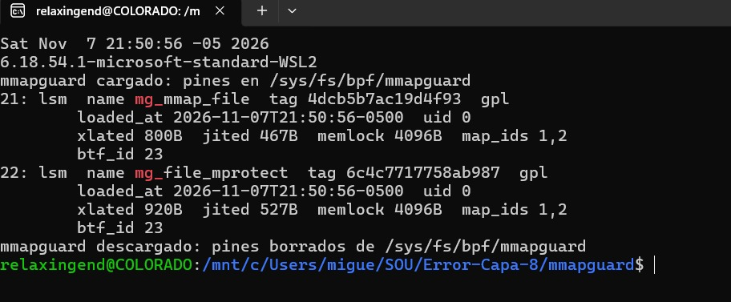

### Argumentación y análisis de resultados

#### Por qué decidir en el kernel y no en espacio de usuario

Nos quedamos con el kernel porque el hook LSM (`mmap_file`, `file_mprotect`) responde antes de que se cree o cambie el VMA y no depende de que el proceso coopere. La alternativa E (`LD_PRELOAD`) sale Baja en cobertura y en resistencia a la evasión en la matriz: solo envuelve funciones de libc en los procesos que la cargan, así que un binario estático o una syscall directa la esquivan, y cualquiera puede quitar la variable sin privilegios.

Tampoco la vendemos de más. El hook decide cuando se crea o cambia el mapeo, no en cada acceso: con la PTE activa, las lecturas y escrituras corren sin pasar por el hook.

Lo que medimos son dos cosas. Primero, la línea base, es decir, el costo de la operación que el hook intercepta (`make bench`, más abajo). Segundo, con la defensa cargada, que el hook sí decide: la demo con defensa niega `shared-write`, `exec` y `mprotect-write` con errno=1 y deja pasar `private-write`, y las pruebas con root dieron 64 PASS. El overhead de la defensa lo medimos en 3 sesiones de `bench_con_defensa.sh`, como pedía la guía, y no lo afirmamos como cifra: en todas las comparaciones los rangos de mínimo a máximo se solapan con los de la línea base de la misma sesión, así que no lo distinguimos del ruido de WSL2. Entre ejecuciones de WSL2 las medianas cambiaron, por eso las leemos como orden de magnitud.

#### Resultados con defensa

Todo esto lo ejecutamos el sábado 2026-11-07 en nuestro WSL2 (kernel 6.18.54.1-microsoft-standard-WSL2, 12 procesadores), con `sudo`.

**`bpf` está en la lista de LSM activos.** `dmesg | grep -i "LSM: initializing"` y `cat /sys/kernel/security/lsm` muestran `capability,landlock,yama,safesetid,selinux,bpf,ima`; `securityfs` ya estaba montado y no tocamos `.wslconfig`.

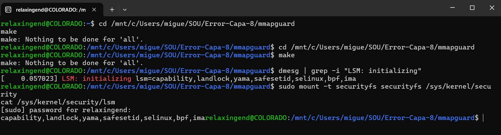

**Carga, verificador y descarga.** `sudo ./build/mmapguard load --count-faults` cargó los programas: el verificador aceptó los dos programas LSM y la sonda `fentry`. `policy list` salió sin reglas y `unload` terminó correctamente.

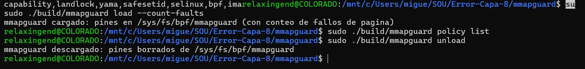

**Demo: línea base frente a defensa.** Es el mismo archivo de prueba de 4096 bytes y las mismas cuatro sondas de `mg_probe`; en la corrida con defensa la regla fue `deny-write-shared,deny-exec`. En la línea base la escritura de `shared-write` llegó al archivo.

| Modo | Qué intenta | Línea base (sin defensa) | Con defensa | Códigos de salida (línea base / con defensa) |
| --- | --- | --- | --- | --- |
| `shared-write` | `mmap` compartido con escritura | PERMITIDO | DENEGADO errno=1 (Operation not permitted) | 0 / 10 |
| `private-write` | `mmap` privado con escritura | PERMITIDO | PERMITIDO | 0 / 0 |
| `exec` | `mmap` con `PROT_EXEC` | PERMITIDO | DENEGADO errno=1 (Operation not permitted) | 0 / 10 |
| `mprotect-write` | `mprotect` que agrega escritura a un mapeo compartido | PERMITIDO | DENEGADO errno=1 (Operation not permitted) | 0 / 10 |

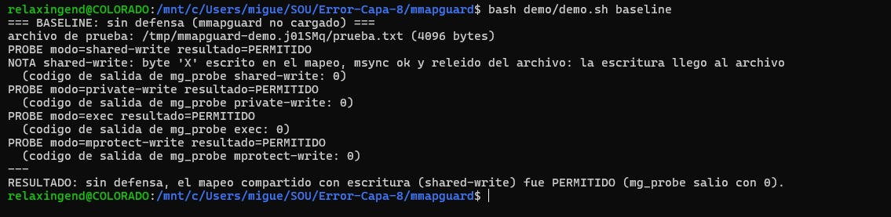

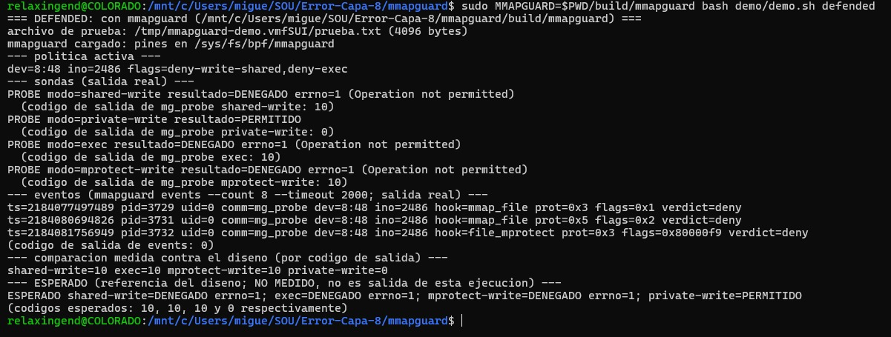

La demo imprime al final unas líneas "ESPERADO" que son la referencia del diseño y no una medición; lo medido es lo que mostramos arriba (el resultado de cada sonda y su código de salida). Repetimos la demo y los veredictos coincidieron; la primera corrida quedó en esta otra captura, donde cambia el inode del archivo de prueba porque la demo lo crea de nuevo en cada corrida.

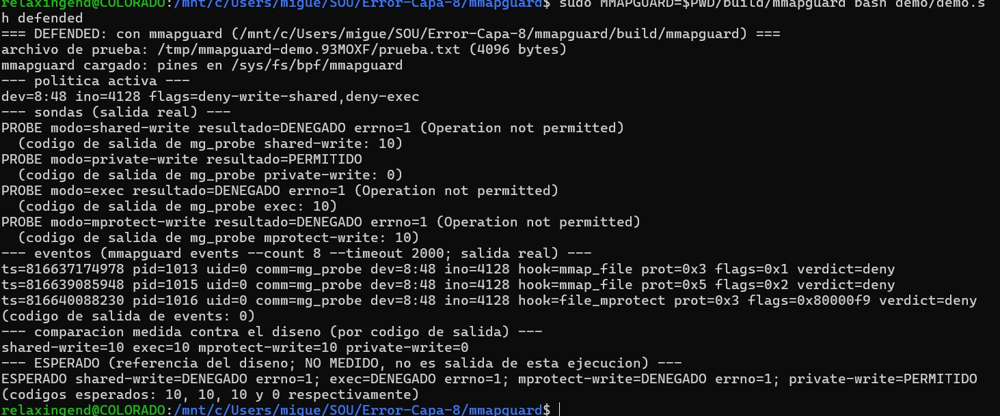

**Eventos reales.** `mmapguard events --count 8 --timeout 2000` devolvió tres eventos, uno por cada intento denegado, y ninguno para `private-write`, que pasó sin violar la regla:

| Hook | `prot` | `flags` | Veredicto | Sonda que lo causó |
| --- | --- | --- | --- | --- |
| `mmap_file` | 0x3 | 0x1 | deny | `shared-write` |
| `mmap_file` | 0x5 | 0x2 | deny | `exec` |
| `file_mprotect` | 0x3 | 0x80000f9 | deny | `mprotect-write` |

**Pruebas con root.** `sudo MMAPGUARD=$PWD/build/mmapguard bash tests/run_tests.sh` terminó con RESUMEN 64 PASS, 0 FAIL y 0 REQUIERE ROOT. Sin root, la misma batería da 49 PASS, 0 FAIL y 7 REQUIERE ROOT: esos 7 son los casos que necesitan la defensa cargada, y con `sudo` se ejecutan.

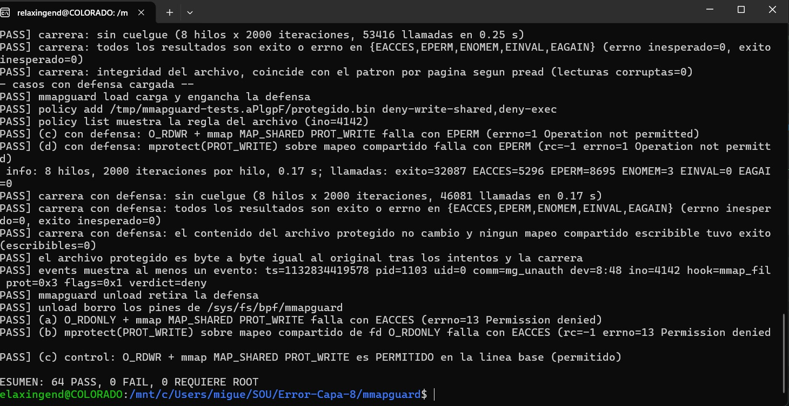

#### Costos medidos (línea base y con defensa)

Medimos en dos capas. La **línea base** es `make bench` sin defensa. El **costo de la defensa** sale de `sudo bash bench/bench_con_defensa.sh`, que en cada sesión mide tres casos sobre un archivo de 64 KiB: el caso 0 es sin defensa (la referencia de esa misma sesión, antes de cargar), el caso i es con la defensa cargada y el archivo sin regla (el hook hace una búsqueda que falla) y el caso ii es con la defensa cargada y el archivo con la regla `deny-exec` (búsqueda exitosa). En todos los casos usamos 1000 iteraciones por corrida y 10 corridas intercaladas entre escenarios, y reportamos la mediana en ns por iteración con el rango (mínimo a máximo) entre paréntesis.

**Línea base (`make bench`, sin defensa).** La ejecución inicial es la que teníamos antes de cargar la defensa; A y B son dos ejecuciones posteriores del mismo comando, y la última columna es la ejecución en la que `perf stat` volvió a funcionar.

| Medición | Ejecución inicial | `make bench` A | `make bench` B | `make bench` con perf |
| --- | --- | --- | --- | --- |
| `mmap_munmap`, ns por iteración | 1506.7 (1118.2 a 2693.0) | 1570.0 (1157.8 a 4244.1) | 2279.9 (1314.8 a 3556.4) | 1351.8 (1126.4 a 2508.6) |
| `mmap_touch`, ns por iteración | 18393.2 (16242.4 a 38799.0) | 16909.2 (15996.1 a 18373.2) | 16461.6 (15765.0 a 20099.9) | 15531.8 (15376.6 a 17779.4) |
| `mmap_mprotect`, ns por iteración | 1622.5 (1456.9 a 2912.0) | 1828.0 (1506.3 a 2370.8) | 1673.4 (1193.5 a 5293.8) | 1542.3 (1404.9 a 3037.6) |
| `mmap_munmap`, fallos de página menores por corrida | 2 (2 a 2) | mediana 2 | mediana 2 | 2 (2 a 2) |
| `mmap_touch`, fallos de página menores por corrida | 15002 (15002 a 15002) | mediana 15002 | mediana 15002 | 15002 (15002 a 16002) |
| `mmap_mprotect`, fallos de página menores por corrida | 2 (2 a 2) | mediana 2 | mediana 2 | 2 (2 a 2) |

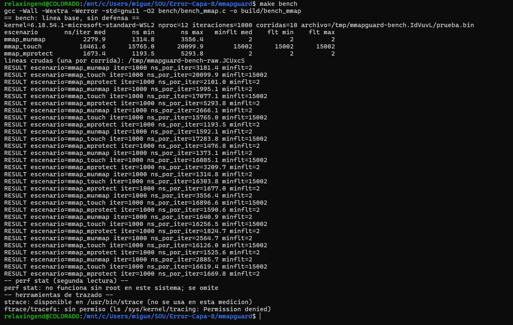

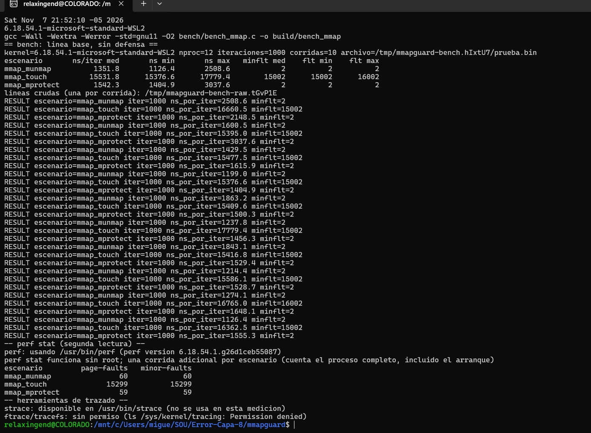

**Con defensa (`bench_con_defensa.sh`, tres sesiones).**

| Medición | Sesión A, caso 0 | Sesión A, caso i | Sesión A, caso ii | Sesión B, caso 0 | Sesión B, caso i | Sesión B, caso ii | Sesión C, caso 0 | Sesión C, caso i | Sesión C, caso ii |
| --- | --- | --- | --- | --- | --- | --- | --- | --- | --- |
| `mmap_munmap`, ns por iteración | 1419.5 (1168.3 a 3107.9) | 1416.0 (1314.7 a 2386.1) | 1415.6 (1257.1 a 2447.3) | 2026.8 (1178.0 a 3860.8) | 1560.0 (1289.1 a 2738.5) | 1876.8 (1312.0 a 6143.3) | 1404.0 (1140.0 a 2438.0) | 1364.7 (1300.8 a 2737.0) | 1334.4 (1269.7 a 1931.3) |
| `mmap_touch`, ns por iteración | 16206.7 (15705.0 a 19771.0) | 16656.2 (16174.5 a 18516.3) | 16380.3 (16014.9 a 22294.4) | 17537.9 (16425.9 a 52970.6) | 18229.4 (16304.2 a 20958.0) | 18126.2 (17209.6 a 58434.5) | 16541.8 (15994.2 a 17612.2) | 16633.2 (16046.6 a 19139.9) | 16838.7 (15827.7 a 17795.9) |
| `mmap_mprotect`, ns por iteración | 1582.1 (1496.6 a 2363.8) | 1877.3 (1756.0 a 1918.7) | 1826.8 (1735.8 a 1977.2) | 1888.0 (1514.5 a 3226.0) | 1966.7 (1822.5 a 3002.6) | 2133.2 (1760.5 a 3312.2) | 1605.4 (1526.5 a 2237.8) | 1808.2 (1720.0 a 1901.0) | 1805.8 (1758.9 a 2384.8) |

Sesión A, casos 0, i y ii:

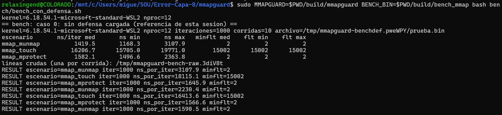

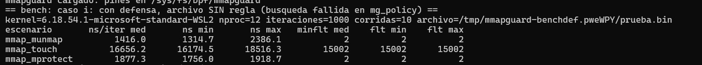

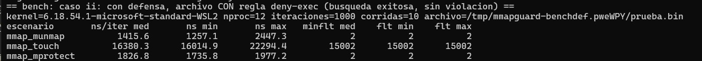

Sesión B, casos 0, i y ii:

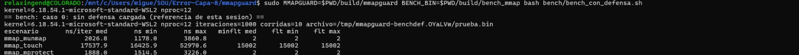

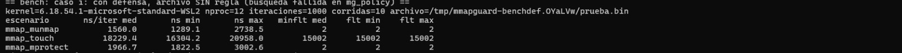

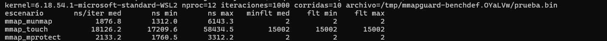

Sesión C, casos 0, i y ii. Los fallos menores por corrida dieron lo mismo que en la línea base: 2, 15002 y 2, con mínimo y máximo iguales a la mediana en los tres casos.

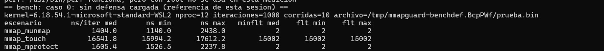

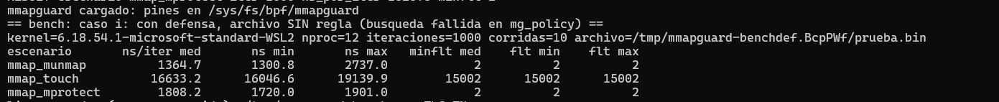

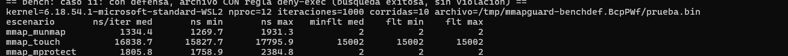

**Diferencias contra el caso 0 de la misma sesión.** La diferencia es la mediana con defensa menos la mediana del caso 0 de la misma sesión (en ns), y el porcentaje es la diferencia dividida entre el caso 0 por 100. Los calculamos con un script de Python temporal (no versionado) que aplica esa fórmula a las medianas de la tabla anterior, con un decimal. Cualquier celda se puede comprobar a mano; por ejemplo, la sesión A de `mmap_mprotect` en el caso i sale con `python3 -c "print(round(1877.3-1582.1,1), round((1877.3-1582.1)/1582.1*100,1))"`, que imprime `295.2 18.7`.

| Medición | Sesión | Caso | Caso 0, mediana (mín. a máx.) | Caso con defensa, mediana (mín. a máx.) | Diferencia (ns) | Porcentaje (%) | Rangos se solapan |
| --- | --- | --- | --- | --- | --- | --- | --- |
| `mmap_munmap` | A | i | 1419.5 (1168.3 a 3107.9) | 1416.0 (1314.7 a 2386.1) | -3.5 | -0.2 | sí |
| `mmap_munmap` | A | ii | 1419.5 (1168.3 a 3107.9) | 1415.6 (1257.1 a 2447.3) | -3.9 | -0.3 | sí |
| `mmap_munmap` | B | i | 2026.8 (1178.0 a 3860.8) | 1560.0 (1289.1 a 2738.5) | -466.8 | -23.0 | sí |
| `mmap_munmap` | B | ii | 2026.8 (1178.0 a 3860.8) | 1876.8 (1312.0 a 6143.3) | -150.0 | -7.4 | sí |
| `mmap_munmap` | C | i | 1404.0 (1140.0 a 2438.0) | 1364.7 (1300.8 a 2737.0) | -39.3 | -2.8 | sí |
| `mmap_munmap` | C | ii | 1404.0 (1140.0 a 2438.0) | 1334.4 (1269.7 a 1931.3) | -69.6 | -5.0 | sí |
| `mmap_touch` | A | i | 16206.7 (15705.0 a 19771.0) | 16656.2 (16174.5 a 18516.3) | +449.5 | +2.8 | sí |
| `mmap_touch` | A | ii | 16206.7 (15705.0 a 19771.0) | 16380.3 (16014.9 a 22294.4) | +173.6 | +1.1 | sí |
| `mmap_touch` | B | i | 17537.9 (16425.9 a 52970.6) | 18229.4 (16304.2 a 20958.0) | +691.5 | +3.9 | sí |
| `mmap_touch` | B | ii | 17537.9 (16425.9 a 52970.6) | 18126.2 (17209.6 a 58434.5) | +588.3 | +3.4 | sí |
| `mmap_touch` | C | i | 16541.8 (15994.2 a 17612.2) | 16633.2 (16046.6 a 19139.9) | +91.4 | +0.6 | sí |
| `mmap_touch` | C | ii | 16541.8 (15994.2 a 17612.2) | 16838.7 (15827.7 a 17795.9) | +296.9 | +1.8 | sí |
| `mmap_mprotect` | A | i | 1582.1 (1496.6 a 2363.8) | 1877.3 (1756.0 a 1918.7) | +295.2 | +18.7 | sí |
| `mmap_mprotect` | A | ii | 1582.1 (1496.6 a 2363.8) | 1826.8 (1735.8 a 1977.2) | +244.7 | +15.5 | sí |
| `mmap_mprotect` | B | i | 1888.0 (1514.5 a 3226.0) | 1966.7 (1822.5 a 3002.6) | +78.7 | +4.2 | sí |
| `mmap_mprotect` | B | ii | 1888.0 (1514.5 a 3226.0) | 2133.2 (1760.5 a 3312.2) | +245.2 | +13.0 | sí |
| `mmap_mprotect` | C | i | 1605.4 (1526.5 a 2237.8) | 1808.2 (1720.0 a 1901.0) | +202.8 | +12.6 | sí |
| `mmap_mprotect` | C | ii | 1605.4 (1526.5 a 2237.8) | 1805.8 (1758.9 a 2384.8) | +200.4 | +12.5 | sí |

**Criterio y veredicto.** Seguimos el criterio de la guía: una diferencia solo es defendible si el signo se repite en las sesiones y los rangos de mínimo a máximo no se solapan. Con la sesión C ya tenemos las 3 sesiones. El signo se repite en las tres sesiones en los seis pares de medición y caso, pero los rangos se solapan en las 18 comparaciones, así que ninguna diferencia es defendible y las seis salen "no se distingue del ruido":

| Medición | Caso | Signo sesión A | Signo sesión B | Signo sesión C | Signo se repite | Algún par se solapa | Veredicto |
| --- | --- | --- | --- | --- | --- | --- | --- |
| `mmap_munmap` | i | - | - | - | sí | sí | no se distingue del ruido |
| `mmap_munmap` | ii | - | - | - | sí | sí | no se distingue del ruido |
| `mmap_touch` | i | + | + | + | sí | sí | no se distingue del ruido |
| `mmap_touch` | ii | + | + | + | sí | sí | no se distingue del ruido |
| `mmap_mprotect` | i | + | + | + | sí | sí | no se distingue del ruido |
| `mmap_mprotect` | ii | + | + | + | sí | sí | no se distingue del ruido |

Qué leemos de ahí, con cuidado. En `mmap_munmap` las diferencias salen negativas (de -0.2 % a -23.0 %), y no esperamos que una defensa haga el `mmap` más rápido: es la señal de que ese ruido es del tamaño de lo que buscábamos. En `mmap_touch` las diferencias son positivas pero pequeñas (de +0.6 % a +3.9 %). En `mmap_mprotect` las seis diferencias son positivas (de +4.2 % a +18.7 %, es decir, de +78.7 a +295.2 ns; en la sesión C, +12.6 % y +12.5 %), lo que sería lo esperable si el hook de `file_mprotect` se paga en cada llamada, pero con rangos que se solapan no lo afirmamos como cifra. La sesión C repitió el signo de las sesiones A y B en los seis pares y no cambió el veredicto.

**Conteo y traza (strace y ftrace).** Con `sudo` pudimos usar dos herramientas que antes no teníamos. Aquí no sirven para comparar tiempos: el tracer infla lo que mide.

| Herramienta | Comando | Resultado | Nota |
| --- | --- | --- | --- |
| `strace` | `strace -c -f -e trace=mmap,munmap,mprotect build/bench_mmap mmap_mprotect /tmp/p.bin 1000` | `mmap` 1024 llamadas, `munmap` 1017, `mprotect` 1019, total 3060, 11 usecs/call | Los 11 usecs/call están inflados por `ptrace`: sirve para contar llamadas, no para medir tiempo. Que haya algo más de 1000 llamadas por tipo, con 1000 iteraciones, creemos que se debe al arranque del proceso (POR CONFIRMAR) |
| `ftrace` (`function_graph`) | `security_mmap_file` sobre `mmap_munmap` con 100 iteraciones, sin defensa cargada | La llamada recorre `selinux_mmap_file`, `inode_has_perm`, `avc_has_perm`, `bpf_lsm_mmap_file()` y `ima_file_mmap`. `bpf_lsm_mmap_file()` tomó 0.066 us porque no había ningún programa BPF enganchado; una llamada completa a `security_mmap_file` tomó 17.959 us | La traza infla los tiempos: 17.959 us no se compara con los ns por iteración del bench, solo muestra qué funciones atraviesa el hook y que, sin defensa, el punto de enganche de BPF está vacío |

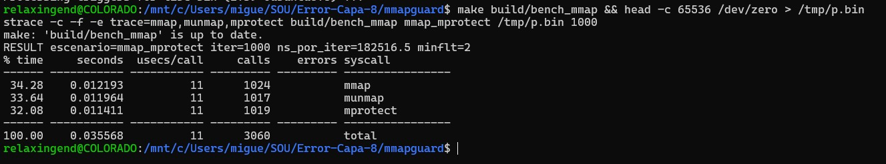

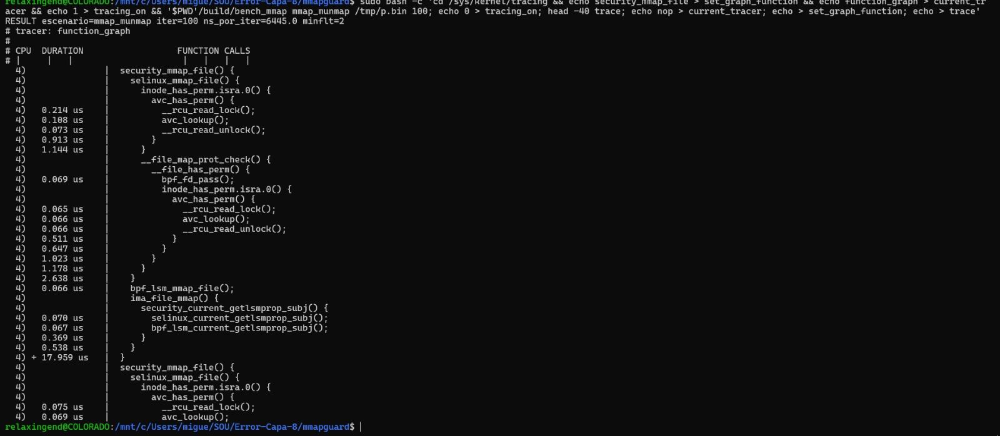

**Qué cambió con `perf`.** En la ejecución inicial `perf stat -e page-faults,minor-faults` funcionaba sin root y dio 58, 15299 y 59 page-faults; lo usábamos como segunda lectura de los fallos de página. Después de instalar `linux-tools-generic`, el `perf` del PATH pasó a ser el wrapper de Ubuntu y `make bench` empezó a avisar "perf stat: no funciona sin root; se omite". Por eso la columna de fallos de página de las ejecuciones A y B solo usa `getrusage` (`ru_minflt`), que no depende de `perf`. `bench.sh` y `bench_con_defensa.sh` ahora buscan el `perf` real, y al repetir `make bench` recuperamos la lectura: el bench usó `/usr/bin/perf` (perf version 6.18.54.1.g26d1ceb55087), indicó que `perf stat` funciona sin root y dio 60, 15299 y 59 page-faults para `mmap_munmap`, `mmap_touch` y `mmap_mprotect`, con los mismos valores en minor-faults. Frente a la ejecución inicial solo cambió `mmap_munmap` (de 58 a 60). En `bench_con_defensa.sh`, que corre con root, el script detecta que `/usr/bin/perf` funciona pero no lo usa en esa medición.

#### Limitaciones y trabajo futuro

| Limitación | Qué significa | Cómo lo vimos | Trabajo futuro |
| --- | --- | --- | --- |
| Decide al crear o cambiar el mapeo, no por acceso | Los hooks `mmap_file` y `file_mprotect` actúan cuando nace o cambia el VMA. Con la PTE activa, las lecturas y escrituras no pasan por Ring 0 de forma observable por el hook, así que un mapeo permitido no se vuelve a evaluar. | Párrafo "Límite de cobertura" de la Parte II. La sonda `fentry/handle_mm_fault` de `bpf/mmapguard.bpf.c` solo incrementa `mg_stats`: cuenta fallos, no decide. | Cubrir los fallos de página con otro mecanismo que pueda decidir y no solo contar. |
| Solo cubre `mmap` y `mprotect` nuevos | No reevalúa mapeos creados antes de cargar la defensa y no controla `read` ni `write` por syscalls normales sobre el archivo. | `bpf/mmapguard.bpf.c` define únicamente dos programas LSM: `mg_mmap_file` y `mg_file_mprotect`. | Recorrer los mapeos ya existentes al cargar y evaluar hooks de lectura y escritura de archivo. |
| Exige `bpf` en la lista de LSM y privilegios | Sin `bpf` activo en `lsm=` el enganche falla, y cargar o descargar pide root o CAP_BPF. Un root con CAP_BPF puede descargar el programa. | En nuestro WSL2 `bpf` ya estaba en la lista (`capability,landlock,yama,safesetid,selinux,bpf,ima`) y `load`, `policy list` y `unload` funcionaron con `sudo`. No probamos un kernel sin `bpf` en `lsm=`. | Estudiar cómo impedir la descarga por un root y repetir la prueba en un kernel donde `bpf` no esté activo. |
| Identifica el archivo por (dev, inode), no por ruta | Un archivo recreado con otro inode escapa de la regla. En el 9p de `/mnt/c` de WSL, la estabilidad del inode está POR CONFIRMAR. Los enlaces duros comparten inode y quedan protegidos por esa misma razón (consecuencia del diseño, no probada). | `bpf/mmapguard.bpf.c` lee `i_sb->s_dev` e `i_ino` con CO-RE, y `src/policy.c` arma la llave desde `stat`. En la demo el inode del archivo de prueba cambió entre corridas porque se recrea cada vez. | Medir la estabilidad del inode en 9p y renovar la regla cuando el archivo se recree. |
| Helpers permitidos sin enumerar | El verificador aceptó los programas y la sonda `fentry`, pero no enumeramos qué helpers admite en total el tipo `BPF_PROG_TYPE_LSM` (POR CONFIRMAR). Las firmas de los hooks sí se verificaron. | `load --count-faults` terminó sin rechazo del verificador. Las firmas salen de `bpftool btf dump file /sys/kernel/btf/vmlinux` en el kernel 6.18.54.1 (tabla de `mmapguard/CONTRATO.md`). | Listar los helpers disponibles para programas LSM y registrar la salida detallada del verificador. |
| Costo de la defensa dentro del ruido | Medimos 3 sesiones de `bench_con_defensa.sh` y en las 18 comparaciones los rangos de mínimo a máximo se solapan con el caso 0 de la misma sesión: no distinguimos el costo del ruido de WSL2. | Tablas de "Costos medidos": por ejemplo `mmap_mprotect` fue de +4.2 % a +18.7 % sobre el caso 0, pero con rangos solapados; `mmap_munmap` salió negativo en las seis comparaciones. | Medir fuera de WSL2 para reducir el ruido y ver si la diferencia de `mmap_mprotect` se separa de él. |

Dejamos las seis a la vista porque la rúbrica pide limitaciones, y ninguna es un error del código: todas son consecuencia de la opción C que escogimos.

## Categorías preexistentes del shell

El shell educativo (`shell/`, binario `eafitOS`) clasifica sus comandos por categoría. Cada comando muestra en magenta, al estilo de `strace`, la llamada al sistema que ejecuta, sus parámetros y el valor que retorna el kernel (macros `LOG_SYSCALL*` de `shell/shell.h`). Estas cuatro categorías vienen del shell del profesor; el editor (Base heredada 1) agrega la quinta, `editor`.

### Datos y archivos (`datos`)

Archivo: `shell/cat_datos.c`. Cada comando es atómico: abre, opera y cierra en la misma invocación.

| Comando | Acción | Syscalls |
| --- | --- | --- |
| `d_create <archivo> "<texto>"` | Crea o vacía el archivo y escribe el texto | `open(O_WRONLY\|O_CREAT\|O_TRUNC, 0644)`, `write`, `close` |
| `d_read <archivo>` | Lee hasta 1023 bytes (buffer de 1024) y los imprime | `open(O_RDONLY)`, `read`, `close` |
| `d_info <archivo>` | Muestra inodo, permisos en octal, UID del dueño, tamaño, tamaño de bloque y fecha de modificación | `stat` |
| `d_copy <origen> <destino>` | Copia en bloques de 512 bytes hasta EOF | `open` ×2, `read`/`write` en bucle, `close` ×2 |

```
eafitOS> d_create mi_archivo.txt "Hola SO"
[syscall] open("mi_archivo.txt", O_WRONLY|O_CREAT|O_TRUNC, 0644) ... = 3
[syscall] write(3, "Hola SO", 7) ... = 7
[syscall] close(3) ... = 0
Archivo 'mi_archivo.txt' creado exitosamente con 7 bytes.
```

### Memoria (`memoria`)

Archivo: `shell/cat_memoria.c`.

| Comando | Acción | Syscalls |
| --- | --- | --- |
| `m_sbrk <incremento_bytes>` | Lee el program break (`sbrk(0)`), lo mueve según el incremento (puede ser negativo) y lo vuelve a leer para mostrar el cambio del heap | `sbrk` / `brk` |
| `m_mmap <tamaño_bytes>` | Mapea memoria anónima y privada, escribe un patrón en ella y la libera | `mmap(NULL, n, PROT_READ\|PROT_WRITE, MAP_PRIVATE\|MAP_ANONYMOUS, -1, 0)`, `munmap` |
| `m_info` | Filtra `/proc/self/status`: `VmPeak`, `VmSize`, `VmLck`, `VmHWM`, `VmRSS`, `VmData`, `VmStk`, `VmExe`, `VmLib`, `VmPTE` | Lectura de `/proc/self/status` |

### Monitoreo y procesos (`monitoreo`)

Archivo: `shell/cat_monitoreo.c`.

| Comando | Acción | Syscalls |
| --- | --- | --- |
| `p_fork` | El hijo imprime su PID y el de su padre, duerme 2 s y sale con `exit(42)`; el padre espera y muestra el código con `WIFEXITED`/`WEXITSTATUS` | `fork`, `getpid`, `getppid`, `waitpid` |
| `p_exec <comando> [args...]` | El hijo reemplaza su imagen con el programa; si `execvp` falla sale con `127` | `fork`, `execvp`, `waitpid` |
| `p_kill <pid> <numero_señal>` | Envía la señal al proceso | `kill` |
| `p_monitor` | Tiempos de CPU de usuario y de sistema, RSS máximo, fallos de página y cambios de contexto voluntarios e involuntarios del shell | `getrusage(RUSAGE_SELF)` |

### Utilidades (`utilidades`)

Archivo: `shell/cat_util.c`.

| Comando | Acción | Syscalls |
| --- | --- | --- |
| `saludar` | Saluda al usuario actual por su nombre | `getuid` + `getpwuid(3)` |
| `despedir` | Despide al usuario actual por su nombre | `getuid` + `getpwuid(3)` |
| `hora` | Hora del sistema `HH:MM:SS` | `time` + `localtime(3)`/`strftime(3)` |
| `fecha` | Fecha del sistema `YYYY-MM-DD` | `time` + `localtime(3)`/`strftime(3)` |

### Ayuda interactiva

* `help`: bienvenida y lista de categorías.
* `help <categoria>`: comandos de `datos`, `memoria`, `monitoreo`, `utilidades` o `editor`.
* `help <comando>`: descripción, uso y syscalls de un comando.
* `clear` limpia la pantalla; `exit` (o `Ctrl+D`) cierra el shell.
* Un comando desconocido sugiere ejecutarlo como binario externo con `p_exec`.

## Base heredada 1: Integración con el shell

El shell educativo del curso (`shell/`) organiza sus comandos en categorías (`datos`, `memoria`, `monitoreo`, `utilidades`), cada una en su propio archivo `cat_*.c` y registrada en la tabla `commands[]` de `main.c`. El editor se integró como una **categoría nueva, `editor`**, con un único comando:

```
eafitOS> e_edit [archivo]
```

### Por qué una categoría nueva y no `datos`

| Criterio | `datos` | Editor |
| --- | --- | --- |
| Estado | Cada comando hace `open → read/write → close` y termina | Mantiene un `fd` abierto y una lista en memoria durante toda la sesión |
| Ciclo de vida | Termina al retornar el handler | Termina con `q` → `close()` + `exit()` |
| Nombres | Prefijo `d_` | Comandos de una letra (`o p a d i s q`); `d` y `p` chocarían con los prefijos `d_` y `p_` |
| Syscalls | `open`, `read`, `write`, `close`, `stat` | Además `lseek` y `ftruncate` |

### Funcionamiento

**Proceso hijo**

`e_edit` hace `fork()`. El hijo ejecuta el editor con su propio prompt `editor>`; el padre espera con `waitpid()` y reporta el código de salida. Así el `exit()` que exige el comando `q` termina solo al editor, y su descriptor y su heap desaparecen con el hijo sin afectar al shell.

```c
pid_t pid = fork();
if (pid == 0) {
    ed_traza = 1;
    editor_run(argc == 2 ? argv[1] : NULL);   /* nunca retorna: q -> exit() */
}
waitpid(pid, &status, 0);
```

**Ctrl+C**

Mientras el editor corre, el shell ignora `SIGINT`; el hijo restaura la acción original. Sin un trabajo Huffman activo, una interrupción termina solo al editor, y como cada comando ya quedó persistido en disco, no se pierde nada. Con un trabajo de compresión o descompresión en curso, `Ctrl+C` cancela ese trabajo y el editor sigue abierto (ver [Base heredada 3](#base-heredada-3-compresor-huffman-concurrente)).

**stdin sin buffer**

Al inicio del shell se ejecuta `setvbuf(stdin, NULL, _IONBF, 0)`. Si la entrada viene de una tubería o un script, el buffer de stdio podría guardar líneas leídas por adelantado; el hijo recibe una copia de ese buffer y, al volver, el padre re-ejecutaría los comandos del editor. Sin buffer, `fgets` nunca lee más allá del `\n`.

### Cambios al shell

| Archivo | Cambio |
| --- | --- |
| `shell/cat_editor.c` | Nuevo: comando `e_edit` |
| `shell/shell.h` | Prototipo de `cmd_e_edit` |
| `shell/main.c` | Registro de `e_edit` (su descripción y syscalls incluyen el compresor), categoría `editor` en `help`, `setvbuf` de stdin |
| `shell/Makefile` | Compila `cat_editor.c` y las fuentes de `../editor` (editor, lista y los módulos del compresor `huffman.c`, `hilos.c`, `huf_editor.c`), enlaza con `-pthread`; `all` ya no ejecuta el binario (eso pasa a `make run`); `clean` borraba `$(TARGET)`, que no existía |

### Pasos de ejecución

1. Compilar el shell: `cd shell && make`.
2. Ejecutar: `./eafitOS` (o `make run`).
3. Escribir `help editor` para ver la categoría.
4. Escribir `e_edit notas.txt` para abrir el editor; `q` regresa al shell.

## Base heredada 2: Editor de texto

Editor estilo `ed` escrito en C. El archivo se manipula **únicamente** con `open`, `read`, `write`, `lseek`, `ftruncate` y `close`; no se usa `fopen`/`fread`/`fwrite`/`fclose`. La consola sí usa `printf` y `fgets`.

### Comandos

| Comando | Acción | Syscalls sobre el archivo |
| --- | --- | --- |
| `o <archivo>` | Abre o crea el archivo y lo carga en memoria | `open(O_RDWR\|O_CREAT)`, `read` |
| `p [n]` | Imprime la línea `n`, o todo el archivo | — |
| `a <texto>` | Agrega una línea al final | `lseek(SEEK_END)`, `write` |
| `d <n>` | Borra la línea `n` | `lseek`, `read`, `write`, `ftruncate` |
| `i <n> <texto>` | Inserta en la línea `n`, desplazando el resto | `lseek`, `read`, `write` |
| `s <palabra>` | Reporta las líneas donde aparece y cuántas veces | — |
| `c`, `x`, `t`, `k`, `w` | Compresor Huffman en segundo plano (ver [Base heredada 3](#base-heredada-3-compresor-huffman-concurrente)) | `open`, `fstat`, `pread`, `pwrite`, `ftruncate`, `rename`, `unlink` |
| `q` | Cierra, libera la lista y termina | `close`, `exit` |
| `h` | Ayuda | — |

### Estructura de datos

Lista doblemente enlazada de líneas. Cada nodo guarda un buffer reservado con `malloc`, su longitud y los punteros `prev` / `next`:

```c
typedef struct Linea {
    char *texto;
    size_t len;
    struct Linea *prev, *next;
} Linea;
```

| Variable | Uso |
| --- | --- |
| `fd` | Descriptor del archivo abierto (`-1` si no hay) |
| `lineas` | Lista con `head`, `tail` (append en O(1)) y `count` (validar `n` en O(1)) |
| `nl_final` | Indica si el archivo está vacío o termina en `\n`, para no pegar texto a la última línea |

**¿Por qué no una tabla hash?** La única clave natural es el número de línea, y ese número cambia para todas las líneas siguientes en cada `i` y cada `d`. No hay claves estables que la justifiquen, y la búsqueda `s` es por subcadena, no por clave exacta.

**¿Por qué no un arreglo?** Insertar o borrar en medio obliga a mover memoria (`memmove`) y a reasignar (`realloc`). En la lista, una vez ubicado el nodo, insertar o desenlazar es O(1), y la búsqueda de la línea `n` empieza desde el extremo más cercano (`head` o `tail`).

### Funcionamiento

**Persistencia inmediata**

Cada comando que modifica (`a`, `d`, `i`) actualiza la lista y escribe el cambio en disco en la misma operación. El desplazamiento en bytes de la línea `n` se calcula desde la lista:

offset(n) = suma de (len + 1) de las líneas 1 .. n-1

**Borrar (`d`)**

Los bytes que siguen a la línea se copian hacia atrás en bloques de 4 KiB, de adelante hacia atrás, y luego se recorta el archivo:

```
antes:     l 1 \n l 2 \n l 3 \n        (borrar línea 2: bytes [3, 6))
copiar:    [6, 9) -> [3, 6)
ftruncate: l 1 \n l 3 \n
```

**Insertar (`i`)**

Los bytes desde la línea `n` se copian `len + 1` posiciones hacia adelante, **de atrás hacia adelante** para no sobrescribir datos que aún no se han leído, y luego se escribe la línea en el hueco. Traza real de `i 2 medio` sobre `uno\ndos\ntres\n`:

```
[syscall] lseek(3, 0, SEEK_END) ... = 13
[syscall] lseek(3, 4, SEEK_SET) ... = 4
[syscall] read(3, buf, 9) ... = 9
[syscall] lseek(3, 10, SEEK_SET) ... = 10
[syscall] write(3, buf, 9) ... = 9
[syscall] lseek(3, 4, SEEK_SET) ... = 4
[syscall] write(3, buf, 6) ... = 6
```

**Manejo de errores**

Cada retorno de syscall se verifica y los fallos se reportan con `perror()`. `read` y `write` se reintentan ante `EINTR` y `write` se repite hasta escribir todo el buffer. Si `a` falla al escribir, se deshace en la lista y el archivo vuelve a su tamaño anterior con `ftruncate`. Si `o` falla, se conserva el archivo que estaba abierto. Los errores del usuario (línea inexistente, número inválido, comando desconocido) no terminan el editor.

### Pasos de ejecución

1. Compilar: `cd editor && make` (genera `./editor`; `make clean` borra binarios y temporales).
2. Ejecutar: `./editor notas.txt`, o `./editor -t notas.txt` para ver la traza de cada syscall.
3. Escribir comandos, por ejemplo `a hola`, `i 1 primera`, `p`, `s hola`, `d 2`.
4. Salir con `q` (o `Ctrl+D`).

## Base heredada 3: Compresor Huffman concurrente

El compresor vive **dentro del editor** como una segunda capacidad: mientras `editor>` sigue aceptando comandos, un hilo orquestador y un pool de hilos trabajadores comprimen o descomprimen el archivo abierto. Solo usa `pthread` (mutex, variables de condición) y syscalls POSIX; no hay librerías de compresión ni de sincronización de alto nivel.

| Archivo | Contenido |
| --- | --- |
| `editor/huffman.c`, `editor/huffman.h` | Motor: histograma, árbol y códigos canónicos, codificación/decodificación por bloque, CRC32, versiones secuencial y concurrente |
| `editor/hilos.c`, `editor/hilos.h` | Pool de hilos genérico con cola de tareas, barrera de fin de fase y cancelación cooperativa |
| `editor/huf_editor.c`, `editor/huf_editor.h` | Orquestador en segundo plano: máquina de estados del trabajo, progreso, cancelación, `SIGINT` |
| `editor/editor.c` | Comandos `c`, `x`, `t`, `k`, `w` y guardia de `a`/`d`/`i` durante un trabajo |
| `editor/docs/CONCURRENCIA.md` | Protocolo de concurrencia completo: hilos, recursos, orden de locks, diagramas, decisiones |
| `editor/docs/FORMATO_HUF.md` | Especificación del formato `.huf` |

### Comandos en el editor

| Comando | Acción |
| --- | --- |
| `c [salida]` | Comprime el archivo abierto en segundo plano; por defecto escribe `<ruta>.huf` |
| `x [salida]` | Descomprime el archivo abierto (debe terminar en `.huf`); por defecto quita la extensión. La salida no puede ser el archivo abierto y nunca sobrescribe un archivo existente (`O_EXCL`) |
| `t` | Estado del trabajo y porcentaje de avance |
| `k` | Cancela el trabajo en curso (cooperativo, entre bloques) |
| `w` | Bloquea hasta que el trabajo termine (espera en variable de condición) |

`c` y `x` regresan de inmediato al prompt. El progreso se imprime en cada múltiplo de 10 % (`[huf] 30 % (comprimiendo notas.txt)`) y nunca retrocede. Solo puede haber un trabajo activo a la vez. `q`, EOF y `Ctrl+C` cancelan el trabajo, unen todos los hilos con `pthread_join` y borran el temporal.

```
editor> o notas.txt
editor> c
[huf] compresión en segundo plano: notas.txt -> notas.txt.huf
editor> t
editor> w
editor> o notas.txt.huf
editor> x notas.rt
editor> w
```

### Fases del algoritmo

El archivo se divide en bloques (64 KiB por defecto). El pool tiene tantos hilos como CPUs en línea, con un tope de 8.

1. **Conteo de frecuencias.** Cada tarea lee su bloque con `pread` y cuenta en su **propio** histograma parcial (`parciales[k][256]`): no hay dato compartido durante el conteo. Tras la barrera (`hilos_esperar`), el orquestador suma los parciales.
2. **Árbol y códigos.** Un solo hilo construye el árbol con un min-heap de desempate determinista y deriva códigos canónicos (longitud máxima 32 bits, con recorte de Kraft para entradas patológicas). La tabla queda inmutable y los workers solo la leen.
3. **Codificación en paralelo.** Cada worker codifica un bloque en su propio buffer, con CRC32 del bloque original.
4. **Ensamblado en orden.** El orquestador hace de ensamblador: espera en `cond_listo` el bloque `sig_escribir`, lo escribe con `pwrite` en el offset acumulado y avanza. Una ventana `W = 2·N` limita cuántos bloques pueden ir por delante, sin interbloqueo porque el bloque esperado siempre está dentro de la ventana.
5. **Cierre atómico.** Se escribe la tabla de bloques, y `<salida>.tmp` se renombra con `rename` solo si todo salió bien; ante error o cancelación se hace `unlink` del temporal.

La **descompresión** reparte un bloque por tarea: cada worker localiza su bloque en la tabla, lo decodifica, verifica el CRC32 y lo escribe con `pwrite` en `k · tam_bloque`. Los destinos son disjuntos, así que no hace falta lock ni orden de escritura.

### Sincronización

| Recurso | Protección |
| --- | --- |
| Cola de tareas del pool | `pthread_mutex` + condvar `hay_tareas` (workers duermen) y `cola_vacia` (barrera) |
| Histogramas parciales | Ninguna: una fila por tarea, reducción en un solo hilo tras la barrera |
| Bloques codificados y cursor de escritura | `mtx` del contexto + condvars `cond_listo` y `cond_ventana` |
| Estado del trabajo (editor) | `estado_mtx` + `estado_cv` |
| Salida por pantalla | `salida_mtx` (prompt y progreso no se mezclan) |
| Cancelación | Bandera atómica (`__atomic_load_n`/`__atomic_store_n`) |
| `SIGINT` | `volatile sig_atomic_t`; el manejador solo la activa |

No hay espera activa: todo punto de espera bloquea en una variable de condición o en `pthread_join`. `estado_mtx` y `salida_mtx` nunca se anidan, y los mutex del motor son hojas, por lo que no hay ciclos de locks. El detalle, los diagramas de hilos y estados y las preguntas de sustentación están en [editor/docs/CONCURRENCIA.md](editor/docs/CONCURRENCIA.md).

### Carrera con la edición

Mientras un trabajo está `RUNNING` o `CANCELLING`, `a`, `d` e `i` se **rechazan** sin tocar el archivo:

```
Error: hay un trabajo Huffman en curso; no se puede modificar el archivo.
Usa 'w' para esperar, 'k' para cancelar o 't' para ver el estado.
```

El estado pasa a `RUNNING` antes de crear el hilo orquestador, y el REPL es monohilo, así que ninguna edición puede colarse entre el arranque del trabajo y la primera lectura de los workers. El trabajo lee con su propio descriptor, nunca con el del editor. `p` y `s` siguen respondiendo porque solo leen la lista en memoria.

### Formato del archivo `.huf`

Enteros little-endian. Especificación completa en [editor/docs/FORMATO_HUF.md](editor/docs/FORMATO_HUF.md).

| Sección | Tamaño | Contenido |
| --- | --- | --- |
| Encabezado | 276 bytes | Magic `HUF1`, tamaño original (u64), tamaño de bloque (u32), número de bloques (u32), 256 longitudes de código (u8) |
| Tabla de bloques | `nbloques × 32` bytes | Por bloque: offset del flujo, longitud comprimida, longitud original, CRC32, bits útiles |
| Flujos de bits | variable | Un flujo por bloque, alineado a byte |

Solo se guardan las longitudes: el descompresor reconstruye los mismos códigos canónicos. La tabla permite decodificar cada bloque sin leer los anteriores.

### Pasos de ejecución

1. Compilar el shell (incluye editor y compresor): `cd shell && make`.
2. Ejecutar `./eafitOS` y abrir el editor: `e_edit notas.txt`.
3. Escribir `h` para ver los comandos; `c` comprime, `t` muestra el avance, `w` espera.
4. Abrir el comprimido con `o notas.txt.huf` y descomprimir con `x notas.rt`; luego `w`.
5. Salir con `q` y comparar: `cmp notas.txt notas.rt` (sin salida si son idénticos).

También se puede usar el editor independiente: `cd editor && make && ./editor notas.txt`.

## Base heredada 4: Pruebas

Hay dos baterías, ambas en `editor/tests/`. El contenido en disco se compara **byte a byte** con `cmp`/`md5sum`.

**`run_tests.sh` (`make test`)**: editor y shell.

- Los 7 comandos del editor, con sus errores de uso y casos borde (línea inexistente, `ENOENT`, `EISDIR`, archivo vacío, archivo sin `\n` final, archivo de más de 4 KiB).
- Ausencia de `fopen`/`fread`/`fwrite`/`fclose` en el binario (`nm -u`) y fugas con AddressSanitizer/LeakSanitizer.
- Integración con el shell (`e_edit`, `waitpid`, `Ctrl+C`).
- Integración shell → editor → compresor: `e_edit`, `h`, `c`, `w`, `x`, ida y vuelta idéntica con `cmp`, sin temporales.

**`run_tests_huf.sh` (`make test-huf`)**: compresor.

- Corrección: ida y vuelta con distintos números de hilos y tamaños de bloque, datos de texto, aleatorios, un solo símbolo y ceros; histograma paralelo idéntico al secuencial.
- Carreras con la edición: `a`/`d`/`i` rechazados durante el trabajo, `p`/`s` responden, original intacto.
- Cancelación con `k`, `q`, EOF y `SIGINT`: sin `.tmp`, original intacto.
- Progreso monótono de 0 a 100 %.
- Errores: `.huf` corrupto o truncado, salida existente, entrada inexistente.
- Estrés con parámetros aleatorios y una tabla de rendimiento.
- Las secciones de carreras y cancelación se repiten con un editor compilado con ThreadSanitizer.

Resultados en WSL2 Ubuntu 24.04 (kernel 6.18.40.1) / GCC 13.3.0:

| Suite | Comando | Resultado |
| --- | --- | --- |
| Editor + shell + integración | `make test` | **73 PASS, 0 FAIL** |
| Compresor | `make test-huf` | **52 PASS, 0 FAIL** |
| Compresor con AddressSanitizer/UBSan/LeakSanitizer | `make test-asan` | **52 PASS, 0 FAIL** |
| Compresor con ThreadSanitizer | `make test-tsan` | **52 PASS, 0 FAIL** |

ThreadSanitizer de GCC 13 aborta al arrancar en kernels con alta entropía de ASLR (`FATAL: ThreadSanitizer: unexpected memory mapping`). Por eso `run_tests_huf.sh` se re-ejecuta a sí mismo con `setarch -R` (ASLR desactivado), y un `FATAL` de TSan cuenta como fallo.

El reporte técnico del editor está en [editor/docs/REPORTE_TECNICO.md](editor/docs/REPORTE_TECNICO.md).

### Pasos de ejecución

1. Entrar al editor: `cd editor`.
2. Editor, shell e integración: `make test`.
3. Compresor: `make test-huf`; con sanitizers: `make test-asan` y `make test-tsan`.
4. Limpiar binarios y temporales: `make clean`.

## Rendimiento: secuencial vs concurrente

Compresión de una entrada de 64 MiB (texto repetido y bytes aleatorios) con el CLI de pruebas `editor/huf_cli` (`make huf_cli`), bloque de 64 KiB, 12 CPUs lógicas, mediana de 3 corridas:

| Modo | Comando | Tiempo (s) | Speedup |
| --- | --- | --- | --- |
| Secuencial | `./huf_cli c in.bin o.huf` | 2.060 | 1.00x |
| Pool de 1 hilo | `./huf_cli C in.bin o.huf 1` | 2.029 | 1.02x |
| Pool automático (8 hilos) | `./huf_cli C in.bin o.huf 0` | 0.489 | 4.21x |

La ida y vuelta (`C` + `X` concurrente y `c` + `x` secuencial) produjo el mismo SHA-256 que la entrada. El detalle de las corridas está en [editor/docs/CONCURRENCIA.md](editor/docs/CONCURRENCIA.md#10-evidencia-secuencial-vs-concurrente).

## Estructura del repositorio

| Ruta | Contenido |
| --- | --- |
| `shell/` | Shell educativo `eafitOS`: categorías `datos`, `memoria`, `monitoreo`, `utilidades` y `editor` |
| `editor/` | Editor por líneas (`main.c`, `editor.c`, `lista.c`) y compresor (`huffman.c`, `hilos.c`, `huf_editor.c`), con su `Makefile` |
| `editor/tests/` | `run_tests.sh`, `run_tests_huf.sh` y el CLI de pruebas `huf_cli.c` |
| `editor/docs/` | `REPORTE_TECNICO.md`, `CONCURRENCIA.md`, `FORMATO_HUF.md` |
| `src/capturas/` | Evidencia gráfica de la Parte II (capturas de prompts en `src/capturas/3.1/`) |
| `src/docx/` | `Estrategia Parcial 3.pdf`, el PDF de la estrategia del equipo |

## Autores

**Miguel Ángel Colorado Castaño** <br>
**Sebastián Andrés Ibarra Prada**

## Información del curso
**Curso:** Sistemas Operativos - SO2026B <br>
**Profesor:** Edison Valencia Díaz <br>
**Universidad:** Universidad EAFIT <br>
**Entrega:** Parcial 3, Seguridad de Archivos mediante Intervención en la Capa del Kernel y Mapeo de Memoria (mmap) <br>
**Ciclo:** 2026-2
